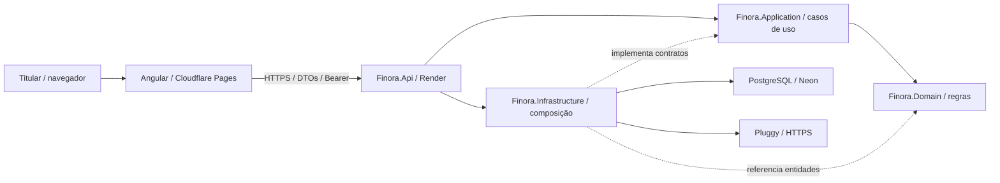

# Finora — TDD v0

**Technical Design Document — documento de desenho técnico**  
**Estado:** v0, revisão documental 0.1 — aprovada documentalmente pelo autor em 13/11/2026; propostas e validações pendentes preservadas.\
**Base atual:** [Finora — PRD v0, revisão 0.3](PRD.md), aprovada documentalmente; base anterior aprovada: revisão 0.2.\
**Data de início:** 9 de novembro de 2026.

**Data desta revisão:** 13 de novembro de 2026. **Responsável/decisor conhecido:** autor do TCC, com elaboração assistida. **Origem:** solicitação do autor para alinhar PRD/TDD às skills atuais, seguida de solicitação para aplicar a mudança documental. Não constitui aprovação desta revisão, do SDD ou de implementação futura.

**Aprovação posterior:** após a entrega do diff, o autor confirmou no harness “Registrar minha aprovação” para PRD 0.3, TDD 0.1 e SDD em 13/11/2026, e confirmou a atualização dos registros. Aprova-se o documento com seus estados explícitos: propostas/decisões pendentes, capacidades dos provedores e verificações técnicas continuam sujeitos às condições indicadas. Não autoriza código, PR, merge, publicação ou arquivamento.

### Histórico e fontes

| Revisão | Data | Resumo / estado |
|---|---|---|
| v0 — FNR-001 | 13/11/2026 (início em 09/11) | Revisão documental aprovada explicitamente pelo autor; PR #1 integrado em `075af73`. Propostas e validações técnicas permaneciam pendentes. Evidências e limites no [backlog](BACKLOG.md), §7, e no [SDD histórico](../openspec/changes/archive/2026-11-13-fnr-001-alinhar-documentacao/design.md). |
| v0 — documental 0.1 | 13/11/2026 | Resumo, registro DT-xx, roadmap, rastreabilidade e operação/recuperação. Entregue em revisão e posteriormente **aprovada documentalmente pelo autor**, por confirmação no harness, sem transferência da aprovação anterior. Propostas e validações pendentes preservadas. Ver [proposta](../openspec/changes/alinhar-prd-tdd-skills/proposal.md) e [SDD desta revisão](../openspec/changes/alinhar-prd-tdd-skills/design.md). |

Fontes desta complementação: PRD, TDD v0/FNR-001, backlog, [README](../README.md), [AGENTS.md](../AGENTS.md), skills `generate-prd`/`generate-tdd` e solicitação desta conversa. Não há nova entrevista, medição ou validação de compatibilidade tecnológica nesta revisão. Desconhecidos e eventuais divergências futuras devem ser resolvidos nos gates dos §§7 e 16–18, não por suposição.

### Resumo e objetivos técnicos

Entregar o núcleo P0 do PRD: leitura real local pela Pluggy, importação persistente/idempotente, autenticação do titular, organização das compras e indicadores conciliados. O monólito modular concentra regras e cálculos no backend e expõe DTOs à interface; esse recorte evita introduzir serviços distribuídos para um projeto individual. Essa justificativa é análise desta revisão, não relato de justificativa histórica do autor.

Restrições herdadas: um titular, desenvolvimento individual, duas semanas como referência original com entrega/capacidade a confirmar, frontend/API separados, planos de hospedagem sujeitos a validação. Integridade, privacidade, autorização, recuperação de falhas e clareza de cobertura são os atributos centrais (RNF-01–RNF-10). A meta de até 2s/5.000 transações é local; não há SLA hospedado confirmado.

Investimentos manuais, simulador e CSV são P1 após estabilidade do P0. Permanência de login, múltiplos usuários, rotinas com aplicação fechada e operação comercial ficam fora desta entrega. O roadmap §16 diferencia MVP integrado local, entrega hospedada restrita e complementos; nenhum marco equivale a aprovação de produção comercial.

## 1. Decisões confirmadas

### Registro central de decisões técnicas

Legenda de origem/estado: **H** = escolha confirmada herdada da tabela do TDD v0/FNR-001, atribuída ao autor conforme o registro aprovado em 13/11/2026; não significa implementação ou compatibilidade verificada. **J0** = justificativa histórica não registrada. **A0** = alternativas históricas não registradas. As consequências são **análise desta revisão**, incluída na aprovação documental posterior, não falas históricas do autor nem resultados de implementação. Detalhes propostos recebem estado próprio abaixo; não são fechados por associação a H ou pela aprovação documental.

| ID | Tema | Decisão / contexto preservado | Estado | Origem / decisor | Justificativa | Alternativas | Consequências / detalhe |
|---|---|---|---|---|---|---|---|
| DT-01 | Arquitetura | Monólito modular: uma API, um frontend e um banco, com organização por funcionalidades | Confirmada | H / autor | J0 | A0 | Uma unidade backend; preservar fronteiras (§3). |
| DT-02 | Projetos backend | Finora.Api, Finora.Application, Finora.Domain e Finora.Infrastructure | Confirmada | H / autor | J0 | A0 | Responsabilidades separadas (§3). |
| DT-03 | Endpoints | Controllers | Confirmada | H / autor | J0 | A0 | Controllers delegam regras (§3). |
| DT-04 | Backend | ASP.NET Core em .NET 10 | Confirmada | H / autor | J0 | A0 | SDK e pacotes a validar (§7). |
| DT-05 | Frontend | Angular 22, conforme versão informada pelo autor | Confirmada; compatibilidade pendente | H / autor | J0 | A0 | Conferir CLI e dependências em FNR-002. |
| DT-06 | Node | Versão 24, conforme ambiente informado pelo autor | Confirmada; compatibilidade pendente | H / autor | J0 | A0 | Validar ambiente, sem afirmar instalação. |
| DT-07 | Persistência | Entity Framework Core 10 com migrations | Confirmada | H / autor | J0 | A0 | Modelo e provider a validar (§10). |
| DT-08 | Acesso à persistência | Repositórios específicos, com contratos na Application e implementações na Infrastructure; sem repositório genérico | Confirmada | H / autor | J0 | Repositório genérico não adotado | Contratos por caso de uso (§3). |
| DT-09 | Mapeamento | Explícito em C# no MVP; sem AutoMapper | Confirmada | H / autor | J0 | AutoMapper não adotado | Normalização verificável em C# (§3). |
| DT-10 | Interface visual | Templates HTML do Angular com Tailwind CSS; sem Angular Material | Confirmada | H / autor | J0 | Angular Material substituído | Acessibilidade nos componentes próprios. |
| DT-11 | Gráficos | Chart.js em componentes Angular próprios | Confirmada | H / autor | J0 | A0 | Representação com resumo HTML (§13). |
| DT-12 | Testes backend | MSTest, em substituição à proposta de xUnit | Confirmada | H / autor | J0 | xUnit substituído | Fixar runner/pacotes (§14). |
| DT-13 | Repositório Git | Único, com frontend e backend em pastas separadas e publicações independentes | Confirmada | H / autor | J0 | A0 | Configurar diretórios e gatilhos (§9). |
| DT-14 | Banco de desenvolvimento | PostgreSQL local em Docker, separado da Neon | Confirmada | H / autor | J0 | A0 | Isolar testes e dados hospedados. |
| DT-15 | Migrations | Comando administrativo antes da publicação; não executar na inicialização da API | Confirmada | H / autor | J0 | Migração na inicialização não adotada | Compatibilidade com versão ativa (§9). |
| DT-16 | Publicação de versões | Automática após atualização da main por integração de PR, condicionada aos checks aprovados do commit publicado; sem push direto | Confirmada | H / autor | J0 | Push direto não permitido | Pipeline deve selecionar commit verificado. |
| DT-17 | Condição para publicar | Build e testes aprovados; falha impede nova publicação | Confirmada | H / autor | J0 | Publicar com checks falhos não permitido | CI é gate, não autorização documental. |
| DT-18 | Estado no Angular | Serviços com Signals; HttpClient/RxJS para chamadas HTTP; sem NgRx no MVP | Confirmada | H / autor | J0 | NgRx não adotado | Estado por funcionalidade (§3). |
| DT-19 | Banco | PostgreSQL na Neon; substitui a escolha anterior de SQL Server | Confirmada | H / autor | J0 | SQL Server substituído | Limites e recuperação a validar (§17). |
| DT-20 | Frontend hospedado | Cloudflare Pages, plano gratuito, publicação estática | Confirmada | H / autor | J0 | A0 | SPA e limites a validar. |
| DT-21 | Backend hospedado | Render Free, publicação por Docker | Confirmada | H / autor | J0 | A0 | Tratar retomada após inatividade. |
| DT-22 | Publicação | Frontend e API em hospedagens separadas | Confirmada | H / autor | J0 | A0 | Não há troca de versão atômica (§9). |
| DT-23 | Público | Apenas o autor, sem cadastro público | Confirmada | H / autor; RF14 | J0 | Multiusuário fora do escopo | Verificar propriedade dos recursos. |
| DT-24 | Autenticação | E-mail e senha com ASP.NET Core Identity | Confirmada | H / autor; RF14 | J0 | A0 | Hash/validação pelos serviços Identity. |
| DT-25 | Criação do usuário | Comando administrativo inicial, sem cadastro público e sem senha fixa no código | Confirmada | H / autor; RF14 | J0 | Cadastro público não adotado | Entrada protegida e idempotência (§5). |
| DT-26 | Recuperação de acesso | Redefinição por comando administrativo no MVP; sem envio de e-mail | Confirmada | H / autor; RF14 | J0 | Recuperação por e-mail fora do MVP | Revogar todas as sessões (§5). |
| DT-27 | Configuração da Pluggy | Credenciais e itemId nos segredos do backend; sem autorização bancária iniciada pelo Angular no MVP | Confirmada | H / autor | J0 | Autorização na interface fora do MVP | Renovação realizada no provedor (§4). |
| DT-28 | Sessão no MVP | Token de acesso por 30 minutos, somente na memória do Angular; novo login ao recarregar ou expirar | Confirmada | H / autor; RF14 | J0 | Persistência/refresh fora do MVP | Perda local da sessão ao recarregar. |
| DT-29 | Token | JWT assinado; Identity valida as credenciais e JwtBearer valida as chamadas | Confirmada | H / autor | J0 | A0 | Validar algoritmo/emissor/destino (§5). |
| DT-30 | Revogação | Sessões persistidas no PostgreSQL e verificadas em cada requisição autenticada; logout revoga a sessão atual e redefinição de senha revoga todas | Confirmada | H / autor; RF14 | Revogação imediata, explicitada no §5 | Stateless puro não atende à revogação descrita | Dependência do banco para autorizar chamadas. |
| DT-31 | Evolução da sessão | Manter login ao recarregar, com mecanismo de persistência e renovação a definir futuramente | Intenção futura confirmada; mecanismo pendente | H / autor; FNR-032 | J0 | A definir na evolução | Não altera DT-28 nem entra no MVP. |
| DT-32 | Sincronização | Ao entrar, se os dados estiverem antigos, e por botão de atualização | Confirmada | H / autor; RF16 | J0 | Agendamento com app fechado fora do MVP | Navegação/filtros leem banco local. |
| DT-33 | Dados antigos | 24 horas desde a última importação completa bem-sucedida; intervalo configurável | Confirmada | H / autor; RF16 | J0 | A0 | Falha não renova sucesso (§6). |
| DT-34 | Histórico inicial | Até 12 meses anteriores, limitado aos dados disponíveis no provedor; parcelas futuras em situação separada | Confirmada | H / autor; RF02 | J0 | A0 | Informar cobertura, não prometer histórico. |
| DT-35 | Edição de compras | Categoria e observação pessoal; preservar valor, data e descrição originais | Confirmada | H / autor; RF15 | J0 | Edição de dados da origem não permitida | Separar anotações da origem. |
| DT-36 | Categorias | Conjunto inicial e criação de novas categorias pelo usuário | Confirmada | H / autor; RF06 | J0 | Renomear/arquivar/excluir fora do MVP | Preservar classificação manual (§15). |
| DT-37 | Docker | Autor conhece o básico; documentação deverá incluir passos de build e publicação | Contexto herdado e orientação documental | H / autor | J0 | A0 | Instruções reproduzíveis em FNR-025. |

### Direções e propostas herdadas, ainda sujeitas a validação

Origem **P**: desenho já descrito no TDD v0/FNR-001, nas seções indicadas; aprovação documental não fechou as propostas. Responsável sugerido por validação: autor. Quando a origem registra uma direção sem aprovação específica, ela não é promovida a escolha confirmada. Linguagem C# está registrada em DT-09; versão do PostgreSQL, Tailwind, Chart.js, bibliotecas de validação/emissão JWT e runners/pacotes exatos não está fixada — FNR-002 deve registrar compatibilidade, sem nova escolha silenciosa.

| ID | Tema / direção | Estado / origem / decisor | Justificativa registrada ou análise identificada | Alternativas / consequências | Condição de validação |
|---|---|---|---|---|---|
| DT-38 | Referências Domain ← Application ← Infrastructure; Api compõe Application/Infrastructure | Proposta; P §3 / decisor pendente | Análise desta revisão: preservar fronteiras do monólito | Direções alternativas não registradas; não expor EF/IQueryable ao caso de uso | FNR-003, antes de fixar referências |
| DT-39 | Claims mínimas e direção HS256 com chave de pelo menos 256 bits; rotação/tolerância explícitas | Direção/proposta; P §5 / decisor pendente | Emissor/consumidor único já indicado no §5 | Alternativas de assinatura não registradas; segredo estável por ambiente exige operação segura | FNR-009/025; algoritmo/validação/rotação testados |
| DT-40 | Modelo relacional, UUIDs, numeric(19,4), índices, datas e reconciliação de identidade | Proposta; P §10 / decisor pendente | Integridade/identidade e semântica de datas descritas no §10 | Índices a refinar; não deduplicar por descrição/data/valor; não excluir por ausência | FNR-005/007/012, contrato e migrations locais verificados |
| DT-41 | Contratos DTO, paginação, erros e rotas HTTP | Proposta; P §11 / decisor pendente | Totais de todo o filtro e erros sanitizados descritos no §11 | Alternativas de contrato não registradas; preservar autorização e compatibilidade | FNR-011/015 e respectivos SDDs antes de estabilizar contratos |
| DT-42 | SyncRun persistente, 202/polling, BackgroundService, posse/expiração e gravação completa | Proposta; P §12 / decisor pendente | Evitar tarefa abandonada e sucesso parcial, conforme §12 | Memória antes da transação vs staging/lotes após medição; sem fila externa proposta | FNR-005/013; medir volume e testar reinício/concorrência |
| DT-43 | Intervalo manual de cinco minutos configurável, retries limitados e janela incremental | Proposta; P §§6/12 / decisor pendente | Respeitar limites e revisitar registros mutáveis, conforme §12 | Valores/janela finais a definir; não assumir atualização só por data de importação | FNR-005/014; limites reais e política registrados |
| DT-44 | Categorias com nome normalizado, limite proposto de 60, unicidade e CategoryId nulo | Proposta; P §15 / decisor pendente | Preservar escolha manual e evitar duplicidade, conforme §15 | Política de acentos a definir; nulo como Sem categoria ainda proposto | FNR-016/017; testar concorrência/propriedade e filtros |
| DT-45 | Agregados e simulador no backend; Chart.js apenas apresenta | Direção herdada; §13 / autor conforme FNR-001 | Mesmas regras em lista e totais, explicitadas no §13 | Cálculo financeiro divergente no Angular não atende ao desenho | FNR-018/023/030, conciliação e fórmula independente |
| DT-46 | Plano de testes unitários, integração, HTTP, Angular e manual | Plano proposto; P §14 / decisor pendente | Exercitar riscos financeiros/segurança, conforme §14 | Sem cobertura percentual arbitrária; testes reais da Pluggy separados de CI | FNR-002/024/028; runner e cenários efetivamente executados |
| DT-47 | Completar observabilidade, backup/restore, retenção e recuperação de versão | Pendente; adição desta revisão, §17 / decisor pendente | Análise desta revisão: operação não pode ser declarada validada sem avaliar perda/recuperação | Nenhuma política ou ferramenta selecionada; capacidades dos planos desconhecidas | OP-01–OP-07; decisão explícita e evidência antes dos marcos dependentes |

Escolhas de plano não garantem gratuidade ilimitada nem disponibilidade contínua. Limites devem ser conferidos na publicação. A aplicação deve tolerar a retomada do backend após inatividade.

## 2. Visão de implantação

Referências: DT-19–DT-22 e DT-27–DT-30. Escolhas de hospedagem são herdadas; limites e procedimentos operacionais dependem do §17.

```text
Navegador
  ├── HTTPS → Cloudflare Pages → arquivos estáticos do Angular
  └── HTTPS → Render → API ASP.NET Core
                        ├── conexão TLS → PostgreSQL na Neon
                        └── HTTPS → API da Pluggy
```

O Angular não acessará diretamente o banco ou a API da Pluggy com credenciais de servidor. Client Secret, chave da API e string de conexão devem permanecer no backend e fora do repositório.

A API deve exigir autenticação e autorização em todos os endpoints de dados financeiros. A tela de login pode ser pública; isso não torna os dados públicos. CORS deve ser restrito às origens autorizadas e não substitui autenticação.

### Componentes e fronteiras



Legenda: visão **planejada**, sem componentes implementados ou implantação comprovada. Angular/API/banco e hospedagens são escolhas herdadas; as dependências entre projetos seguem a direção proposta no §3. Setas internas mostram dependências/responsabilidades, não chamadas de rede entre serviços: Api, Application, Domain e Infrastructure compõem um backend. PostgreSQL local em Docker substitui Neon no desenvolvimento; a interface não consulta Pluggy nem banco diretamente. A evolução deve manter os limites dos módulos e rever contratos antes de ampliar o escopo, sem introduzir microserviços ou novos usuários implicitamente.

## 3. Estrutura confirmada

Referências: DT-01–DT-14, DT-18 e direção proposta DT-38. A estrutura é confirmada; a direção das referências explicitamente proposta abaixo continua sujeita à revisão em FNR-003.

```text
Finora.Api             endpoints, autenticação e composição das dependências
Finora.Application     casos de uso e contratos de entrada/saída
Finora.Domain          entidades e regras de negócio
Finora.Infrastructure  EF Core, PostgreSQL e cliente da Pluggy
finora-web             Angular
```

Organizar as funcionalidades por módulos dentro dessa estrutura: integração, transações, dashboard e investimentos. Endpoints implementados em Controllers no projeto Finora.Api; regras financeiras e importação não devem ficar nos Controllers.

Direção proposta das referências: Domain não referencia os outros projetos; Application referencia Domain; Infrastructure implementa os contratos necessários e referencia Application/Domain; Api referencia Application e Infrastructure para compor a aplicação. Contratos HTTP não devem expor entidades do EF ou respostas brutas da Pluggy.

Application acessa a persistência por contratos específicos, como ITransactionRepository, implementados na Infrastructure com EF Core. As interfaces devem atender às operações dos casos de uso; não retornar IQueryable para que a camada Application componha consultas dependentes do provedor. Fronteiras de transação e gravação serão detalhadas com o fluxo de importação.

O mapeamento entre contratos externos, entidades e DTOs será explícito em C#. A normalização de valor, moeda, status e natureza da transação deve ter regras verificáveis; não é mera cópia de campos.

O frontend usará templates HTML do Angular com Tailwind CSS, preservando o protótipo como referência visual. Não adotar Angular Material. Componentes próprios devem contemplar foco, navegação por teclado, rótulos, mensagens de erro e estados de carregamento.

### Repositório e frontend

Um único repositório Git conterá `backend/`, `frontend/` e `docs/`. Cloudflare Pages e Render publicarão suas respectivas partes de forma independente. A configuração de publicação precisa definir os diretórios de trabalho e os caminhos que disparam cada build.

O Angular manterá estado em serviços com Signals e usará HttpClient/RxJS para as chamadas HTTP, sem NgRx no MVP. Separar funcionalidades de autenticação, integração, transações, dashboard e investimentos; manter componentes reutilizáveis em uma área compartilhada. Gráficos implementados com Chart.js em componentes próprios, com descrição acessível e resumo dos valores em HTML. A ferramenta de testes do frontend ainda será definida.

O token de sessão deve ficar em um serviço de autenticação, apenas em memória. O interceptor de autenticação só pode anexá-lo a requisições para a API configurada do Finora. A resposta 401 deve encerrar a sessão local e orientar novo login; uma resposta 403 deve informar falta de permissão sem iniciar uma repetição de login.

## 4. Integração bancária: ponto de partida

Referências: DT-27, DT-32–DT-35 e propostas DT-40/42/43. RF01/RF02 exigem prova real; o contrato não foi validado por esta revisão.

O autor já conectou o Nubank ao Meu Pluggy e visualizou cartão e transações no painel do provedor. Informou também ter guardado Client ID, Client Secret e itemId. Os valores não devem ser inseridos neste documento.

A leitura pela API .NET, os campos efetivamente disponíveis, a paginação e a normalização de status e valores ainda precisam ser validados. A prova de conceito continua sendo o primeiro marco técnico.

Essa prova de conceito (FNR-004) será local, após a preparação documental, de ambiente e da estrutura mínima (FNR-001 a FNR-003), sem depender de dashboard ou autenticação hospedada já implementados. Não publicar endpoints financeiros desprotegidos; a evidência deve ser sanitizada. FNR-005 validará o contrato e a normalização antes de fechar a importação persistente.

O dashboard deve consultar o banco da aplicação. Uma nova coleta externa não deve ser executada a cada mudança de tela ou filtro.

Confirmado: configurar Client ID, Client Secret e itemId nos segredos do backend. No MVP, o Angular exibe estado da conexão e permite consultar atualizações; a autorização ou renovação junto ao banco é realizada no ambiente do provedor. Não publicar uma tela que solicite senha bancária. A orientação de reconexão deve diferenciar a configuração no provedor da sessão de login do Finora.

## 5. Autenticação

Referências confirmadas: DT-23–DT-30. Claims e direção de assinatura são DT-39, sujeitas à validação técnica; não confundir aprovação de JWT/sessão com fechamento de todos os parâmetros operacionais.

Confirmado: Identity, e-mail/senha, apenas um usuário e nenhum cadastro público.

Decisão confirmada para o MVP: token de acesso com validade de 30 minutos, armazenado apenas na memória do Angular. Recarregar ou fechar a página perde a sessão local. A expiração exige novo login; a interface deve explicar o motivo. Não armazenar o token em localStorage ou sessionStorage.

Não haverá renovação automática no MVP. Não emitir ou disponibilizar refresh token ao frontend por conveniência; o desenho de permanência do login será uma evolução explícita. O logout confirmado pelo servidor revoga a sessão atual e o Angular remove seu token da memória. Se a chamada falhar, limpar a memória local e informar que não foi possível confirmar o encerramento no servidor; não apresentar revogação remota como concluída.

Criação do usuário confirmada por comando administrativo inicial, fora dos endpoints públicos. A implementação deverá usar os serviços do Identity para validar e gerar o hash da senha, obter os dados por entrada protegida ou configuração temporária de segredos e não registrar senha em saída, histórico ou código. O comando deve detectar usuário existente e não redefinir sua senha silenciosamente. Não executar provisionamento com senha a cada inicialização da API.

Recuperação de acesso confirmada por comando administrativo de redefinição no MVP, sem serviço de e-mail. Usar os serviços do Identity e entrada protegida para a nova senha; não aceitar senha por argumentos que apareçam no histórico ou na lista de processos. A resposta operacional não pode exibir o segredo. A invalidação das sessões após redefinição deverá ser tratada no mecanismo de autenticação escolhido.

Não expor os endpoints padrão de cadastro indiscriminadamente. O backend valida identidade e autorização em todas as operações financeiras; o frontend não é a barreira de acesso.

Desenho confirmado: Identity valida credenciais, uma biblioteca de tokens emite JWT assinado para a API do Finora e o middleware JwtBearer valida assinatura, algoritmo, emissor, destinatário e expiração. Claims mínimas propostas: identificador do usuário (`sub`), identificador da sessão/token (`jti`), emissor (`iss`), destinatário (`aud`), emissão (`iat`) e expiração (`exp`). Não incluir dados financeiros, senha ou credenciais da Pluggy. O JWT assinado não deve ser tratado como conteúdo confidencial criptografado.

Direção técnica de assinatura para este único backend emissor e consumidor: HS256, chave aleatória com pelo menos 256 bits guardada em segredo estável entre reinicializações, fora do repositório e diferente por ambiente. Validar o algoritmo explicitamente. Usar bibliotecas consolidadas para gerar/validar o token; não implementar criptografia própria. Definir tolerância pequena de relógio e processo explícito de rotação na configuração de autenticação.

### Sessões e revogação imediata

Persistir uma sessão em `AuthSessions` para cada login, com identificador aleatório de alta entropia correspondente ao `jti`, UserId, CreatedAtUtc, ExpiresAtUtc e RevokedAtUtc opcional. Não persistir o JWT completo. Somente entregar o token após gravar a sessão com sucesso.

Após validar criptograficamente o JWT, consultar a sessão pelo identificador e usuário e exigir que esteja ativa e não expirada. Sessão ausente, revogada ou expirada não autoriza a chamada. Não usar cache que crie uma janela de aceitação de sessões revogadas no MVP. A autenticação, portanto, não é totalmente stateless: a consulta ao PostgreSQL é uma decisão deliberada para revogação imediata.

O logout revoga apenas a sessão atual. A redefinição de senha revoga todas as sessões do usuário; alteração de senha e revogação devem ser transacionais. Invalidar também sessões anteriores a uma mudança de senha/versão de segurança, para que um login concorrente iniciado com credenciais antigas não crie sessão válida após a redefinição. Em caso de indisponibilidade do banco, falhar sem liberar dados e informar indisponibilidade; não confundir falha operacional com senha incorreta.

Frontend e API separados usarão o cabeçalho Bearer no MVP, sem cookies de autenticação entre sites. A eventual persistência de login será redesenhada futuramente; não habilitar localStorage ou refresh token silenciosamente como atalho.

## 6. Sincronização

Referências: DT-32–DT-35; executor e limites são propostas DT-42/43. O intervalo manual proposto de cinco minutos (§12) não substitui uma política validada do provedor.

Confirmado: ao entrar na aplicação, consultar os dados disponíveis no provedor se estiverem antigos; permitir também atualização por botão. A navegação entre telas e mudanças de filtro consultam o banco local, sem acionar uma nova importação.

Limiar confirmado para dados antigos: 24 horas desde a última importação completa bem-sucedida, configurável no backend. Se nunca houve importação, tentar a primeira ao entrar. Falha ou importação incompleta não reinicia esse prazo.

Propostas operacionais para detalhamento: usar um único fluxo de importação para entrada e botão; impedir duas importações simultâneas da mesma conexão; desabilitar o botão durante a execução e aplicar um intervalo mínimo entre tentativas. Erros não avançam o horário de sucesso nem apagam o histórico. O intervalo mínimo e a política de nova tentativa serão definidos com os limites da API.

Exibir separadamente a última importação bem-sucedida no Finora e a atualização na origem, quando informada. Consultar o provedor não força atualização imediata no Nubank. Nenhuma rotina agendada com o aplicativo fechado foi solicitada.

Importação inicial confirmada: solicitar até 12 meses anteriores à referência de execução, sem prometer histórico que o provedor não retornar. Não eliminar parcelas futuras retornadas por serem posteriores à referência: preservá-las com classificação própria e fora dos gastos efetivados. Registrar cobertura solicitada e efetivamente disponível quando identificável.

Categoria e observação pessoal são os únicos campos de compra editáveis pelo usuário. Separar esses campos dos dados da origem, para que uma sincronização possa atualizar descrição, data, valor e situação do provedor sem apagar a organização pessoal. Não oferecer endpoint de exclusão ou alteração de valor de compra importada.

## 7. Validações no início da implementação

1. Confirmar versões instaladas e compatibilidade de pacotes; fixar as dependências e o runner de testes do frontend.
2. Validar pela API real da Pluggy paginação, histórico, identidade de contas/transações, sinais, datas e situações. Ajustar a normalização aos resultados observados.
3. Medir duração e volume da primeira importação e validar a proposta de processamento persistente da seção 12.
4. Conferir limites dos provedores, intervalo mínimo e parâmetros de repetição antes da publicação.
5. Verificar emissão/revogação do JWT, comandos administrativos e persistência das chaves de proteção usadas pelos recursos do Identity.
6. Configurar publicação do commit aprovado pelos checks sem disparos paralelos dos provedores.

As escolhas principais de arquitetura e ferramentas estão fechadas nesta versão. As validações acima são tarefas técnicas, sem necessidade de novas rodadas sobre detalhes rotineiros, salvo descoberta que altere escopo, custo ou comportamento definido.

## 8. Referências técnicas consultadas

- Identity para SPAs: https://learn.microsoft.com/en-us/aspnet/core/security/authentication/identity-api-authorization?view=aspnetcore-10.0
- EF Core para PostgreSQL: https://www.npgsql.org/efcore/
- Angular no Cloudflare Pages: https://developers.cloudflare.com/pages/framework-guides/deploy-an-angular-site/
- Limites do Render Free: https://render.com/docs/free
- Integração pessoal Pluggy: https://docs.pluggy.ai/en/docs/guides/meu-pluggy-personal-use

Este documento registra decisões e propostas de implementação; não representa componentes já implementados ou validados. A revisão 0.2 do PRD incorpora os comportamentos já confirmados de acesso hospedado, categorias pessoais, observações e atualização. Detalhes técnicos permanecem neste TDD. As propostas das seções 10–12 e 15 continuam propostas, não aprovações implícitas pela revisão documental.

## 9. Desenvolvimento e publicação

Referências: DT-13–DT-22 e contexto DT-37; recuperação operacional pendente em DT-47/§17. Este processo de publicação não substitui o roadmap incremental do §16.

Decisões confirmadas: PostgreSQL local em Docker para desenvolvimento; PostgreSQL na Neon para o ambiente hospedado; migrations executadas por comando administrativo antes da publicação; publicação automática de frontend e API após integração de PR na `main`, somente com os checks aprovados do commit a publicar.

Não executar `Database.Migrate()` como efeito da inicialização da API. Separar as configurações de desenvolvimento e ambiente hospedado e não usar o banco da Neon como base de testes automatizados.

### Sequência operacional proposta

1. Selecionar uma mudança do backlog e criar uma feature branch. Conferir PRD → TDD → SDD no OpenSpec, com rastreabilidade e revisão da especificação antes de implementar. Artefatos existentes ou completos no CLI não significam aprovação humana.
2. Após as revisões necessárias, implementar somente o escopo aprovado, gerar a migration quando necessária e validá-la no PostgreSQL local; executar os testes aplicáveis.
3. Abrir PR vinculando PRD, TDD, SDD/OpenSpec e item do backlog; registrar testes, riscos e solicitar revisão. Não substituir aprovações documentais pendentes pela abertura ou aprovação do PR.
4. Para alteração de esquema, após revisão e checks necessários e antes da integração que disparará a publicação dependente, aplicar o comando administrativo no ambiente hospedado, com as credenciais do destino correto. Não executar comandos destrutivos sem plano específico de migração e recuperação.
5. Integrar na `main` exclusivamente pelo PR, após revisões, aprovações, checks e migration aplicável bem-sucedida, sem contornar proteções. Publicar automaticamente apenas após os checks aprovados do commit a publicar; se falharem, bloquear o deploy.
6. Verificar a saúde da API, o login e os fluxos afetados após a publicação. Registrar evidências e atualizar o backlog; manter apenas uma mudança principal em implementação por vez.

Como a versão anterior da API pode continuar ativa durante a migration, as alterações devem ser compatíveis com ela. Mudanças incompatíveis exigem etapas separadas ou janela de manutenção explicitamente planejada. Falha na migration bloqueia a integração do PR que dispararia a publicação dependente. Não fazer push direto na `main` como atalho.

Confirmado: build e testes são uma condição obrigatória para publicar. Se os checks falharem, a nova versão não deve ser enviada à hospedagem. O pipeline deverá evitar que o deploy nativo dos provedores dispare em paralelo antes do resultado dos checks; o mecanismo exato de acionamento será definido na configuração da integração contínua.

A publicação deve usar o commit verificado. Publicações mais antigas não devem sobrescrever uma versão mais nova por terminarem depois. Frontend e API têm implantações independentes, sem atomicidade garantida entre provedores; contratos compatíveis reduzem esse risco. Credenciais de publicação e de banco devem ficar em configurações protegidas, fora dos arquivos versionados.

## 10. Modelo de dados — desenho técnico proposto

Referência: DT-40, com invariantes de propriedade/sessão/anotação herdadas de DT-23/30/35/36. Migrations seguem DT-07/15; retenção e recuperação permanecem pendentes no §17.

As decisões de negócio acima são confirmadas. Tipos, nomes e índices abaixo são uma proposta técnica para implementar essas decisões e podem ser ajustados ao validar o contrato real da Pluggy.

| Entidade | Campos principais e finalidade |
|---|---|
| ApplicationUser | Usuário gerenciado pelo Identity; credenciais com hash e versão de segurança |
| AuthSession | Id/jti, UserId, emissão, expiração, revogação e referência de versão de segurança |
| FinancialConnection | Id, UserId, Provider, ExternalItemId, situação, referência de expiração, última tentativa, último sucesso e atualização na origem |
| CardAccount | Id, UserId, ConnectionId, identificador externo, nome, final mascarado, moeda e dados opcionais de crédito |
| FinancialTransaction | Id, CardAccountId, identificador externo, descrição original, valor, moeda, data original/normalizada, natureza, situação e dados opcionais de parcela/fatura |
| Category | Id, nome, nome normalizado, UserId opcional e indicador de categoria de sistema; categorias iniciais e categorias criadas pelo titular |
| TransactionAnnotation | TransactionId único, CategoryId opcional, observação pessoal e UpdatedAtUtc |
| SyncRun | Id, ConnectionId, início, fim, estado, intervalo solicitado, contadores e código de falha sanitizado |
| Investment — P1 | Id, UserId, nome, classe, valor aplicado, valor atual e datas de criação/alteração |

### Convenções

- IDs internos como UUID; os identificadores externos permanecem strings opacas, sem reinterpretar seu formato.
- UserId obtido da identidade autenticada, nunca aceito livremente do corpo da requisição. Mesmo com apenas um usuário, consultas devem verificar propriedade dos recursos.
- Dinheiro em `decimal` no .NET e `numeric(19,4)` no PostgreSQL; moeda identificada separadamente. Arredondar para apresentação segundo a moeda, sem arredondamentos intermediários desnecessários.
- Horários de execução, criação e auditoria em UTC, com tipo apropriado no PostgreSQL. Preservar a semântica de data da origem: um campo que representa apenas um dia não deve mudar de dia por conversão de fuso.
- Guardar data normalizada de competência da transação para filtros; não confundir com vencimento de fatura. A regra de normalização depende da prova de conceito.
- Restrição única para sessão/jti, para anotação por transação e para identificador externo de transação dentro da conta normalizada.
- Índices para conta + data + Id, categoria da anotação, conexões por usuário e execuções por conexão/estado. Refinar com consultas reais, sem índices redundantes por antecipação.
- FKs, limites de texto e precisão definidos nas configurações do EF Core. Migrations versionadas na Infrastructure.
- Não armazenar número completo do cartão, senha bancária ou respostas de identidade desnecessárias.

### Reconexões e exclusões

ExternalItemId é referência da conexão, não identidade permanente do cartão. Se mudar, reconciliar a conta e os identificadores de transação antes de importar. Se não houver informação confiável para reconhecer a continuidade, interromper a reconciliação automática e orientar revisão; não usar apenas nome ou final do cartão para fundir contas.

Um registro ausente numa resposta parcial ou vazia não é uma exclusão. Atualizar lançamentos conhecidos pela identidade externa e manter histórico. Exclusões/cancelamentos na origem exigem evidência contratual da API, não inferência por ausência.

### Relacionamentos e ciclos de vida propostos

ApplicationUser possui sessões e conexões; conexão possui contas; conta possui transações; transação possui no máximo uma anotação, que referencia categoria permitida ao titular; SyncRun pertence à conexão. Categoria de sistema não tem titular individual. Investment pertence ao usuário somente quando P1 for implementado. FKs e invariantes devem impedir vínculos de outro titular.

Sessão nasce após autenticação e gravação, torna-se inválida por expiração/revogação e não é reativada pelo frontend. Conexões refletem a situação informada pela origem, sem inventar enumeração contratual antes de FNR-005. Execuções têm estados propostos de pendente, em processamento, sucesso ou falha; reinício exige detectar interrupção/posse expirada antes de retomar idempotentemente (§12). Nomes finais/transições de SyncRun serão fechados no SDD de FNR-013. Não há política de descarte automático definida para sessões, transações ou execuções.

## 11. Contratos HTTP — proposta inicial

Referência: DT-41; identidade e propriedade obrigatórias seguem DT-23–DT-30. Rotas/DTOs abaixo continuam propostas, não endpoints já existentes. Versionamento da API e política de evolução de contratos estão a definir; antes de estabilizar/publicar, o autor deve registrar a estratégia no SDD de FNR-011/015 e avaliar compatibilidade em FNR-026/027. O prefixo `/api` não comprova uma política de versões.

Base: `/api`. Todos os endpoints financeiros exigem JWT válido, sessão ativa e propriedade do recurso. O retorno de health deve ser mínimo e não expor segredos ou erros internos. Contratos de resposta usam DTOs próprios.

| Método e rota | Responsabilidade |
|---|---|
| POST /api/auth/login | Validar credenciais; criar sessão; retornar accessToken, tokenType e expiresIn, sem refreshToken |
| POST /api/auth/logout | Revogar a sessão atual |
| GET /api/auth/me | Retornar identificação mínima do usuário autenticado |
| GET /api/connections/current | Situação da conexão configurada, horários e necessidade de intervenção; sem credenciais |
| POST /api/connections/current/sync | Solicitar atualização; origem automática verifica o prazo de 24h no servidor, manual respeita intervalo mínimo |
| GET /api/sync-runs/{id} | Estado e contadores da execução pertencente ao usuário |
| GET /api/cards | Listar cartões disponíveis para o titular |
| GET /api/transactions | Filtrar por conta, intervalo, categoria, situação e busca; retornar página e total filtrado |
| PATCH /api/transactions/{id}/annotation | Alterar categoria e observação; validar propriedade e limites dos campos |
| GET /api/categories | Listar categorias disponíveis |
| POST /api/categories | Criar categoria pessoal, validando nome e duplicidade |
| GET /api/dashboard | Resumo agregado do período, com critérios e cobertura explícitos |
| GET /api/transactions/export — P1 | CSV das transações filtradas |
| GET/POST /api/investments — P1 | Listar/criar investimento manual |
| PUT/DELETE /api/investments/{id} — P1 | Atualizar/excluir investimento manual do usuário |
| POST /api/simulations/calculate — P1 | Validar parâmetros e retornar projeção calculada no backend |
| GET /health | Estado mínimo para verificação da aplicação |

Paginação proposta de transações: `page`, `pageSize` com padrão 25 e máximo 100; ordenação estável por data e Id. Resposta com itens, página, tamanho, quantidade total e total monetário elegível por moeda. A soma apresentada para o filtro deve considerar todo o conjunto filtrado, não apenas os itens da página.

Usar intervalo de datas explícito e validado, com início incluso e fim exclusivo no contrato técnico, convertido de forma consistente pelos filtros de mês da interface. Não enviar filtros SQL arbitrários ou expressões de ordenação não permitidas.

Erros em Problem Details, com código de aplicação e traceId sanitizado. Usar 400 para entrada inválida, 401 para credenciais/sessão inválidas, 403 para acesso sem permissão, 404 para recurso inexistente/não acessível, 409 para conflito, 429 para limite de tentativa e 503 para dependência indisponível. Não retornar stack traces ou mensagens brutas do provedor.

## 12. Execução da sincronização — proposta

Referências: DT-42/43; regras confirmadas de entrada/histórico em DT-32–DT-34. Confirmar o desenho com medição de FNR-005 e SDD de FNR-013/014 antes de implementá-lo.

O processamento deve ter registro persistente e idempotência, sem depender de uma tarefa em memória iniciada pelo Controller e abandonada após responder.

Proposta: o endpoint registra uma SyncRun e responde 202 com seu identificador; um BackgroundService na própria API processa execuções pendentes enquanto a instância está ativa. A interface consulta o estado em intervalos limitados. Não há serviço de fila externo nem execução por horário com o aplicativo fechado. O despertar da instância é provocado por acesso normal à aplicação.

Somente uma execução por conexão pode processar por vez. Usar controle persistente de posse/expiração e retomada idempotente para lidar com reinicializações. Ao reiniciar, detectar execuções interrompidas; marcar/reprocessar com controle de tentativas, sem deixá-las eternamente em andamento.

Fluxo: validar conexão → recuperar contas → paginar os lançamentos do intervalo → normalizar → persistir de forma consistente → publicar sucesso e horários. Evitar transação de banco aberta durante chamadas HTTP externas. O desenho de preparação e gravação deve impedir que uma importação incompleta seja apresentada como conjunto completo; para o volume do MVP, reunir um intervalo limitado antes da gravação transacional é a primeira alternativa a medir. Caso seja necessário processar em lotes, introduzir área de preparação identificada por SyncRun e promover apenas a execução completa.

Incrementais devem revisitar registros recentes e pendentes, além de recuperar novos lançamentos, para refletir efetivação ou estorno. A janela e o cursor serão fechados após validar a API; não presumir que apenas a data da última importação identifica mudanças.

Proposta operacional: intervalo mínimo manual de cinco minutos por conexão, configurável, inclusive após tentativa que falhou, com informação de próxima tentativa. Respeitar Retry-After e limites do provedor; repetir automaticamente apenas falhas transitórias de operações seguras, com poucas tentativas e espera limitada. Falhas de autorização exigem intervenção, sem repetição automática contínua.

O sucesso registra cobertura e horário da importação. A atualização na origem é outro campo; importar dados idênticos não significa coleta mais recente no banco. Dados anteriores continuam legíveis durante a execução. Se o histórico solicitado exceder o disponível, informar a cobertura efetiva em vez de fabricar meses sem registros como gastos iguais a zero.

## 13. Cálculos e interface

Referências: DT-11/18/35/45; componentes/rotas ainda propostos devem respeitar RF04–RF13/RF15 e as prioridades do PRD.

Os cálculos financeiros e os agregados do dashboard são responsabilidade do backend, para usar as mesmas regras na listagem e nos totais. Chart.js apenas representa os resultados retornados.

Aplicar as regras do PRD: distinguir compras efetivadas, estornos, pagamentos de fatura, encargos, pendências e parcelas futuras. Não usar um único sinal numérico como prova de natureza. O dashboard apresenta gastos do cartão em BRL; não inventa receitas ou saldo bancário.

Para o simulador P1, calcular no backend com a fórmula do PRD e retornar série por período, total aportado e valor projetado. O Angular pode aplicar debounce nas alterações de campos e cancelar leituras substituídas. Cenários simulados não alteram a carteira manual e não precisam de persistência no MVP.

Rotas Angular propostas: `/login`, `/dashboard`, `/card`, `/transactions`, `/investments` e `/simulator`. Guards organizam a navegação, mas a autorização real permanece na API. Rotas P1 somente aparecem quando implementadas; não deixar botões que aparentem funcionalidades concluídas.

## 14. Testes e verificação

Referências: ferramenta confirmada DT-12, plano proposto DT-46; matriz requisito → verificação no §19.

Confirmado: MSTest para o backend e Chart.js para os gráficos. O pacote/runner exato será fixado conforme compatibilidade com .NET 10 e ambiente de CI.

Plano técnico proposto:

- Testes unitários das regras de natureza/situação, estornos, critérios de inclusão nos totais e projeção com juros e taxa zero.
- Testes de integração com PostgreSQL descartável, isolado de Neon e dados reais, para migrations, unicidade, duas importações idênticas, atualização de pendentes, preservação de anotações e falha transacional.
- Testes HTTP de autenticação: token ausente, assinatura inválida, destinatário incorreto, expiração, logout, redefinição de senha e acesso a recurso de outro titular.
- Provedor Pluggy simulado nos testes automáticos, com paginação, falha na segunda página, autorização expirada, resposta vazia e repetição de registro. A prova de conceito real é uma validação manual separada e não requisito para todo build.
- Testes do Angular nos fluxos críticos: login, perda/expiração da sessão, filtros e total, edição de anotação, carregamento e falha da sincronização. Runner escolhido após criar o projeto com a versão confirmada do CLI.
- Verificação manual de layout responsivo, teclado, feedback de erro, resumo acessível dos gráficos e retomada da hospedagem após inatividade.

Não adotar meta arbitrária de cobertura percentual. Os checks obrigatórios devem falhar para regressões nas regras acima, além de exigir builds de backend e frontend. Antes da apresentação, conferir a versão publicada e ter dados fictícios separados para demonstrar sem expor as finanças do autor.

Complementação proposta de verificação, ainda não executada:

- Concorrência: importar a mesma conexão simultaneamente e durante reinício; criar categorias de mesmo nome em concorrência; redefinir senha durante login. Os testes devem demonstrar uma execução proprietária, unicidade consistente e nenhuma sessão antiga válida (§§5/12/15).
- Contrato: usar fixtures fictícias representativas do contrato validado de FNR-005, verificando campos ausentes, datas/status e cobertura. Mocks não comprovam a API real; a PoC manual continua separada.
- Ponta a ponta: roteiro do titular desde login até importação, anotação, filtro/dashboard, logout e expiração, local e depois publicado. Automatização/ferramenta E2E a definir com runner/compatibilidade em FNR-002/024; enquanto não houver decisão, o roteiro manual é proposta de evidência, não suíte automatizada existente.
- RNF-08: propor protocolo da M-05 do PRD com até 5.000 transações fictícias, consultas/filtros, ambiente, amostra, resultados individuais e estatística a definir antes do ensaio. Separar tempo de API externa e retomada da instância; não inventar percentil ou SLA hospedado.
- Segurança/operação: inspeção de logs/configurações, acesso por propriedade, falha de dependência e procedimentos OP-01–OP-07 pertinentes. A avaliação de restore/rollback exige ambiente isolado e decisão explícita, não execução em dados reais nesta etapa.

Critérios técnicos de aceite e encaminhamento por RF/RNF estão no §19. Responsável sugerido pelos roteiros e evidências: autor. Todo resultado futuro deve identificar versão/ambiente; esta revisão não registra aprovação de nenhum teste funcional.

## 15. Categorias iniciais e pessoais

Referências: comportamento confirmado DT-35/36; regras técnicas propostas DT-44. Não tratar limite/normalização/representação de ausência como novas decisões confirmadas.

Decisão confirmada: entregar categorias iniciais e permitir criar novas. Renomear, arquivar e excluir categorias não foram solicitados para este MVP e ficam para evolução posterior.

Categorias iniciais: Alimentação, Transporte, Compras, Lazer, Saúde, Educação, Outros e Sem categoria. Provisionar de forma idempotente, com identificadores estáveis; reiniciar ou atualizar o sistema não cria cópias.

Regras técnicas propostas:

- `POST /api/categories` recebe somente o nome. O backend define o titular pela sessão autenticada; o cliente não pode criar categoria de sistema ou escolher outro usuário.
- Nome obrigatório, após remoção de espaços nas extremidades, com limite de 60 caracteres. Uma chave normalizada deve unificar diferenças de caixa e espaços redundantes; definir uma política consistente de acentos e aplicá-la no banco e nas validações.
- Impedir duplicidade entre categorias pessoais do mesmo usuário e entre uma categoria pessoal e um nome inicial. Usar restrição de unicidade para as categorias pessoais e validação dos nomes iniciais, com tratamento do conflito concorrente.
- Listar categorias de sistema e categorias do titular em ordem previsível. Nunca permitir associar uma compra a categoria pessoal de outro usuário.
- Após criar, atualizar o seletor sem recarregar toda a aplicação. A nova categoria pode ser aplicada às compras existentes e utilizada nos filtros e no dashboard.
- Criar uma categoria não reclassifica automaticamente compras anteriores. A anotação manual sempre prevalece sobre classificação externa.
- A ausência de escolha manual deve ter uma representação única e documentada: proposta de `CategoryId` nulo na anotação, resolvido como Sem categoria para apresentação, enquanto não houver classificação externa confiável.
- Observação pessoal: texto simples de até 500 caracteres; não interpretar como HTML. Valor vazio pode limpar a observação sem remover a categoria.

Adicionar verificações de criação, nome vazio, duplicidade, propriedade, preservação após sincronização e inclusão nos filtros/agregados aos testes críticos.

## 16. Roadmap de implementação incremental

**Estado:** detalhamento proposto nesta revisão, sem iniciar tarefas. As entregas e prioridades vêm do [backlog](BACKLOG.md), §§3–5; dependências individuais de §4 continuam sendo a fonte da ordem executável. FNR-001 permanece concluída/arquivada; FNR-002 e demais itens de código não foram iniciados. Não há datas novas, capacidade diária confirmada ou renovação do prazo original.

Responsável **sugerido** por execução e evidências: autor do TCC, em todas as fases. O autor também é o decisor conhecido, mas revisão/aprovação deve ser registrada explicitamente para cada mudança; um critério técnico atingido não aprova documentos. As pendências do PRD §15 e §§7/17/18 deste TDD devem ser tratadas antes do passo que delas depende. As verificações abaixo são planejadas, não resultados já obtidos.

| Fase / escopo | Pré-requisitos e dependências | Entregáveis incrementais | Critério verificável de saída | Validação que bloqueia passagem | Requisitos / decisões |
|---|---|---|---|---|---|
| M0 — preparação; FNR-001–003 | 001 documental concluída; 002 depende de 001; 003 depende de 001/002. Revisões pendentes desta mudança não herdam aprovação de 001. | Ambiente/pacotes e comandos documentados; backend mínimo e testes compilando. | Evidência de compatibilidade/fixação e build/teste mínimo reproduzível, sem exposição de finanças. | §7.1 e aceites documentais aplicáveis; ausência de SDK/compatibilidade impede 003. | Base para RF01/RF14; RNF-01/03; DT-01–DT-14/38/46 |
| M1 — viabilidade; FNR-004–005 | 004 depende de 003; 005 de 004. Não depende de dashboard ou hospedagem autenticada pronta. | PoC real local, paginação/cobertura e contrato sanitizado com normalização e volume/duração. | Leitura reproduzível pelo .NET e exemplos verificados de sinais, datas, status e identidade; bloqueios registrados, sem substituir por mocks. | VP-02/03/04; falha de leitura ou semântica não resolvida bloqueia fechamento da importação/indicadores. | RF01/RF02/RF07; RNF-01/02/09; DT-27/34/40/42/43 |
| M2 — persistência e acesso; FNR-006–011 | 006 depende de 003; 007 de 005/006; 008 de 006; 009 de 008; 010 de 009; 011 de 009. Não impor dependência de toda M1 a 006/008. | PostgreSQL local, migrations/modelo, comandos administrativos, login/sessões/revogação e API segura. | Migrations locais verificadas, unicidade/propriedade testadas, acesso negado sem sessão válida e reset/logout cobrindo concorrência. | Contrato antes de 007; algoritmo/parâmetros e proteção de chaves antes dos fluxos dependentes (§7.5, DT-39). | RF02/RF03/RF09/RF14; RNF-01–RNF-05; DT-07/14/15/23–DT-30/39–DT-41 |
| M3 — dados utilizáveis; FNR-012–018 | 012: 005/007; 013: 011/012; 014: 013; 015: 011/012; 016: 007/011; 017: 015/016; 018: 005/015/017. | Importação repetível, execução/retomada, saúde/atualização, consultas, categorias/anotações e agregados. | Duas importações sem duplicações/perda manual; falha intermediária não publica sucesso; reinício e concorrência tratados; filtros e dashboard conciliados. | Medição para executor, limites/janela/retries e normalização de categorias a fechar nos SDDs 013/014/016/017; propostas não são implementação aprovada. | RF02–RF08/RF15/RF16; RNF-04/05/09/10; DT-32–DT-36/40–DT-45 |
| M4 — MVP P0 integrado local; FNR-019–023 | 019: 002/003; 020: 010/011/019; 021: 014/020; 022: 015/016/017/020; 023: 018/020/022. A base 019 pode anteceder a conclusão de M3. | Angular integrado: login, conexão, lista, organização e gráficos acessíveis. | Roteiro do titular e testes críticos verificam sessão, filtros/totais, observações, atualização e estados em desktop/celular. | Runner validado, APIs dependentes e critérios funcionais; falta de P0 impede declará-lo pronto. | RF04–RF09/RF14–RF16; RNF-03/06/07; DT-05/06/10/11/18/28/41/45/46 |
| M5 — entrega P0 hospedada restrita; FNR-024–028 | 024: 010/013/017/018/023; 025: 003/011/013; 026: 024/025; 027: 024/026; 028: 021/022/023/026/027. | Checks, imagem/health, configuração protegida, migration administrativa, publicações e evidências seguras da entrega. | Checks aprovados do commit publicado; migração aplicável bem-sucedida; saúde/login/autorização, leitura real e fluxos publicados verificados (§9 e PRD §13). | Limites dos planos, segredos, compatibilidade e gates de PR/publicação. Avaliações operacionais OP-01–OP-07 devem ter decisão/evidência antes de se declarar operação validada; encaminhamento novo sujeito a revisão, não alteração tácita do backlog. | RF01–RF09/RF14–RF16; RNF-01–RNF-10; DT-13–DT-22/25–DT-30/37/46/47 |
| M6 — complementos P1; FNR-029–031 | Cada item depende de 028; iniciar somente após P0 estável e capacidade reavaliada, sem novas datas. | Carteira manual, projeção independente e CSV filtrado, com testes/documentação e publicação compatível quando aplicável. | Persistência/totais da carteira, taxa zero/fórmula independente e exportação de todo filtro verificadas sem regressão do núcleo. | Contratos/migrations e verificações de cada mudança; não reduzir P0 para acomodar P1. | RF10–RF13; RNF-02–RNF-08/10 conforme módulo; DT-07/15/35/40/41/45/46 |

### Relação com marcos do PRD e publicação

O PRD §12 resume a intenção em M1 integração, M2 dados, M3 núcleo, M4 complementos e M5 entrega, com janelas apenas sugeridas. Este roadmap usa M0–M6 do backlog e explicita dependências: M1 cobre integração, M2/M3 cobrem dados, M4 cobre núcleo integrado, M5 verifica entrega P0 e M6 só então complementa com P1. Não se deve executar estritamente as linhas do PRD como calendário nem antecipar P1 com P0 instável.

MVP local (M4) não é entrega hospedada validada (M5). A hospedagem continua restrita ao titular; piloto multiusuário e produção comercial não se aplicam a este escopo. P2/FNR-032–037 requer nova especificação, sem compromisso nesta entrega.

### Migração, rollout e recuperação por mudança

Antes da publicação dependente, validar migration no PostgreSQL local, compatibilidade com a versão ainda ativa, configurações do destino e checks/revisões (§9; DT-15–DT-17). Migrations administrativas bem-sucedidas e PR com gates atendidos precedem integração/publicação; não executar na inicialização. Contratos devem tolerar publicações não atômicas de frontend/API. Falha bloqueia o passo dependente, não justifica bypass.

O procedimento concreto de rollback/restore depende da migration e do contrato de cada mudança e permanece pendente (OP-05/06). A proposta é avaliar artefato anterior compatível ou correção à frente, sem presumir downgrade seguro. Antes de alterações incompatíveis, planejar etapas ou manutenção e recuperação, com decisão explícita; não executar ação destrutiva nesta revisão documental.

## 17. Segurança, operação e recuperação

Esta seção complementa §§2/5/9/12 (DT-15–DT-17/27–DT-30/42/47). Não comprova serviços configurados nem define política operacional aprovada. As ameaças centrais são exposição de segredos/finanças, acesso indevido, dupla importação ou dados parciais apresentados como completos, perda de histórico/anotações, indisponibilidade e incompatibilidade entre versões. RNF-01–RNF-05/09/10 e os testes de §14 tratam os controles já previstos; os procedimentos abaixo ainda precisam de decisão e evidência.

### Confirmado e herdado

- Segredos somente no backend e fora do Git/logs/frontend; configuração distinta por ambiente, PostgreSQL local para desenvolvimento e banco de testes descartável separado da Neon. CORS restrito, HTTPS/TLS planejados e autorização/propriedade na API, não apenas no guard.
- Sessão de 30 minutos, token somente em memória, revogação no banco a cada chamada e falha fechada sem liberar dados se não for possível validar sessão (§5). Não persistir JWT completo nem senha em argumentos/logs.
- Publicação condicionada ao commit verificado, checks/revisões aplicáveis, migrations administrativas compatíveis e publicações separadas (§9). Nenhum deploy ou migration é executado nesta revisão.
- Logs sem segredos/conteúdo financeiro completo e instruções reproduzíveis (RNF-10). Health mínimo e retomada de importação estão no desenho proposto, não são monitoramento ou recuperação já implementados.

### Registro de pendências operacionais

Responsável sugerido em todas as linhas: **autor**, a confirmar; referências a FNR abaixo são encaminhamentos de validação, não ampliação automática de seus critérios. Novas propostas requerem revisão antes de virar compromisso. Não há lacuna que impeça entregar esta revisão documental como pendente; há lacunas que impedem declarar procedimentos operacionais validados.

| ID / tema | Estado conhecido e proposta, quando houver | Desconhecido / impacto | Ação e condição de validação | Encaminhamento sugerido |
|---|---|---|---|---|
| OP-01 — configuração, segredos e chaves | Proteção por ambiente e chave estável são herdadas; direção de assinatura DT-39 e mecanismos de proteção usados pelo Identity ainda devem ser validados. | Locais concretos de configuração, acesso administrativo, geração/rotação e proteção/persistência de chaves a definir; vazamento ou perda pode comprometer acesso. | Documentar procedimento sem segredos, testar reinício e revogação/rotação no ambiente apropriado antes da publicação dependente. Não escolher duração de rotação sem decisão. | FNR-009/025/026; M2/M5 |
| OP-02 — logs, health e monitoramento | Sanitização é requisito; health mínimo é proposta DT-41. Proposta desta revisão: relacionar execução/erro por identificador técnico para diagnóstico, sem dados financeiros completos. | Ferramenta, destino, retenção de logs, alertas e rotina de acompanhamento a definir; falhas podem passar despercebidas. | Autor deve revisar e decidir o acompanhamento mínimo e demonstrar diagnóstico de erro/retomada antes de declarar operação validada. Não estabelecer SLA ou monitoramento contínuo fictício. | FNR-025/026/028; M5 |
| OP-03 — backup e restore | Não há política definida nem capacidade do plano validada. Proposta: avaliar mecanismos disponíveis e ensaiar restauração em destino isolado com dados seguros. | Frequência, retenção, localização/proteção, responsabilidade operacional efetiva, RPO/RTO e suporte a PITR a definir; risco de perda do histórico e anotações. | Confirmar limites/custos do plano real, decidir estratégia e registrar teste de restauração/limitações antes de declarar recuperação validada. Não depender só de reimportar: anotações e carteira manual não vêm do provedor. | FNR-026/028; M5; RNF-04/10 |
| OP-04 — retenção e descarte | Minimização e preservação do histórico em falhas são requisitos; não existe prazo de retenção aprovado. | Duração de transações, anotações, investimentos, sessões revogadas, SyncRuns e logs a definir; retenção excessiva ou descarte indevido afetam privacidade/integridade. | Autor deve decidir/documentar ciclo de vida por classe de dado antes de implementar descarte ou declarar política concluída; considerar dependências de auditoria técnica/recuperação sem inventar obrigação normativa. | FNR-007/025/026/028 conforme dado; RNF-02/04 |
| OP-05 — rollout/migrations | Gates e compatibilidade com versão ativa confirmados (§9). | Comandos reais, seleção do commit e acionamento sem deploy paralelo ainda não configurados; risco de publicar versão errada ou quebrar versão ativa. | Testar pipeline, migration local/destino e pós-publicação para a mudança concreta antes do passo dependente; falha bloqueia integração/publicação, sem bypass. | FNR-024–028; M5; DT-15–DT-17/22 |
| OP-06 — rollback de aplicação/esquema | Sem procedimento concreto aprovado. Proposta: comparar retorno a artefato anterior compatível com correção à frente, conforme contratos e esquema. | Artefatos recuperáveis, passos, efeitos sobre dados e janela de manutenção a definir; downgrade/restauração podem perder dados ou invalidar sessões. | Planejar/testar recuperação segura antes de publicar mudança incompatível e antes de declarar recuperação operacional concluída. Não executar migration reversa ou restore automaticamente; aprovar ação destrutiva especificamente. | SDD de cada mudança de esquema; FNR-026–028; M5/M6 |
| OP-07 — indisponibilidade, limites e execução interrompida | Tolerar retomada é requisito; executor persistente, posse/retomada e retries são propostas DT-42/43. | Limites/custos reais, timeout, tentativas/backoff, janela incremental e viabilidade na instância ativa a validar; risco de execução travada ou atualização incompleta. | Medir volume/duração, confirmar contrato/limites e testar falha/reinício/concorrência antes de fechar executor e publicação. Não declarar gratuidade ilimitada ou execução com app fechado. | FNR-005/013/014/025/026/028; M1/M3/M5 |

Backup/restore, rollback de versão e retomada de SyncRun são operações distintas. A importação idempotente não substitui backup; restore não garante compatibilidade com aplicação antiga. Resultados futuros devem registrar ambiente, versão e limitações, sem incluir segredos ou dados reais no repositório.

## 18. Riscos, alternativas e pendências técnicas

Complementa o PRD §§11/15 e não altera a escolha das tecnologias. Responsável sugerido por encaminhar cada linha: autor, a confirmar. Análises de trade-offs nesta seção são propostas de revisão, não justificativas históricas inventadas ou aceite de riscos já dado.

| Risco / impacto | Resposta e alternativa considerada | DT / fase | Condição de resolução / evidência |
|---|---|---|---|
| Versões informadas incompatíveis ou dependências não fixadas bloqueiam build. | Conferir ambiente e documentação oficial das versões antes de implementar; ajustar o desenho se houver conflito material, sem trocar stack silenciosamente. | DT-04–DT-07/12/46; M0 | FNR-002 com versões/locks e comandos verificados (§7.1). Runner frontend continua pendente. |
| Painel Pluggy funcionar, mas API/contrato não sustentar o produto. | PoC real e normalização primeiro; mocks permitem desenvolver, não fechar integração real. Alternativa acadêmica depende de avaliação com professor se bloqueado. | DT-27/34/40; M1 | FNR-004/005 com cobertura e exemplos sanitizados; VP-02/03/04. |
| Volume/reinício tornar a coleta em memória ou trabalhador inadequados. | Medir antes de fechar DT-42; comparar intervalo reunido antes da transação com staging/lotes; posse persistente e retomada a testar. Não adotar fila externa ou agendamento novo sem revisão. | DT-42/43; M1/M3/M5 | FNR-005/013 demonstram completude, concorrência e retomada; OP-07. |
| Identidade externa mudar na reconexão ou resposta parcial causar duplicação/perda. | Reconciliar com evidência contratual; interromper fusão automática sem identidade confiável; nunca inferir exclusão por ausência nem fundir só por final do cartão. | DT-34/35/40/42; M3 | FNR-012 com repetição/reconexão/falha intermediária e anotações preservadas. |
| Sessões persistidas aumentarem dependência do banco; reset e login concorrentes liberarem acesso antigo. | Manter consulta em cada chamada e falha fechada; testar transação/versão de segurança. Alternativa stateless puro não preserva a revogação imediata escolhida. | DT-28–DT-30/39; M2/M5 | FNR-009/010 verificam assinatura, expiração, revogação, concorrência e indisponibilidade; OP-01. |
| Duas publicações não atômicas ou migration incompatível quebrarem a versão ativa. | Contratos compatíveis, gates do commit e migration administrativa; etapas separadas ou manutenção explícita para incompatibilidade, com plano de recuperação. | DT-15–DT-17/22/41/47; M5/M6 | FNR-024–028 e SDD da mudança validam OP-05/06 antes do passo dependente. |
| Perda de dados/anotações ou vazamento por operação não definida. | Decidir e testar backup/restore, descarte, acesso administrativo e logs; nenhum plano gratuito é tratado como garantia de recuperação. | DT-19/27/47; M5 | OP-01–OP-04 com decisão/evidência e limitações; não declarar operação validada enquanto pendente. |
| Dashboard ou projeção divergirem da lista/regra financeira. | Regras e agregados no backend, conjunto controlado e resultado independente. Não deduzir renda/saldo nem rentabilidade ajustada da carteira manual. | DT-09/11/40/45/46; M3/M4/M6 | RF05/RF07/RF11/RF12; FNR-018/023/029/030; M-03 do PRD. |
| Prazo real não comportar P0 e P1, ou métricas sem protocolo gerarem conclusões falsas. | Confirmar entrega/capacidade e métodos antes de prometer calendário ou resultado; P1 só após P0; sem metas percentuais fabricadas. | DT-23/31/46; todas as fases | VP-01/05 do PRD; autor registra capacidade e medições antes de concluir avaliação. |

Pendências de contratos, versionamento da API e política de acentos permanecem em DT-41/44 (§§11/15), a resolver pelo autor nos SDDs de FNR-011/015/016/017 antes de estabilizar os respectivos contratos. Em caso de decisão nova que altere comportamento/custo/escopo, revisar PRD/TDD/SDD e solicitar escolha; não tratar resposta técnica rotineira como aprovação do documento inteiro.

Esta revisão documental pode ser apresentada com essas pendências explícitas. Isso não libera implementação dos trechos bloqueados nem substitui os gates de integração/publicação. O backlog conserva seu status e dependências; a conclusão histórica da FNR-001 não é reaberta.

## 19. Matriz de rastreabilidade e critérios técnicos

Referência funcional: [PRD](PRD.md), §§7–9/13. A matriz relaciona o desenho aos critérios existentes e ao plano de verificação; **não afirma implementação, aprovação ou testes passados**. P0/P1 seguem o PRD. RNFs aplicam-se aos módulos entregues, inclusive P1 quando implementado, sem antecipar esses módulos.

| Requisito / prioridade | Decisões relacionadas | Componentes / detalhe | Verificação e critério técnico planejados | Itens do backlog |
|---|---|---|---|---|
| RF01 / P0 | DT-04/27/34 | Infrastructure Pluggy, Application integração; §4 | PoC .NET reproduzível identifica cartão/lançamentos; segredos ausentes da resposta. | FNR-004/005 |
| RF02 / P0 | DT-07/34/40/42 | Importador, modelo e SyncRun; §§10/12 | Todas as páginas do intervalo disponível processadas, cobertura informada, parcelas futuras separadas; falha intermediária não conclui intervalo. | FNR-005/007/012/013 |
| RF03 / P0 | DT-08/40/42 | Repositórios e importação; §§3/10/12 | Duas execuções iguais sem aumento indevido; alterações conciliadas, ausência parcial não exclui histórico e reconexão não duplica carteira. | FNR-007/012/013 |
| RF04 / P0 | DT-05/40/41 | API transações e lista Angular; §§11/13 | Campos, moeda, situação e parcelas disponíveis coerentes; ordenação estável por data recente; opcionais não fabricados. | FNR-015/022 |
| RF05 / P0 | DT-08/41/45 | Consulta, filtros e totais; §§11/13 | Busca/filtros combinados, datas consistentes e soma de todo conjunto, não só página; vazio e propriedade testados. | FNR-015/022 |
| RF06 / P0 | DT-35/36/40/44 | Categorias/anotações, lista e dashboard; §15 | Criar/selecionar categoria válida sem duplicidade, testar concorrência/propriedade e persistência após sincronização, refletindo filtros/agregados. | FNR-016/017/018/022 |
| RF07 / P0 | DT-09/11/40/45 | Domain/Application dashboard, gráficos; §13 | Cálculo independente concilia BRL e casos de compra/estorno/pagamento/pendência/futuro, sem renda/saldo inventados. | FNR-005/018/023 |
| RF08 / P0 | DT-32/33/42/43 | Conexão, SyncRun e interface; §§6/12 | Horários distintos, erro e cobertura reais; falha/vazio não apagam histórico nem simulam sucesso. | FNR-013/014/021 |
| RF09 / P0 | DT-10/18/41/46 | Controllers/DTOs e telas; §§3/11/14 | Estados carregando/vazio/erro com recuperação; mensagens sanitizadas e falhas do provedor distinguíveis. | FNR-011/013/021/022/023 |
| RF10 / P1 | DT-07/23/40/41 | Investment, API e tela; §§10/11 | CRUD manual persiste após recarga, valida propriedade e não integra cotações fictícias. | FNR-029 |
| RF11 / P1 | DT-40/45 | Resumo da carteira; §13 | Aplicado/atual/diferença/distribuição conciliam; não chamar diferença simples de rentabilidade ajustada. | FNR-029 |
| RF12 / P1 | DT-41/45/46 | Simulador backend e interface; §13 | Entradas/limites do PRD, taxa zero e fórmula independente com aporte ao fim do mês; carteira real inalterada. | FNR-030 |
| RF13 / P1 | DT-23/41 | Exportador CSV; §11 | Todo conjunto filtrado autorizado, cabeçalhos/datas/valores coerentes; escapar conteúdo e neutralizar fórmulas conforme backlog. | FNR-031 |
| RF14 / P0 | DT-23–DT-30/39 | Identity, JwtBearer, AuthSessions e Angular; §5 | Token de 30min, reload/expiração/logout/reset e concorrência verificados, sem renovação/cadastro público; falha do banco não autoriza. | FNR-008/009/010/011/020 |
| RF15 / P0 | DT-35/40/44 | TransactionAnnotation e editor; §§6/15 | Texto simples até 500, edição/limpeza, preservação da origem e após importação, propriedade da compra/categoria verificada. | FNR-017/022 |
| RF16 / P0 | DT-32/33/42/43 | Elegibilidade no backend e entrada/botão; §§6/12 | Sem sucesso ou mais de 24h solicita importação; falha não renova sucesso; filtros/navegação não importam. | FNR-013/014/021 |
| RNF-01 | DT-24–DT-29/39 | Segredos/cliente Pluggy/auth; §§4/5/17 | Inspecionar configuração, respostas, logs e repositório; ausência de credenciais de servidor no Angular. | FNR-004/009/011/025/026 |
| RNF-02 | DT-23/27/40/47 | Modelo, logs e demonstração; §§10/17 | Minimização, ausência de finanças/segredos reais versionados e conjunto demonstrativo seguro; retenção não presumida. | FNR-005/007/025/028 |
| RNF-03 | DT-23–DT-30/41 | API/sessão/propriedade; §§2/5/11 | Chamadas sem token/sessão válida ou a recurso de outro titular não liberam dados, inclusive após reset/logout. | FNR-009/010/011/020/028 |
| RNF-04 | DT-07/14/19/40/42/47 | PostgreSQL e retomada; §§10/12/17 | Reiniciar sem perder registros/anotações; persistência P1 testada quando entregue. Backup/restore OP-03 continua decisão pendente, não garantia. | FNR-006/007/012/013/026/029 |
| RNF-05 | DT-07/09/40/42 | Domain, EF e transações; §§10/12 | Precisão decimal, unicidade/FKs, rollback transacional em falha e importação sem duplicatas. | FNR-007/012/018 |
| RNF-06 | DT-10/11/18/46 | Interface e resumos HTML; §§3/13/14 | Roteiro em português, datas/moedas claras, teclado/foco/rótulos e estados textuais. | FNR-019/021/022/023/028 |
| RNF-07 | DT-10/46 | Dashboard/filtros/tabela; §§3/14 | Inspeção desktop/celular, filtros utilizáveis e rolagem quando necessária, sem alegar certificação normativa. | FNR-022/023/028 |
| RNF-08 | DT-08/40/45/46 | Consultas/agregados e protocolo local; §14 | Medir até 5.000 transações fictícias contra meta existente de até 2s; ambiente/amostra/estatística definidos antes de concluir medição. API externa separada. | Encaminhamento proposto FNR-024/028, sem novo critério tácito |
| RNF-09 | DT-27/42/43 | Cliente Pluggy e sync; §§6/12/17 | Timeout/retries limitados conforme limites validados; autorização expirada sem loop, dados preservados e erro compreensível. | FNR-005/013/014/021 |
| RNF-10 | DT-13/15–DT-17/37/41/47 | Logs, health, documentação/CI; §§9/17 | Instruções reproduzíveis, logs sanitizados, versão publicada verificável e limitações operacionais explícitas. | FNR-024/025/026/027/028 |

Dependências, escopo e estado dos itens permanecem no backlog; esta matriz não os marca como iniciados ou concluídos. Decisões DT-31 e P2 não viram requisitos P0. Pendências operacionais e novos protocolos devem ser revisados antes de se incorporarem a critérios executáveis.
