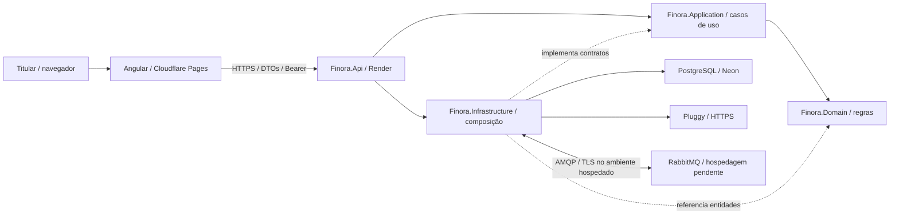
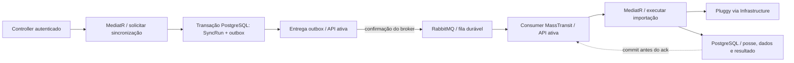

# Finora — TDD v0

**Technical Design Document — documento de desenho técnico**  
**Estado:** v0. Revisão factual 0.36 preparada em 26/11/2026, pendente de revisão documental própria; atualiza o estado da tarefa 3.1 do explorador, a coerência do §13 e classifica o bloqueio CORS do fluxo automático de entrada. A revisão 0.35 permanece aprovada explicitamente pelo titular no harness em 26/11/2026, junto do aceite local da implementação FNR-038; a revisão 0.34 permanece aprovada somente em seu escopo FNR-023.\
**Revisão anterior 0.33 — aprovada explicitamente pelo titular no harness em 25/11/2026, junto do aceite local da implementação FNR-023:** registrava 13/13 tarefas e apresentação para aceite; o estado subsequente foi registrado na revisão 0.34 e atualizado pelas revisões factuais posteriores. A aprovação cobre somente a revisão 0.33 e não autoriza operações Git/publicação.\
**Base atual:** [Finora — PRD v0, revisão 0.5](PRD.md), aprovada em 26/11/2026; esta revisão factual preserva o desenho técnico aprovado no TDD 0.35 e não altera requisitos do PRD.\
**Data de início:** 9 de novembro de 2026.

**Data desta revisão:** 26 de novembro de 2026. **Responsável/decisor conhecido:** autor do TCC, com elaboração assistida. A revisão 0.22 atualiza §11/DT-41 e a matriz RF04/RF05/M-03 para FNR-015 e foi aprovada explicitamente pelo titular no harness em 23/11/2026 antes do código dependente; essa aprovação não é aceite da implementação nem review/check GitHub. A revisão 0.21 documenta o contrato HTTP local e recebeu aceite explícito do titular no harness em 23/11/2026, junto com a implementação FNR-014 e o BACKLOG 0.49; preserva a aprovação anterior 0.20 do desenho/artefatos, sem inferir review/check GitHub nem publicação. A revisão 0.13 consolidou somente as decisões novas de login/sessões D1–D7 da [FNR-009](../openspec/changes/archive/2026-11-18-fnr-009-login-jwt-sessoes/design.md), com aprovações preservadas no histórico. A revisão 0.14 acrescentou o desenho FNR-010 descrito em §5 e foi aprovada no escopo registrado. A revisão 0.15 acrescentou rastreabilidade da execução FNR-010 e foi aprovada posteriormente nesse escopo. A revisão 0.16 atualizou §§2/5/11 para registrar decisões FNR-011; o titular confirmou posteriormente no harness que o diff canônico foi aprovado antes do código dependente. A revisão 0.17 acrescentou somente o estado local de implementação e evidências de validação da FNR-011 e foi aprovada após apresentação. A revisão 0.18 detalhou a reconexão FNR-012 e foi aprovada no escopo arquitetural descrito abaixo. A revisão 0.19 registra a implementação, migration e validações locais da FNR-012, sem alterar o PRD nem reabrir o desenho aprovado; o titular aprovou documentalmente o TDD 0.19 e confirmou o aceite da implementação no harness. Essas confirmações não são review/check formal do GitHub nem comprovam integração. O merge local `d4e05b1` confirma o PR #23 de encerramento documental FNR-010; não se infere daí review formal ou check do GitHub. Aprovações 0.12–0.18 permanecem preservadas em seus escopos.

**Revisão factual 0.30 — preparada, pendente de revisão própria:** registra a criação do commit local de implementação `d5a4311`, a sincronização da capability `card-movement-summary` para a spec principal e o arquivamento local FNR-018 com 13/13 tarefas. A spec consolidada passou validação estrita (16/16) e o arquivo validou 21/21 mudanças. O titular autorizou separadamente dois commits locais e abertura de PR contra `main`; esta revisão não declara PR integrado, review/check aprovado, merge ou publicação. Preserva as aprovações 0.27/0.29, a suíte PostgreSQL ampla 214/216 e as fronteiras FNR-022/023/038 e dos critérios financeiros adiados.

**Revisão factual 0.29 — aprovada explicitamente pelo titular no harness em 24/11/2026, junto do aceite da implementação local:** atualiza §§11/13/19 após a conclusão das 13/13 tarefas FNR-018. Restore bloqueado/build passaram; a regressão sem PostgreSQL passou 339/339, a focal PostgreSQL passou 41/41 e a ampla PostgreSQL ficou em 214/216 pelas duas fixtures legadas de FNR-007 que não incluem `SyncRun.AttemptDeadlineAtUtc`. A medição local do reader com 5.000 movimentos ficou abaixo de 2 s nos dois filtros medidos; planos, ambiente e limites estão em AMBIENTE.md. A aprovação não declara suíte ampla verde, UI/M-03 integrado, integração Git, review/check GitHub ou publicação, e não autoriza operações Git. Preserva o contrato pré-código aprovado, as fronteiras FNR-022/023/038 e os objetivos financeiros adiados; não altera o PRD.

**Revisão factual 0.28 — pendente de revisão documental e aceite da implementação:** atualiza §§11/13/19 após os gates pré-código aprovados em 0.27/TDD e BACKLOG 0.60. O leitor PostgreSQL, a rota `GET /api/dashboard`, filtros compartilhados com a lista, cobertura no snapshot e testes focais estão implementados localmente; 9/13 tarefas OpenSpec foram concluídas nesta preparação. Resultados são locais e parciais, sem declaração de suíte ampla verde, aceite humano, integração, review/check GitHub ou publicação. Esta atualização preserva o contrato aprovado, as fronteiras FNR-022/023/038 e os objetivos financeiros adiados; não altera o PRD.

**Revisão 0.18 — aprovada:** detalha a reconexão FNR-012 como comando interno separado, fora da API, e acrescenta em §§10/12 um registro persistente dos IDs externos de conexão aposentados para impedir replay após troca comprovada de item. A alteração exige migration aditiva, backfill dos itens ativos e recusa fail-closed de colisões preexistentes. O titular selecionou “Aprovo e prossiga” no harness em 20/11/2026 após revisar os artefatos OpenSpec, o diff TDD 0.18 e BACKLOG 0.44. A aprovação cobre somente esse desenho; não comprova implementação, migration, teste ou integração e não altera os escopos anteriores.

**Revisão 0.19 — aprovada documentalmente pelo titular no harness em 20/11/2026:** atualiza §§10/12 e o status das entidades para registrar que o comando interno, a migration aditiva `20261120211916_AddFinancialConnectionItemIdentityHistory` e os testes de importação/reconexão foram implementados e validados localmente na feature branch. As evidências e limitações estão em [AMBIENTE.md — FNR-012](AMBIENTE.md). O titular também confirmou o aceite da implementação FNR-012 no harness. Isso não atesta integração, aplicação da migration em ambiente de destino ou publicação; preserva a aprovação arquitetural 0.18 e distingue-a do aceite da implementação.

**Aprovação posterior:** após revisar o encerramento FNR-010, o titular aprovou expressamente no harness o TDD 0.15 e o BACKLOG 0.39, incluindo os registros históricos 0.24/0.25/0.38, e autorizou o encaminhamento do PR documental e sua integração após os gates aplicáveis. O aceite não é review formal do GitHub, check remoto aprovado nem autorização de publicação.

**Registro histórico da revisão 0.4:** inclusão documental do MediatR nos casos de uso, sem implementação nem alteração do PRD, backlog ou artefatos OpenSpec. A origem foram o pedido de atualização pela skill `generate-tdd` e as escolhas explícitas no harness: requests/handlers, Controllers com ISender, health direto e linha 12.x com licença Apache-2.0 verificada no tag v12.4.1; versão exata e compatibilidade continuaram pendentes. Essas escolhas não aprovaram automaticamente o documento completo; decisões anteriores não alteradas foram herdadas da revisão 0.3.

**Escopo histórico 0.7:** alinhamento aprovado pelo titular em 16/11/2026 após a decisão de substituir o objetivo pendente da FNR-005/5.3 no MVP por movimentos descritivos e recorrência assistida. O conteúdo final foi aprovado e o encerramento revisado da FNR-005 foi aceito nos limites registrados. Preservar o incremento técnico integrado pelo [PR #12](https://github.com/VictorJer/GestFinan-a/pull/12), merge `adee6998342722e905a1db98ed1423620ce77ee4`, e suas evidências. O objetivo original de 5.3 é substituído por revisão de escopo, não tecnicamente atendido; o aceite não depende da futura implementação das telas ou do detector. Reutilizar o [explorador existente, arquivado posteriormente](../openspec/changes/archive/2026-11-26-explorador-movimentos-cartao-sem-total/proposal.md); recorrência pertence a mudança própria ainda não criada. Tolerâncias de valor, datas e descrição permanecem pendentes antes de implementar. Nenhuma tecnologia, dependência ou regra financeira existente é ampliada naquela revisão.

**Escopo histórico 0.8:** registra PostgreSQL 18 como major escolhido para o banco local de desenvolvimento na FNR-006 e alinha as referências técnicas correspondentes. O banco hospedado continua sujeito à verificação de compatibilidade de major antes de migrations destinadas ao ambiente. Permanecem as decisões DT-15 e §9: executar migrations por comando administrativo antes da publicação e nunca aplicar migrations automaticamente no startup da API. Esta revisão não alterou o modelo financeiro nem validou uma migration de domínio; foi aprovada documentalmente pelo titular em 16/11/2026. As evidências de ambiente e o escopo de validação técnica estão em [AMBIENTE.md](AMBIENTE.md) e na [mudança FNR-006 arquivada](../openspec/changes/archive/2026-11-17-fnr-006-postgresql-efcore/proposal.md).

**Escopo histórico 0.9:** concretiza em §10 o desenho relacional e a fronteira de armazenamento Identity do SDD aprovado da FNR-007, sem alterar requisitos do PRD ou confirmar execução. O TDD 0.8 e sua aprovação permanecem históricos. A falta de PR associado ao commit técnico FNR-006 `c03f0c7` foi aceita pelo titular como ressalva histórica em 17/11/2026, sem declará-la conforme ao fluxo de PR; a regularização documental PR #15 não integrou novamente esse código. A revisão 0.9 foi aprovada documentalmente em 17/11/2026; isso não comprova implementação nem validação técnica.

**Escopo histórico 0.10:** fixa os únicos códigos internos aceitos em `SyncRun.FailureCode` — `PROVIDER_UNAVAILABLE`, `RATE_LIMITED`, `AUTH_REQUIRED`, `INVALID_RESPONSE`, `PROVIDER_TIMEOUT`, `PERSISTENCE_FAILED`, `CANCELLED` e `UNKNOWN` — para impedir persistência de mensagem arbitrária do provedor. O titular escolheu explicitamente essa lista no harness em 17/11/2026. Também esclarece DT-44 para refletir o escopo de categoria já aprovado em §10, mantendo pendentes a política de acentos, o catálogo e a opção visual. A revisão foi aprovada em seu escopo limitado; não implementa executor nem altera requisitos do PRD.

**Escopo aprovado 0.11:** fixa `IdentitySchemaVersions.Version2` e `MaxLengthForKeys = 128` para o modelo EF do Identity sem roles, sem tabela de passkeys, de modo compartilhado pela factory, testes e futura configuração da aplicação FNR-008. O titular aprovou esse complemento documental no harness em 17/11/2026. O valor 128 corresponde ao padrão de comprimento de chaves do modelo Identity v2 no pacote 10.0.15; a aprovação documental não comprova sua implementação ou validação técnica.

**Escopo aprovado 0.12:** registra em §5 o desenho administrativo da FNR-008 (D1–D6), rastreável a RF14 e DT-23–DT-26/30/38/48/49. O titular selecionou “Aprovar tudo e continuar” no harness após revisar o diff em 17/11/2026. A aprovação não confirma execução, teste, satisfação integral de RF14 ou prontidão para publicação autenticada.

**Estado da aprovação 0.7:** o titular aprovou explicitamente o conteúdo final no harness em 16/11/2026 e aceitou o encerramento revisado da FNR-005. A aprovação não valida compra/competência nem autoriza implementação, nova consulta real, instalação, commits, PR, sync ou arquivamento. Os parágrafos de escopo/aprovação 0.4–0.6 abaixo preservam seu histórico.

**Estado da aprovação 0.8:** o titular aprovou explicitamente esta revisão documental em 16/11/2026, após declarar “revisei os documentos e aprovo eles” nesta conversa do OpenCode. A aprovação cobre o conteúdo documental do TDD 0.8, não constitui aceite da implementação nem autoriza commit, PR, merge, publicação, sync ou arquivamento. A aprovação documental 0.7 permanece preservada e não é transferida.

**Estado da aprovação 0.9:** o titular aprovou explicitamente esta revisão no harness em 17/11/2026, respondendo “Aprovo (Recomendado)” após a apresentação do conteúdo. A aprovação 0.8 permanece preservada no escopo histórico e não se transfere. A aprovação documental não comprova restore, build, migration, testes ou integração.

**Estado da aprovação 0.10:** o titular selecionou no harness, em 17/11/2026, a opção que aprova a allowlist fixa de SyncRun e enumerou no próprio texto da opção estes oito códigos. O aceite é restrito a esse complemento da revisão; TDD 0.9 continua aprovado em seu escopo original. Nenhuma dessas aprovações comprova execução ou validação técnica.

**Estado da aprovação 0.11:** o titular aprovou explicitamente no harness, em 17/11/2026, o complemento apresentado para revisão: `IdentitySchemaVersions.Version2`, `MaxLengthForKeys = 128`, modelo sem passkeys e reutilização por factory/testes/FNR-008. A aprovação limita-se a esta revisão documental e não comprova build, migration, testes ou integração.

**Estado da aprovação 0.12:** o titular aprovou explicitamente no harness em 17/11/2026 o diff desta revisão após a apresentação do conteúdo e selecionou “Aprovar tudo e continuar”. A aprovação cobre a consolidação D1–D6 da FNR-008 e não comprova implementação/validação, aceite funcional, commit, PR, integração ou publicação. A aprovação 0.11 e as anteriores permanecem preservadas em seus escopos.

**Escopo histórico 0.5:** RabbitMQ para solicitações de sincronização, MassTransit 8.x, consumidor e entrega da outbox dentro da API, somente com a instância ativa. Outbox PostgreSQL, entrega ao menos uma vez, idempotência por SyncRun, tentativas limitadas e fila de erro foram escolhidos explicitamente pelo autor no harness em 15/11/2026. Esta revisão substitui a proposta anterior sem broker de DT-42, mas preserva MediatR e os requisitos do PRD. Versões exatas, parâmetros e hospedagem do broker permanecem pendentes, conforme autorizado na entrevista. Somente documentação; sem instalação, infraestrutura, código ou alterações em PRD/backlog/OpenSpec. As escolhas não equivalem à aprovação desta revisão nem à contratação de serviços.

**Aprovação documental 0.5:** após a entrega do TDD atualizado, o autor solicitou explicitamente “aprove o tdd” nesta conversa do OpenCode em 15/11/2026. Registra-se sua aprovação da revisão 0.5 completa, incluindo o desenho MediatR herdado da 0.4 e RabbitMQ/MassTransit. A aprovação é posterior às escolhas descritas acima; não resulta apenas delas. Propostas, versões exatas, compatibilidade, hospedagem, custos, parâmetros e gates continuam nos estados indicados, sem comprovar testes ou operação. Não autoriza implementação, instalação, contratação, alterações OpenSpec, commit, PR, merge, publicação ou arquivamento.

**Escopo histórico 0.6:** registra a seleção explícita de `MediatR 12.5.0` para FNR-004 e a evidência local de restore/compatibilidade .NET 10 descrita em [AMBIENTE.md](AMBIENTE.md). O autor aprovou essa versão exata em 15/11/2026 no gate da mudança; o gate de pacote não substituiu a aprovação documental da revisão, concedida separadamente abaixo, nem declara manutenção futura garantida. As demais decisões da revisão 0.5 permanecem herdadas sem alteração.

**Aprovação documental 0.6:** após apresentação da revisão e do diff FNR-004, o autor respondeu “Aprovo ambos” no harness em 15/11/2026, aprovando esta atualização do TDD e o conteúdo de implementação revisado. A aprovação documental cobre 0.6; não transfere aprovação para revisões futuras e não autoriza commit, PR, merge, publicação ou arquivamento.

**Aprovação posterior:** após a entrega do diff, o autor confirmou no harness “Registrar minha aprovação” para PRD 0.3, TDD 0.1 e SDD em 13/11/2026, e confirmou a atualização dos registros. Aprova-se o documento com seus estados explícitos: propostas/decisões pendentes, capacidades dos provedores e verificações técnicas continuam sujeitos às condições indicadas. Não autoriza código, PR, merge, publicação ou arquivamento.

**Aprovação documental 0.2:** após a apresentação do diff FNR-002, o autor confirmou “Aprovo o diff” nesta conversa do OpenCode em 14/11/2026. A aprovação cobre esta revisão documental e as alterações apresentadas, sem comprovar build/testes de projetos futuros e sem autorizar commit, PR, merge, publicação ou arquivamento.

### Histórico e fontes

**Revisão 0.3 — FNR-003:** concretiza DT-38 e registra diagnóstico/Swagger conforme SDD aprovado explicitamente no harness em 14/11/2026 (“Aprovar SDD e prosseguir”). Após apresentação do diff, o autor confirmou separadamente “Aprovo o diff”, aprovando esta revisão canônica. Não altera requisitos do PRD, baseline ou decisões não relacionadas. Na aprovação, a implementação e a validação ainda não haviam sido executadas; evidências posteriores da base backend constam em [AMBIENTE.md](AMBIENTE.md). Não autoriza commit, PR, merge ou publicação.

| Revisão | Data | Resumo / estado |
|---|---|---|
| v0 — FNR-001 | 13/11/2026 (início em 09/11) | Revisão documental aprovada explicitamente pelo autor; PR #1 integrado em `075af73`. Propostas e validações técnicas permaneciam pendentes. Evidências e limites no [backlog](BACKLOG.md), §7, e no [SDD histórico](../openspec/changes/archive/2026-11-13-fnr-001-alinhar-documentacao/design.md). |
| v0 — documental 0.1 | 13/11/2026 | Resumo, registro DT-xx, roadmap, rastreabilidade e operação/recuperação. Entregue em revisão e posteriormente **aprovada documentalmente pelo autor**, por confirmação no harness, sem transferência da aprovação anterior. Propostas e validações pendentes preservadas. Ver [proposta](../openspec/changes/archive/2026-11-13-alinhar-prd-tdd-skills/proposal.md) e [SDD desta revisão](../openspec/changes/archive/2026-11-13-alinhar-prd-tdd-skills/design.md). |
| v0 — documental 0.2 | 14/11/2026 | Baseline de ferramentas aprovada para FNR-002 e redistribuição de locks/testes entre FNR-002/003/006/019; diff da revisão 0.2 aprovado explicitamente pelo autor em 14/11/2026. Validações de instalação/execução continuam identificadas no §7 e em [AMBIENTE.md](AMBIENTE.md). Ver [SDD fnr-002-preparar-ambiente](../openspec/changes/archive/2026-11-14-fnr-002-preparar-ambiente/design.md). |
| v0 — documental 0.3 | 14/11/2026 | DT-38 e diagnóstico/Swagger conforme [SDD FNR-003](../openspec/changes/archive/2026-11-14-fnr-003-criar-base-backend/design.md), aprovados pelo autor; diff canônico aceito separadamente no harness. Evidências locais da base backend em AMBIENTE.md; sem integração ou publicação na execução de aprovação documental. |
| v0 — documental 0.4 | 15/11/2026 | MediatR: DT-48/49, desenho §3, gates §7, testes §14, adoção incremental §16 e rastreabilidade §19. Escolhas do autor registradas no harness; documento **Em revisão**, sem aprovação desta revisão ou autorização de implementação. Aprovação 0.3 preservada acima. |
| v0 — documental 0.5 | 15/11/2026 | RabbitMQ/MassTransit 8.x para sincronização: DT-50–53, revisão de DT-42 e desenho detalhado §20, com reflexos nos §§2/3/7/10/12/14/16–19. Entregue Em revisão e posteriormente **aprovada documentalmente pelo autor**, pela solicitação explícita “aprove o tdd” nesta conversa, incluindo MediatR herdado da 0.4. Pendências/gates preservados; sem aprovação retroativa da 0.4 isolada ou autorização de implementação/publicação. |
| v0 — documental 0.6 | 15/11/2026 | Concretiza DT-49 para MediatR 12.5.0, selecionado explicitamente pelo autor no gate FNR-004; registra restore, frameworks e validação local em AMBIENTE.md. **Aprovada documentalmente pelo autor** após a resposta explícita “Aprovo ambos” no harness em 15/11/2026. A revisão 0.5 aprovada e o histórico 0.4 permanecem preservados. |
| v0 — documental 0.7 | 15/11/2026 | **Aprovada documentalmente em 16/11/2026; encerramento revisado FNR-005 aceito.** MVP descritivo, sem agregados monetários de movimentos; recorrência assistida em mudança própria; modelo/contratos/testes/roadmap/rastreabilidade alinhados ao PRD 0.4 aprovado. Incremento PR #12 preservado; objetivo 5.3 substituído por revisão de escopo, não tecnicamente atendido. |
| v0 — documental 0.8 | 16/11/2026 | Registra PostgreSQL 18 como major local de desenvolvimento na FNR-006; mantém a compatibilidade com o major hospedado como gate e preserva migrations administrativas antes da publicação e a proibição de migrations no startup. **Aprovada documentalmente pelo titular em 16/11/2026.** |
| v0 — documental 0.9 | 17/11/2026 | Concretiza o modelo relacional e a fronteira de armazenamento Identity da FNR-007 em §10; preserva TDD 0.8 e não altera o PRD. **Aprovada documentalmente pelo titular no harness em 17/11/2026.** A aprovação não substitui implementação ou validação técnica. |
| v0 — documental 0.10 | 17/11/2026 | Fixa em §10 a allowlist de `SyncRun.FailureCode`: `PROVIDER_UNAVAILABLE`, `RATE_LIMITED`, `AUTH_REQUIRED`, `INVALID_RESPONSE`, `PROVIDER_TIMEOUT`, `PERSISTENCE_FAILED`, `CANCELLED`, `UNKNOWN`. **Complemento aprovado explicitamente pelo titular no harness em 17/11/2026.** Não implementa executor nem altera o PRD. |
| v0 — documental 0.11 | 17/11/2026 | Fixa em §10 `IdentitySchemaVersions.Version2` e `MaxLengthForKeys = 128`, compartilhados por factory/testes e futura configuração FNR-008, sem passkeys. **Aprovada pelo titular no harness em 17/11/2026.** TDD 0.9/0.10 permanecem aprovados em seus escopos anteriores. |
| v0 — documental 0.12 | 17/11/2026 | Consolida em §5 as decisões técnicas administrativas D1–D6 da FNR-008 e sua rastreabilidade com RF14/DT-23–DT-26/30/38/48/49. **Aprovada explicitamente pelo titular no harness em 17/11/2026**, junto dos artefatos OpenSpec; a revisão 0.11 e aprovações anteriores permanecem restritas aos escopos aprovados. Não declara implementação ou validação técnica. |
| v0 — documental 0.13 | 18/11/2026 | Consolida D1–D7 da FNR-009 em §5 e concretiza DT-39: composição isolada, login transacional/lockout, AuthSessions, HS256/relógio/rotação, validação persistente e testes. Artefatos OpenSpec e diff canônico aprovados antes de código dependente. Preserva aprovações anteriores e gates FNR-010/011/020/publicação. |
| v0 — documental 0.14 | 19/11/2026 | Registra aprovação no harness da proposta, duas deltas, desenho D1–D6 e tarefas FNR-010; consolida o contrato técnico de logout e reset com revogação transacional em §5. O diff canônico foi aprovado explicitamente pelo titular (“Aprovo e continue”) antes de código dependente. Não declara implementação ou validação técnica; preserva RF14, decisões herdadas e gates FNR-011/020/publicação. |
| v0 — documental 0.15 | 19/11/2026 | Atualiza somente a rastreabilidade de execução local FNR-010 em §5: reset atômico, schema mínimo, saída allowlist e limites de confirmação, com links a AMBIENTE/BACKLOG. Mantém D1–D6 e aprovações de 0.14 sem mudança; aprovada posteriormente pelo titular no harness, sem presumir review/check formal do GitHub ou publicação. |
| v0 — documental 0.16 | 19/11/2026 | Prepara §§2/5/11 para FNR-011: fallback de autorização, propriedade, erros sanitizados, CORS explícito, limites locais e compatibilidade. Os quatro artefatos e limites foram aprovados pelo titular; a aprovação do diff canônico antes do código dependente foi confirmada posteriormente no harness. Registra localmente o merge PR #23 (`d4e05b1`), sem inferir reviews/checks GitHub. Aprovações 0.15 e anteriores preservadas em seus escopos. |
| v0 — documental 0.17 | 19/11/2026 | Atualiza factual e pontualmente a implementação local FNR-011: CORS e limites por instância de login/titular, partições, comportamento de proxy, 429, lockout Identity e validação integrada local (restore/build, 254 testes sem PostgreSQL e 97 PostgreSQL descartável). Mantém o desenho 0.16 sem reabri-lo. Revisão documental e aceite da implementação local aprovados explicitamente pelo titular no harness; sem review/check GitHub ou autorização de integração/publicação. Evidências e limites em AMBIENTE.md/BACKLOG. |
| v0 — documental 0.18 | 20/11/2026 | **Aprovada explicitamente no harness pelo titular:** detalha reconexão FNR-012 por comando interno separado e identidade persistente ativa/aposentada com migration aditiva e backfill fail-closed, em §§10/12. Aprovação restrita ao desenho; não confirma implementação, validação ou integração. Revisão 0.17 e aprovações anteriores preservadas. |
| v0 — documental 0.19 | 20/11/2026 | Aprovação documental e aceite da implementação FNR-012 confirmados explicitamente pelo titular no harness. São registros externos ao GitHub; não significam review/check formal, integração, aplicação de migration em destino ou publicação. A aprovação arquitetural 0.18 permanece preservada em seu escopo. |
| v0 — documental 0.20 | 23/11/2026 | Prepara §§6/12 e DT-43 para FNR-014: limiar configurável de 24 horas, intervalo configurável de cinco minutos compartilhado entre entrada e botão e fronteira backend/FNR-021. O titular aprovou explicitamente no harness esta revisão, o BACKLOG 0.48 e os artefatos FNR-014 (“Aprovo e prossiga”) antes do código dependente. A aprovação não representa review/check formal GitHub nem aceite da implementação. Registra localmente o merge #27/FNR-013 sem inferir reviews/checks atuais, migration em destino ou publicação. Aprovações 0.19 e anteriores permanecem restritas aos escopos históricos. |
| v0 — documental 0.21 | 23/11/2026 | Atualiza §§6/12/DT-43 para refletir a aprovação documental 0.20 e registra o contrato HTTP local da FNR-014, códigos de resposta, exemplos sintéticos, fronteira de leitura para FNR-021 e validação focal local (restore bloqueado, build e 70 testes; evidências em [AMBIENTE.md](AMBIENTE.md)). O titular aprovou esta revisão e aceitou a implementação FNR-014 no harness em 23/11/2026, após a preparação inicial; isso não altera requisitos/decisões de 0.20 nem comprova review/check GitHub, limites reais do provedor ou publicação. |
| v0 — documental 0.22 | 23/11/2026 | Concretiza em §11/DT-41 o contrato de consulta FNR-015, com respostas allowlist, filtros/paginação, datas técnicas, cobertura separada da contagem e erros sanitizados; atualiza a matriz RF04/RF05/M-03 e vincula ao BACKLOG 0.51. Aprovada explicitamente pelo titular no harness em 23/11/2026 como gate antes do código dependente; não representa aceite da implementação, review/check GitHub ou autorização de encaminhamento. |
| v0 — documental 0.23 | 23/11/2026 | Preparada, pendente de revisão/aceite: registra a implementação local da FNR-015 e corrige o estado factual das rotas em §11, preservando os contratos aprovados em 0.22 e a separação da mudança do explorador. Evidências locais em AMBIENTE.md e nas tarefas OpenSpec; não declara aceite da implementação, integração, review/check GitHub ou publicação. |
| v0 — documental 0.24 | 24/11/2026 | Preparada, pendente de aprovação própria: reconcilia o merge local `a858677` do PR #29/FNR-015 após aceite da implementação e sync/arquivo, sem afirmar review/check GitHub, publicação nem suíte PostgreSQL ampla verde (histórico: 179/181). Propõe em §15/DT-44 sete categorias persistidas, “Sem categoria” virtual, normalização por acentos/caixa/espaços e migration administrativa explícita para FNR-016. Vincula PRD RF06/§8 e BACKLOG 0.54; os quatro artefatos FNR-016 e este diff exigem aprovação antes de código dependente. Preserva aprovação 0.22 e estado pendente 0.23. |
| v0 — documental 0.25 | 24/11/2026 | Aprovada explicitamente pelo titular no harness: registra em §15 o contrato PATCH parcial FNR-017, distinção entre omissão e `null`, autorização pelo titular da sessão, serialização por bloqueio da linha do movimento e nenhuma migration prevista. A aprovação conjunta dos quatro artefatos OpenSpec e BACKLOG 0.56 ocorreu antes de código dependente. Não declara implementação aceita, integração, review/check GitHub ou publicação. Preserva aprovação 0.24 em seu escopo FNR-016 e demais estados históricos. |
| v0 — documental 0.26 | 24/11/2026 | Preparada, pendente de revisão: registra em §15 e em AMBIENTE.md a implementação local FNR-017, 11/11 tarefas, validação focal/ampla e falhas legadas da suíte PostgreSQL (206/208). Preserva decisões do desenho 0.25; não declara aceite da implementação, review/check GitHub, commit, PR, integração, migration em destino ou publicação. |
| v0 — documental 0.27 | 24/11/2026 | **Aprovada explicitamente pelo titular no harness como gate pré-código**, junto dos quatro artefatos OpenSpec FNR-018 e do BACKLOG 0.60. Define em §§11/13 o contrato `GET /api/dashboard`, filtros sem paginação, universo, `dateBasis`, buckets allowlist, cobertura no snapshot e fronteiras FNR-022/023/038; atualiza rastreabilidade RF05/RF07/M-03. Registra merge PR #31/FNR-017 `b173e58` somente como fato do grafo Git local, sem afirmar review/check GitHub ou publicação. A aprovação não declara implementação/validação FNR-018, nem autoriza commits, PR ou publicação; preserva aprovação 0.26 e anteriores nos respectivos escopos. |
| v0 — documental 0.28 | 24/11/2026 | Preparada, pendente de revisão própria: registra implementação local FNR-018 em 9/13 tarefas, rota `GET /api/dashboard`, testes focais e atualização da rastreabilidade RF05/RF07/M-03, sem alterar requisitos nem reabrir o gate pré-código 0.27. Aceite da implementação, integração Git e publicação permanecem pendentes; FNR-022/023/038 e indicadores financeiros adiados continuam em suas fronteiras. |
| v0 — documental 0.29 | 24/11/2026 | **Aprovada explicitamente pelo titular no harness junto do aceite local da FNR-018:** registra 13/13 tarefas, restore/build, 339/339 testes sem PostgreSQL, 41/41 focais PostgreSQL, suíte ampla 214/216 por duas fixtures legadas e medição do reader em 5.000 movimentos. Preserva o gate pré-código 0.27 sem declarar UI/M-03 integrado, integração Git ou publicação; resultados e limites em AMBIENTE.md. Naquele momento não autorizava operações Git. |
| v0 — documental 0.30 | 24/11/2026 | Preparada, pendente de revisão própria: registra a autorização posterior de encaminhamento, o commit de implementação `d5a4311`, a sincronização da spec principal e o arquivo local FNR-018. Validações estritas OpenSpec passaram; a suíte PostgreSQL ampla permanece 214/216. Não declara PR integrado, review/check aprovado, merge ou publicação; preserva a aprovação 0.29 em seu escopo. |
| v0 — documental 0.31 | 25/11/2026 | **Aprovada explicitamente pelo titular no harness como gate pré-código da FNR-020:** reconcilia pelo grafo Git local o merge `c6c310c` do PR #37/FNR-019; registra o desenho de sessão volátil, limite seguro de HTTP, UX de login/logout e rotas em §§5/13. Confere os contratos de API em `AuthenticationController`, specs consolidadas e testes HTTP; não altera API nem afirma reviews/checks atuais ou publicação. A aprovação cobre planejamento/documentação, não implementação ou operações Git/publicação; a revisão 0.30 e aprovações anteriores permanecem em seus escopos. |
| v0 — documental 0.32 | 25/11/2026 | **Aprovada explicitamente pelo titular no harness como gate pré-código da FNR-023:** adiciona DT-56 e detalha em §§11/13/14/19 o consumo frontend do `GET /api/dashboard`, filtros aplicados compartilhados, ciclo de sessão/resposta, navegação protegida, acessibilidade e validação sintética. Confere PRD RF05/RF07/RF09 e M-03 sem alterar seus requisitos. Registra a relação com tarefas 3.1–3.4 do explorador, todas ainda pendentes; não transfere aprovações FNR-018/FNR-022/explorador nem declara implementação. A aprovação do TDD é distinta da aprovação dos artefatos OpenSpec e não é aceite de implementação ou autorização de encaminhamento. |
| v0 — documental 0.33 | 25/11/2026 | Preparada, pendente de revisão/aprovação própria: atualiza o estado local da FNR-023 para implementação validada e apresentada para aceite, com 13/13 tarefas OpenSpec e limites das evidências em AMBIENTE.md. Preserva integralmente as decisões e o gate pré-código aprovados em 0.32; confere RF07 e registra a paridade sintética de M-03 sem declarar integração end-to-end, API/CORS/provedor reais, aceite humano ou publicação. Não altera requisitos do PRD nem tarefas do explorador. |
| v0 — documental 0.34 | 25/11/2026 | **Aprovada explicitamente pelo titular no harness:** registra o aceite local da implementação FNR-023 e as aprovações de TDD 0.33/BACKLOG 0.77 e desta revisão/documento 0.34/0.78. Preserva as decisões/gate pré-código 0.32; 13/13 tarefas, evidência local de RF07 e paridade sintética de M-03 permanecem limitadas, sem aceite integrado do M-03, API/CORS/provedor reais ou publicação. Não autoriza operações Git. |
| v0 — factual 0.35 | 26/11/2026 | **Aprovada explicitamente pelo titular no harness; implementação local FNR-038 aceita.** Atualiza DT-55 e §§10/11/13/14/16/18/19 para refletir a política aprovada e os resultados/limites locais. Integração, API/CORS/provedor reais e publicação não são alegados. TDD 0.34 permanece aprovado somente em seu escopo anterior. |
| v0 — factual 0.36 | 26/11/2026 | Preparada, pendente de revisão documental própria: alinha §13 à tarefa 3.1 aprovada no BACKLOG 0.81 — visão geral com resumos e filtros, valores individuais somente na lista FNR-022 — e atualiza o estado técnico/documental das tarefas do explorador. Distingue a prova local limitada aos GETs do fluxo automático de atualização na entrada, bloqueado pelo preflight CORS de `Idempotency-Key` (FNR-021, dependente da allowlist API FNR-011); não declara a integração de navegador completa validada. Registra 4.3 conferida sem alterar requisitos do PRD, código, evidências históricas FNR-005, ressalvas de leitor de tela ou suíte PostgreSQL histórica 179/181; sem novos testes de código, commit, sync ou arquivo. Preserva as aprovações anteriores em seus escopos. |

**Aprovação posterior da revisão 0.24:** após apresentação dos quatro artefatos FNR-016 e dos diffs canônicos TDD 0.24/BACKLOG 0.54, o titular selecionou “Aprovo ambos” no harness em 24/11/2026, antes de qualquer código FNR-016. A aprovação abrange apenas este desenho e os documentos indicados; não constitui aceite da implementação, review/check formal GitHub, integração ou publicação. O estado de preparação da tabela e a pendência independente de 0.23 permanecem históricos.

**Aprovação da revisão 0.25 e do gate FNR-017:** após apresentação da proposta, delta, design, tarefas e diffs canônicos BACKLOG 0.56/TDD 0.25, o titular aprovou explicitamente os quatro artefatos e as duas revisões no harness em 24/11/2026, antes de código dependente. A aprovação cobre o desenho e o alinhamento documental como gate pré-código; não é aceite da implementação, review/check formal GitHub, autorização de commit/PR, integração ou publicação. As aprovações 0.24 e anteriores permanecem em seus escopos.

**Aprovação posterior da revisão 0.26:** após a validação local da FNR-017, o titular aceitou explicitamente a implementação e aprovou TDD 0.26/BACKLOG 0.57 no harness, ciente da suíte PostgreSQL ampla 206/208 com duas falhas de fixtures legadas. Autorizou somente commits locais pelo subagente committer. A tabela acima mantém o estado histórico de preparação; aceite e autorização não comprovam review/check GitHub, suíte ampla verde, integração ou publicação.

**Aprovação posterior da revisão 0.29 e aceite da FNR-018:** após apresentação dos resultados locais, o titular declarou “Aprovo ambos” no harness, aprovando TDD 0.29/BACKLOG 0.62 e aceitando a implementação local FNR-018. A confirmação é externa ao GitHub, não transforma a suíte PostgreSQL ampla 214/216 em resultado verde e não autoriza commit, push, PR, merge, sync/arquivo ou publicação. O gate pré-código aprovado em 0.27 permanece preservado; UI/M-03 integrado e critérios financeiros adiados seguem fora/pendentes.

**Autorização posterior de encaminhamento FNR-018:** em instrução posterior, o titular autorizou dois commits locais pelo committer e a abertura de PR contra `main`, sem merge ou publicação. A autorização é independente e posterior à aprovação/aceite 0.29; não os amplia retroativamente. O commit de implementação `d5a4311` foi criado, a spec foi sincronizada e a mudança foi arquivada localmente; a revisão factual 0.30 registra esse encerramento sem alegar aprovação documental nova.

Fontes desta complementação: PRD, TDD v0/FNR-001, backlog, [README](../README.md), [AGENTS.md](../AGENTS.md), SDD de FNR-002 e aprovação explícita do autor nesta conversa em 14/11/2026. A aprovação fecha a escolha das baselines registradas abaixo, mas não comprova instalação, restore, build, testes ou compatibilidade integrada. Desconhecidos e divergências futuras devem ser resolvidos nos gates dos §§7 e 16–18, não por suposição.

Fontes adicionais da revisão 0.4: documentos canônicos e código da base FNR-003, em especial `Finora.Application.csproj` e `Finora.Api/Program.cs`, sem MediatR instalado/registrado; documentação oficial do tag v12.4.1 consultada em 15/11/2026 (§8). O README resume PRD 0.2, mas o documento canônico registra aprovação 0.3: esta revisão usa o PRD canônico, sem corrigir conteúdo externo ao pedido. A inclusão do MediatR não muda requisitos funcionais nem reabre FNR-003.

Fontes 0.5: entrevista desta solicitação, PRD 0.3, backlog atual e documentação oficial RabbitMQ/MassTransit (§8). As escolhas de MediatR da entrevista 0.4 são preservadas, sem promover a revisão 0.4 a aprovada. Não há broker, consumidor ou outbox implementado nesta entrega. A documentação web atual do MassTransit contém recursos da linha 9; ela serve de referência conceitual, não prova de API ou licença da linha 8 selecionada.

Fontes 0.9: proposta, spec e design aprovados da [FNR-007](../openspec/changes/archive/2026-11-17-fnr-007-modelar-persistencia-nucleo/proposal.md); [backlog](BACKLOG.md), §§4 e 7; [AMBIENTE.md](AMBIENTE.md), registros de FNR-006/FNR-007; decisão explícita do titular em 17/11/2026 aceitando como ressalva histórica a ausência de PR associado ao commit técnico `c03f0c7`, sem alegar conformidade. Esta revisão consolida o desenho aprovado, não registra restore, build, migration ou teste já executado.

### Resumo e objetivos técnicos

Entregar o núcleo P0 revisado do PRD: leitura real local pela Pluggy, importação persistente/idempotente, autenticação do titular, organização de movimentos e visão descritiva com cobertura e contagens não monetárias. A recorrência assistida terá item/mudança próprios; reconhecimento automático de compras e indicadores financeiros dependentes de compra/competência ficam adiados, não atendidos por este recorte. O monólito modular concentra regras no backend e expõe DTOs à interface; não se acrescentam serviços distribuídos ou bibliotecas para esta revisão.

Na revisão 0.5, o autor acrescenta um broker externo para desacoplar aceitação e execução da sincronização (§20). O backend permanece uma unidade de implantação modular, sem microserviço/worker separado. Esse benefício vem com custo operacional e novas falhas possíveis; não se alega necessidade de escala, processamento contínuo ou melhoria de desempenho já medidos.

Restrições herdadas: um titular, desenvolvimento individual, duas semanas como referência original com entrega/capacidade a confirmar, frontend/API separados, planos de hospedagem sujeitos a validação. Integridade, privacidade, autorização, recuperação de falhas e clareza de cobertura são os atributos centrais (RNF-01–RNF-10). A meta de até 2s/5.000 transações é local; não há SLA hospedado confirmado.

Investimentos manuais, simulador e CSV são P1 após estabilidade do P0 revisado; seus cálculos próprios não são alterados pela proibição de somar movimentos do cartão. Permanência de login, múltiplos usuários, rotinas com aplicação fechada e operação comercial ficam fora desta entrega. O roadmap §16 diferencia MVP integrado local, entrega hospedada restrita e complementos; nenhum marco equivale a aprovação de produção comercial.

## 1. Decisões confirmadas

### Registro central de decisões técnicas

Legenda de origem/estado: **H** = escolha confirmada herdada da tabela do TDD v0/FNR-001, atribuída ao autor conforme o registro aprovado em 13/11/2026; não significa implementação ou compatibilidade verificada. **J0** = justificativa histórica não registrada. **A0** = alternativas históricas não registradas. As consequências são **análise desta revisão**, incluída na aprovação documental posterior, não falas históricas do autor nem resultados de implementação. Detalhes propostos recebem estado próprio abaixo; não são fechados por associação a H ou pela aprovação documental.

| ID | Tema | Decisão / contexto preservado | Estado | Origem / decisor | Justificativa | Alternativas | Consequências / detalhe |
|---|---|---|---|---|---|---|---|
| DT-01 | Arquitetura | Monólito modular: uma API, um frontend e um banco, com organização por funcionalidades | Confirmada | H / autor | J0 | A0 | Uma unidade backend; preservar fronteiras (§3). |
| DT-02 | Projetos backend | Finora.Api, Finora.Application, Finora.Domain e Finora.Infrastructure | Confirmada | H / autor | J0 | A0 | Responsabilidades separadas (§3). |
| DT-03 | Endpoints | Controllers | Confirmada | H / autor | J0 | A0 | Controllers delegam regras (§3). |
| DT-04 | Backend | ASP.NET Core em .NET 10 | Confirmada | H / autor | J0 | A0 | SDK e pacotes a validar (§7). |
| DT-05 | Frontend | Angular 22, conforme versão informada pelo autor | Confirmada; compatibilidade pendente | H / autor | J0 | A0 | Conferir CLI e dependências em FNR-002. |
| DT-06 | Node | Versão 24, conforme ambiente informado pelo autor | Confirmada; compatibilidade pendente | H / autor | J0 | A0 | Validar ambiente, sem afirmar instalação. |
| DT-07 | Persistência | Entity Framework Core 10 com migrations | Confirmada | H / autor | J0 | A0 | Modelo e provider a validar (§10). |
| DT-08 | Acesso à persistência | Repositórios específicos, com contratos na Application e implementações na Infrastructure; sem repositório genérico | Confirmada | H / autor | J0 | Repositório genérico não adotado | Contratos por caso de uso (§3). |
| DT-09 | Mapeamento | Explícito em C# no MVP; sem AutoMapper | Confirmada | H / autor | J0 | AutoMapper não adotado | Normalização verificável em C# (§3). |
| DT-10 | Interface visual | Templates HTML do Angular com Tailwind CSS; sem Angular Material | Confirmada | H / autor | J0 | Angular Material substituído | Acessibilidade nos componentes próprios. |
| DT-11 | Gráficos | Chart.js em componentes Angular próprios | Confirmada | H / autor | J0 | A0 | Representação com resumo HTML (§13). |
| DT-12 | Testes backend | MSTest, em substituição à proposta de xUnit | Confirmada | H / autor | J0 | xUnit substituído | Fixar runner/pacotes (§14). |
| DT-13 | Repositório Git | Único, com frontend e backend em pastas separadas e publicações independentes | Confirmada | H / autor | J0 | A0 | Configurar diretórios e gatilhos (§9). |
| DT-14 | Banco de desenvolvimento | PostgreSQL local em Docker, major 18, separado da Neon | Confirmada; major local registrado na FNR-006 | H / autor; SDD FNR-006 | J0 | A0 | Isolar testes e dados hospedados; verificar compatibilidade com o major hospedado antes de migrations no destino. |
| DT-15 | Migrations | Comando administrativo antes da publicação; não executar na inicialização da API | Confirmada | H / autor | J0 | Migração na inicialização não adotada | Compatibilidade com versão ativa (§9). |
| DT-16 | Publicação de versões | Automática após atualização da main por integração de PR, condicionada aos checks aprovados do commit publicado; sem push direto | Confirmada | H / autor | J0 | Push direto não permitido | Pipeline deve selecionar commit verificado. |
| DT-17 | Condição para publicar | Build e testes aprovados; falha impede nova publicação | Confirmada | H / autor | J0 | Publicar com checks falhos não permitido | CI é gate, não autorização documental. |
| DT-18 | Estado no Angular | Serviços com Signals; HttpClient/RxJS para chamadas HTTP; sem NgRx no MVP | Confirmada | H / autor | J0 | NgRx não adotado | Estado por funcionalidade (§3). |
| DT-19 | Banco | PostgreSQL na Neon; substitui a escolha anterior de SQL Server | Confirmada | H / autor | J0 | SQL Server substituído | Limites e recuperação a validar (§17). |
| DT-20 | Frontend hospedado | Cloudflare Pages, plano gratuito, publicação estática | Confirmada | H / autor | J0 | A0 | SPA e limites a validar. |
| DT-21 | Backend hospedado | Render Free, publicação por Docker | Confirmada | H / autor | J0 | A0 | Tratar retomada após inatividade. |
| DT-22 | Publicação | Frontend e API em hospedagens separadas | Confirmada | H / autor | J0 | A0 | Não há troca de versão atômica (§9). |
| DT-23 | Público | Apenas o autor, sem cadastro público | Confirmada | H / autor; RF14 | J0 | Multiusuário fora do escopo | Verificar propriedade dos recursos. |
| DT-24 | Autenticação | E-mail e senha com ASP.NET Core Identity | Confirmada | H / autor; RF14 | J0 | A0 | Hash/validação pelos serviços Identity. |
| DT-25 | Criação do usuário | Comando administrativo inicial, sem cadastro público e sem senha fixa no código | Confirmada | H / autor; RF14 | J0 | Cadastro público não adotado | Entrada protegida e idempotência (§5). |
| DT-26 | Recuperação de acesso | Redefinição por comando administrativo no MVP; sem envio de e-mail | Confirmada | H / autor; RF14 | J0 | Recuperação por e-mail fora do MVP | Revogar todas as sessões (§5). |
| DT-27 | Configuração da Pluggy | Credenciais e itemId nos segredos do backend; sem autorização bancária iniciada pelo Angular no MVP | Confirmada | H / autor | J0 | Autorização na interface fora do MVP | Renovação realizada no provedor (§4). |
| DT-28 | Sessão no MVP | Token de acesso por 30 minutos, somente na memória do Angular; novo login ao recarregar ou expirar | Confirmada | H / autor; RF14 | J0 | Persistência/refresh fora do MVP | Perda local da sessão ao recarregar. |
| DT-29 | Token | JWT assinado; Identity valida as credenciais e JwtBearer valida as chamadas | Confirmada | H / autor | J0 | A0 | Validar algoritmo/emissor/destino (§5). |
| DT-30 | Revogação | Sessões persistidas no PostgreSQL e verificadas em cada requisição autenticada; logout revoga a sessão atual e redefinição de senha revoga todas | Confirmada | H / autor; RF14 | Revogação imediata, explicitada no §5 | Stateless puro não atende à revogação descrita | Dependência do banco para autorizar chamadas. |
| DT-31 | Evolução da sessão | Manter login ao recarregar, com mecanismo de persistência e renovação a definir futuramente | Intenção futura confirmada; mecanismo pendente | H / autor; FNR-032 | J0 | A definir na evolução | Não altera DT-28 nem entra no MVP. |
| DT-32 | Sincronização | Ao entrar, se os dados estiverem antigos, e por botão de atualização | Confirmada | H / autor; RF16 | J0 | Agendamento com app fechado fora do MVP | Navegação/filtros leem banco local. |
| DT-33 | Dados antigos | 24 horas desde a última importação completa bem-sucedida; intervalo configurável | Confirmada | H / autor; RF16 | J0 | A0 | Falha não renova sucesso (§6). |
| DT-34 | Histórico inicial | Até 12 meses anteriores, limitado aos dados disponíveis no provedor; parcelas futuras em situação separada | Confirmada | H / autor; RF02 | J0 | A0 | Informar cobertura, não prometer histórico. |
| DT-35 | Organização de movimentos | Categoria e observação pessoal; preservar valor, data, descrição, natureza e situação da origem | Decisão herdada preservada; aplicação ao escopo descritivo aprovada na revisão 0.7 | H / autor; RF06/RF15 | J0 | Edição de dados da origem não permitida | Confirmação de recorrência é registro separado, não edição geral da natureza financeira. |
| DT-36 | Categorias | Conjunto inicial e criação de novas categorias pelo usuário | Confirmada | H / autor; RF06 | J0 | Renomear/arquivar/excluir fora do MVP | Preservar classificação manual (§15). |
| DT-37 | Docker | Autor conhece o básico; documentação deverá incluir passos de build e publicação | Contexto herdado e orientação documental | H / autor | J0 | A0 | Instruções reproduzíveis em FNR-025. |
| DT-48 | Despacho de casos de uso | MediatR na Application: commands/queries e handlers; Controllers de negócio usam ISender; health permanece direto | Confirmada na entrevista 0.4; incluída na aprovação documental 0.5 | Autor, harness de 15/11/2026 | Explicitar a fronteira de cada caso de uso e desacoplar Controllers de handlers concretos | Chamada direta de serviços dispensa biblioteca; behaviors/eventos ampliariam o escopo | Mesmo banco e monólito; sem event sourcing ou behaviors obrigatórios. MediatR não fornece mensageria durável; transporte externo acrescentado separadamente em DT-50–53. |
| DT-49 | Linha e licença do MediatR | MediatR 12.5.0 (linha 12.x), Apache-2.0; dependências e compatibilidade local descritas em AMBIENTE.md | Versão exata selecionada pelo autor para FNR-004; restore/build/test locais aprovados; manutenção futura não garantida | Autor, harness de 15/11/2026, seleção explícita 12.5.0 após gate de dependências | Preservar a linha 12.x aprovada e fechar o gate da PoC sem atualização silenciosa | Outra linha/custo exige decisão explícita | NuGet lista linhas mais recentes; não presumir suporte ativo. A evidência é local e não equivale a auditoria completa de segurança; reavaliar antes de novos incrementos/atualizações. |
| DT-50 | Broker e uso inicial | RabbitMQ para enfileirar solicitações de sincronização; MediatR permanece interno ao processo | Confirmada na entrevista 0.5; incluída na aprovação documental 0.5 | Autor, harness de 15/11/2026 | Desacoplar aceitação e execução, mantendo SyncRun como fonte de estado | Polling direto no banco era a proposta anterior; eventos genéricos entre módulos não escolhidos | Nova dependência operacional; não encaminhar todo command/query ao broker. |
| DT-51 | Framework | MassTransit 8.x com transporte RabbitMQ e bus outbox EF/PostgreSQL | Linha confirmada; versões/compatibilidade pendentes | Autor, harness de 15/11/2026 | Integrar transporte e confiabilidade sem implementar protocolo diretamente | Cliente oficial direto e Rebus considerados, não escolhidos | Apache-2.0 verificada no tag v8.5.10, não versão exata fixada; validar EF Core 10, manutenção e transitivas antes de instalar. Não substituir MediatR por MassTransit Mediator. |
| DT-52 | Host de consumo | Consumidor e despachante da outbox dentro da Finora.Api, somente enquanto ativa | Confirmada na entrevista 0.5 | Autor, harness de 15/11/2026 | Evitar nova unidade de implantação nesta entrega | Worker separado não escolhido; não pressupor execução contínua | Render Free mantido, sujeito à validação operacional; broker não acorda nem mantém a API ativa. |
| DT-53 | Confiabilidade | Outbox transacional PostgreSQL, entrega ao menos uma vez, idempotência por SyncRun, retries limitados e fila de erro | Direção confirmada; parâmetros/esquema final pendentes | Autor, harness de 15/11/2026, autorizando detalhamento com pendências explícitas | Evitar perda entre banco e broker e efeitos duplicados | Publicação direta após commit deixa janela de perda; exactly-once não prometido | Não manter transação durante HTTP externo; limites, retenção e recuperação exigem SDD/validação (§20). |
| DT-54 | MVP descritivo e objetivo substituído | Movimentos com valores individuais, cobertura, natureza/situação e contagens não monetárias; sem agregados monetários. Objetivo original FNR-005/5.3 substituído por revisão de escopo, não tecnicamente atendido | Conteúdo 0.7 aprovado; encerramento FNR-005 aceito em 16/11/2026 | Autor, pedido atual; PRD 0.4 RF04–RF07/RF15 | Entregar consulta útil sem apresentar incerteza financeira como gasto validado | Esperar regra universal bloqueia a consulta; somar com ressalvas mantém risco de interpretação | Reutilizar explorador existente; conservar PR #12, regras e evidências. Indicadores financeiros originais ficam adiados; aceite não depende das telas/detector. |
| DT-55 | Recorrência assistida | Backend sugere candidato `recurrence-v1` após três ocorrências elegíveis em meses consecutivos; titular registra/corrige assinatura, parcela, compras independentes ou rejeição; metadados de parcelamento permanecem separados | Política e desenho aprovados antes do código; implementação local FNR-038 aceita pelo titular em 26/11/2026; integração permanece pendente | Autor, aprovação explícita da política no harness em 25/11/2026 e aceite local em 26/11/2026; PRD RF17/VP-07 e OpenSpec FNR-038 | Diferenciar sugestão temporal de fato financeiro ou parcelamento informado | Valor igual sozinho e classificação automática definitiva são insuficientes; critérios completos em PRD §8 e OpenSpec D3 | Identidade/cartão/moeda, valor até 1% da mediana, data ±3 dias com regra de fim de mês, descrição normalizada e `Situation=Effective`; detalhes em §§11/13/14/19. Decisão não altera transações nem habilita competência ou somas. Sem dependência nova. |
| DT-56 | Integração frontend da visão descritiva FNR-023 | Rota protegida `/area/visao`; consumo somente do `GET /api/dashboard` existente, pela base/interceptor atuais; filtros aplicados de `TransactionListStateService` em allowlist, sem `page/pageSize`; estado por geração de sessão/requisição, sem cache persistente e com descarte de respostas obsoletas | Aprovada explicitamente no harness em 25/11/2026 como gate pré-código FNR-023; não é aceite da implementação ou autorização de encaminhamento | Titular; PRD RF05/RF07/RF09 e M-03; design D1–D5 da FNR-023 | Reutilizar o contrato existente e a única lista, mantendo filtros, privacidade e interpretação descritiva coerentes | Duplicar filtros/lista, agregar a página no browser, criar endpoint ou entrar em `/area` para chegar ao resumo | Sem endpoint, migration, dependência, sincronização ou agregação monetária nova. Testes com o mesmo conjunto controlado não prometem snapshot atômico entre GETs distintos; detalhes em §§11/13/14/19. |

### Direções e propostas herdadas, ainda sujeitas a validação

Origem **P**: desenho já descrito no TDD v0/FNR-001, nas seções indicadas; aprovação documental não fechou as propostas. Responsável sugerido por validação: autor. Quando a origem registra uma direção sem aprovação específica, ela não é promovida a escolha confirmada. Linguagem C# está registrada em DT-09; PostgreSQL 18 é o major escolhido para desenvolvimento local conforme DT-14/FNR-006. O major do banco hospedado e sua compatibilidade com o major local precisam ser confirmados antes das migrations destinadas ao destino. Tailwind, Chart.js, bibliotecas de validação/emissão JWT e runners/pacotes exatos continuam sujeitos aos gates indicados, sem nova escolha silenciosa.

| ID | Tema / direção | Estado / origem / decisor | Justificativa registrada ou análise identificada | Alternativas / consequências | Condição de validação |
|---|---|---|---|---|---|
| DT-38 | Domain sem referências; Application → Domain; Infrastructure → Application/Domain; Api → Application/Infrastructure | Confirmada no SDD FNR-003 e na revisão canônica 0.3 pelo autor em 14/11/2026 | Preservar fronteiras do monólito, conforme D1 do SDD | Projeto único e framework adicional de arquitetura não adotados; Api usa Infrastructure como raiz de composição | FNR-003: testar ProjectReference e revisar Controllers; implementação ainda não validada |
| DT-39 | Claims mínimas; HS256 exclusivo, chave externa de pelo menos 256 bits, ClockSkew zero e rotação coordenada sem chave anterior | Desenho FNR-009 D5 e consolidação canônica 0.13 aprovados pelo titular em 18/11/2026 | Emissor/consumidor único; expiração estrita de 30 minutos e segredo estável por ambiente | Sem tolerância adicional; rotação exige reinício coordenado e novo login; alternativas em D5 | FNR-009/025; evidências locais em AMBIENTE, operação hospedada ainda sujeita aos gates próprios |
| DT-40 | Modelo relacional, UUIDs, numeric(19,4), índices, datas de origem e reconciliação de identidade | Desenho detalhado no SDD FNR-007 e aprovado no TDD 0.9 pelo titular em 17/11/2026 | Preservar integridade e semântica original, sem exigir competência financeira para persistir movimentos | Índices a refinar; não deduplicar por descrição/data/valor; não excluir por ausência | FNR-007 implementa/testa o schema; FNR-012 reconcilia importação; nenhuma valida regra geral de compra |
| DT-41 | Contratos DTO, paginação, erros e rotas HTTP | Baseline de autorização/erros/compatibilidade aprovada na FNR-011; concretização FNR-015 da revisão 0.22 aprovada explicitamente no harness em 23/11/2026 | Contagem não monetária do filtro inteiro, DTOs allowlist, filtros, cobertura honesta e erros sanitizados | Preservar autorização e compatibilidade; sem agregados monetários ou sincronização implícita na leitura | Contrato e propriedade da API FNR-015 validados localmente conforme AMBIENTE.md/tarefas; FNR-016/017 mantêm contratos e provas próprios. Aprovação 0.22 não é aceite da implementação nem review/check GitHub |
| DT-42 | SyncRun persistente, 202/polling, posse/expiração e gravação completa; transporte RabbitMQ/MassTransit dentro da API | Revisada em 0.5: broker/host confirmados em DT-50–53; detalhes de execução ainda propostos | Evitar tarefa abandonada e sucesso parcial, conforme §§12/20 | Proposta anterior sem fila externa substituída; memória antes da transação vs staging/lotes ainda depende de medição | FNR-005/013 e gates §20; testar volume, publicação, reinício e concorrência |
| DT-43 | Intervalo configurável de cinco minutos por conexão, compartilhado entre entrada e pedido manual; retries limitados e janela incremental | Revisão canônica 0.20 aprovada; compatibilidade externa permanece gate de publicação | Respeitar limites e revisitar registros mutáveis, conforme §12; contar cooldown desde a última intenção nova aceita, inclusive após falha, sem reiniciá-lo em replay | Limites efetivos do provedor e compatibilidade com Retry-After continuam pendentes; não assumir atualização só por data de importação | RF08/RF16; FNR-005/013/014/021; verificar limites reais antes da publicação |
| DT-44 | Escopo de categoria, chave, limite de 60 e ausência opcional | Persistência aprovada em TDD 0.9: unicidade por ScopeId e CategoryId/CategoryScopeId ambos nulos para ausência; política de nomes/catálogo aprovada na revisão 0.24 como gate pré-código FNR-016 | Preservar escolha manual sem acoplar anotação ao movimento de origem; FNR-016 define chave que ignora acentos, caixa e espaços redundantes, sete registros de sistema com IDs fixos por migration explícita e “Sem categoria” virtual com ID nulo | Sem registro especial persistido, seed no startup ou mudança da unicidade existente; política futura exige análise de colisões | FNR-016: §15 e RF06/PRD §8, validar concorrência, migration e isolamento; FNR-017 trata edição e filtros |
| DT-45 | Resumos no backend; Chart.js apenas apresenta quando aplicável | Direção herdada; recorte descritivo 0.7 aprovado, DT-54 | MVP sem somas monetárias de movimentos em qualquer camada; backend fornece somente resumos autorizados | Indicadores financeiros antigos ficam adiados, não transferidos ao Angular; simulador P1 preservado | FNR-018/023: consistência descritiva e ausência de somas; FNR-030: fórmula independente; conciliação financeira somente em mudança posterior |
| DT-46 | Plano de testes unitários, integração, HTTP, Angular e manual | Plano proposto; P §14 / decisor pendente | Exercitar riscos financeiros/segurança, conforme §14 | Sem cobertura percentual arbitrária; testes reais da Pluggy separados de CI | FNR-002/024/028; runner e cenários efetivamente executados |
| DT-47 | Completar observabilidade, backup/restore, retenção e recuperação de versão | Pendente; adição desta revisão, §17 / decisor pendente | Análise desta revisão: operação não pode ser declarada validada sem avaliar perda/recuperação | Nenhuma política ou ferramenta selecionada; capacidades dos planos desconhecidas | OP-01–OP-07; decisão explícita e evidência antes dos marcos dependentes |

Escolhas de plano não garantem gratuidade ilimitada nem disponibilidade contínua. Limites devem ser conferidos na publicação. A aplicação deve tolerar a retomada do backend após inatividade.

## 2. Visão de implantação

Referências: DT-19–DT-22 e DT-27–DT-30. Escolhas de hospedagem são herdadas; limites e procedimentos operacionais dependem do §17.

Complemento 0.5, DT-50–53: a API também acessará RabbitMQ via transporte MassTransit; o broker fica fora do processo/contêiner da API e não no filesystem efêmero do Render. Host/plano/região e versão do broker não foram escolhidos. O desenho abaixo deve ser lido com a extensão de mensageria do §20; não há publicação desse componente comprovada.

```text
Navegador
  ├── HTTPS → Cloudflare Pages → arquivos estáticos do Angular
  └── HTTPS → Render → API ASP.NET Core
                        ├── conexão TLS → PostgreSQL na Neon
                        └── HTTPS → API da Pluggy
```

O Angular não acessará diretamente o banco ou a API da Pluggy com credenciais de servidor. Client Secret, chave da API e string de conexão devem permanecer no backend e fora do repositório.

A API deve exigir autenticação por padrão em rotas HTTP, com exceções anônimas explícitas apenas para login, health e documentação mapeada em Development. Autorização/propriedade dos dados é verificada no servidor e a identidade deriva exclusivamente da sessão validada; provas de propriedade usam probes de teste enquanto não existem endpoints financeiros de produção. A tela de login pode ser pública; isso não torna os dados públicos. CORS usa origens exatas configuradas, lista vazia por padrão, sem credenciais, origem curinga ou eco arbitrário, e não substitui autenticação. A política é aplicada após roteamento e antes da autenticação, sem bloquear clientes sem Origin.

FNR-011 aprovou limites por instância de 10 logins/minuto por origem observada pelo servidor e 120 chamadas protegidas/minuto por titular autenticado. A implementação local valida parâmetros positivos, usa janelas fixas sem fila e não confia em `X-Forwarded-For`; o host não configura atualmente proxies encaminhados, então clientes atrás do mesmo proxy de rede podem compartilhar a partição por endereço de conexão. Login excedente recebe 429 antes de avaliar credenciais, sem token nem alteração do lockout persistente. O Identity mantém cinco falhas e cinco minutos de bloqueio. Health, preflight e CLI ficam fora das políticas. CORS e limitadores de login/titular estão implementados/testados localmente; restore bloqueado, build e suítes integradas locais passaram conforme as evidências de [AMBIENTE.md — FNR-011](AMBIENTE.md). O titular aprovou a revisão documental 0.17 e aceitou a implementação local no harness. Isso não representa review/check GitHub nem autorização de encaminhamento.

### Componentes e fronteiras



Legenda: visão **planejada** do produto integrado, sem implantação comprovada. A base backend FNR-003 tem evidências locais em AMBIENTE.md; isso não implementa as integrações do diagrama. Angular/API/banco e hospedagens são escolhas herdadas; as dependências entre projetos seguem DT-38, aprovada no SDD FNR-003 e nesta revisão canônica no §3. Setas internas mostram dependências/responsabilidades, não chamadas de rede entre serviços: Api, Application, Domain e Infrastructure compõem um backend. PostgreSQL 18 local em Docker substitui Neon no desenvolvimento; a compatibilidade com o major hospedado será verificada antes de migrations destinadas ao ambiente. A interface não consulta Pluggy nem banco diretamente. A evolução deve manter os limites dos módulos e rever contratos antes de ampliar o escopo, sem introduzir microserviços ou novos usuários implicitamente.

## 3. Estrutura confirmada

Referências: DT-01–DT-14, DT-18 e DT-38 aprovada no SDD FNR-003 e na revisão canônica 0.3; DT-48/49 implementadas nos casos locais FNR-004/005, sem estender isso a endpoints financeiros ainda inexistentes. DT-54/55 orientam o planejamento revisado, não código entregue.

```text
Finora.Api             endpoints, autenticação e composição das dependências
Finora.Application     casos de uso e contratos de entrada/saída
Finora.Domain          entidades e regras de negócio
Finora.Infrastructure  EF Core, PostgreSQL e cliente da Pluggy
finora-web             Angular
```

Organizar as funcionalidades por módulos dentro dessa estrutura: integração, transações, dashboard e investimentos. Endpoints implementados em Controllers no projeto Finora.Api; regras financeiras e importação não devem ficar nos Controllers.

Direção aprovada no SDD FNR-003: Domain não referencia os outros projetos; Application referencia Domain; Infrastructure implementa os contratos necessários e referencia Application/Domain; Api referencia Application e Infrastructure para compor a aplicação. Contratos HTTP não devem expor entidades do EF ou respostas brutas da Pluggy.

O incremento FNR-003 estabelece `backend/Finora.slnx`, os quatro projetos `net10.0` e testes MSTest.Sdk/MTP, sem classes de negócio artificiais. O único endpoint é `GET /health`, por Controller e DTO, com HTTP 200 e JSON exato `{"status":"ok"}`, sem credenciais ou consultas externas: liveness, não prontidão de banco/Pluggy. OpenAPI nativo (Microsoft.AspNetCore.OpenApi) em `/openapi/v1.json` e Swagger UI (somente Swashbuckle.AspNetCore.SwaggerUI, sem SwaggerGen) em `/swagger` ficam exclusivamente em Development, com assets locais e perfis em loopback. Testes HTTP cobrem documento/UI/assets em Development e indisponibilidade fora dele; Try it out será verificado no navegador. Não antecipar JWT/Authorize, banco, integração financeira ou deploy. Versões exatas e evidências pertencem a [AMBIENTE.md](AMBIENTE.md), conforme D4 do [SDD FNR-003](../openspec/changes/archive/2026-11-14-fnr-003-criar-base-backend/design.md), preservando a baseline aprovada.

Application acessa a persistência por contratos específicos, como ITransactionRepository, implementados na Infrastructure com EF Core. As interfaces devem atender às operações dos casos de uso; não retornar IQueryable para que a camada Application componha consultas dependentes do provedor. Fronteiras de transação e gravação serão detalhadas com o fluxo de importação.

O mapeamento entre contratos externos, entidades e DTOs será explícito em C#. A normalização de valor, moeda, status e natureza da transação deve ter regras verificáveis; não é mera cópia de campos.

### Casos de uso com MediatR — desenho da revisão 0.4

**Objetivo e limite (DT-48/49):** organizar operações de negócio em requests e handlers no processo da API. Commands representam intenções de alteração; queries consultam e retornam DTOs, sem efeitos de escrita ou importação implícitos. Trata-se de separação lógica de leitura/escrita, não de bancos separados, event sourcing ou arquitetura distribuída. A adoção não instala bibliotecas adicionais de validação/mapeamento, não cria nova camada/projeto e não muda rotas ou formatos HTTP do §11.

| Fronteira | Responsabilidade e dependências planejadas |
|---|---|
| Api / Controllers | Receber contratos HTTP, obter identidade confiável, converter explicitamente a entrada para request, chamar ISender.Send e traduzir a resposta para HTTP. Não chamar handler concreto nem repositório diretamente. Autenticação/autorização HTTP e Problem Details continuam na Api. |
| Application / requests | Contratos internos baseados em IRequest/TResponse conforme a API da versão selecionada; não transportar HttpContext, IActionResult, IQueryable ou entidades EF. Não aceitar UserId arbitrário do cliente. |
| Application / handlers | Um handler por request, responsável pela orquestração do caso de uso, validação aplicável, propriedade do recurso, regras do Domain e contratos específicos de persistência/integração. Retornar DTOs/resultados de aplicação; não códigos HTTP. |
| Domain | Entidades, invariantes e cálculos puros, sem MediatR, referências à Application ou interfaces de notificações da biblioteca. |
| Infrastructure | Implementar os contratos específicos da Application; manter EF Core, PostgreSQL e Pluggy fora dos handlers concretos e dos Controllers. Não mover requests/handlers de negócio para a infraestrutura. |
| Composição na Api | Registrar o pacote e os handlers do assembly Application com AddMediatR/RegisterServicesFromAssemblyContaining ou registro equivalente da versão fixada; evitar varrer assemblies arbitrários. A forma exata do ponto de registro será especificada no SDD. |

MediatR e os handlers são registrados como transient pela integração documentada da linha consultada; isso **não** altera a vida útil das dependências scoped. Chamadas HTTP usam o escopo da requisição. Caso o trabalhador proposto no §12 seja adotado, cada execução cria seu próprio escopo e resolve o despachante nele, sem capturar DbContext/serviços scoped no singleton e sem reutilizá-los em paralelo. Domain continua sem referências; a dependência de pacote na Application não muda as direções de ProjectReference de DT-38. A Api pode referenciar o pacote explicitamente se necessário à composição; versões devem permanecer coerentes no grafo.

Organização planejada sob `backend/Finora.Application/`: módulos por funcionalidade (integração, transações, categorias, dashboard e autenticação), com pastas por caso de uso reunindo request, handler e DTOs específicos. Contratos compartilhados permanecem próximos do módulo responsável; evitar um diretório genérico que misture todas as funcionalidades. Nomes finais serão definidos no SDD de cada incremento, sem gerar classes vazias para operações futuras. Não criar abstração própria duplicando ISender nem um handler genérico de CRUD.

```mermaid
sequenceDiagram
    participant C as Controller de negócio
    participant S as ISender / MediatR
    participant H as Handler / Application
    participant R as Contrato específico / Infrastructure
    C->>S: Send(request, cancellationToken)
    S->>H: Executar handler registrado
    H->>H: Validar entrada e propriedade; aplicar regras
    H->>R: Consultar ou persistir conforme o caso
    R-->>H: Resultado ou falha
    H-->>S: DTO / resultado de aplicação
    S-->>C: Resultado ou exceção propagada
    C-->>C: Traduzir para HTTP sanitizado
```

Diagrama **planejado**, não integração implementada. Middleware/filters HTTP fazem autenticação/autorização antes da action protegida; o handler verifica propriedade também para chamadas não HTTP. O servidor fornece a identidade por contrato confiável ou entrada montada pela Api, nunca por binding livre do corpo. A identidade derivada do principal/sessão validados e a regra de propriedade foram estabelecidas na FNR-011; DTOs e resultados concretos de cada operação de negócio continuam a ser especificados nas entregas correspondentes. Não há decisão nesta inclusão de introduzir um modelo global de resultados/exceções na Application.

**Validação, falhas e cancelamento:** validar forma da requisição na borda e regras de aplicação no handler/Domain, incluindo chamadas administrativas ou internas. Não pressupor execução de validators automática pelo MediatR. Propagar CancellationToken do Controller às operações assíncronas; não transformar cancelamento em sucesso de negócio ou falha externa com retry. Erros HTTP seguem a matriz aprovada no §11; cada operação futura deve fornecer resultado/erro tipado quando a API precisar distinguir conflito, recurso inacessível ou dependência indisponível, sem classificar falhas por texto livre. Exceções não tratadas chegam ao tratamento central sanitizado, sem registrar o corpo inteiro do request, JWT, observação pessoal ou conteúdo financeiro.

**Persistência, transações e execução durável:** MediatR não inicia transação, não fornece exclusão mútua, retry, idempotência nem fila persistente. Fronteiras atômicas continuam nos casos de uso e contratos da Infrastructure (§§5/10/12). Não introduzir transaction behavior global que mantenha transação aberta durante HTTP à Pluggy. Um request de atualização pode apenas registrar SyncRun e retornar sua referência; o processamento subsequente continua condicionado ao executor persistente proposto no §12. Desconexão do navegador após aceitar a execução não equivale a cancelar uma SyncRun persistida; sua política será fechada em FNR-013. Não usar Publish/notifications ou fire-and-forget como substituto do trabalhador, backup ou registro de sucesso.

**Fora do escopo do MediatR:** pipeline behaviors obrigatórios, FluentValidation, notificações/eventos de domínio, streams e despacho encadeado de handlers como fluxo padrão. Broker/outbox, excluídos na revisão 0.4, passam a ter escopo próprio e limitado em DT-50–53/§20, sem usar notifications do MediatR para entrega durável. Regras reutilizáveis pertencem ao Domain ou a serviços de aplicação específicos; não ocultar dependências em cadeias de Send. `GET /health` continua direto, sem handler artificial, e os comandos administrativos não devem ganhar dependência obrigatória do host HTTP.

O frontend usará templates HTML do Angular com Tailwind CSS, preservando o protótipo como referência visual documentada em [DESING.md](DESING.md) (§§2–12). Não adotar Angular Material. Componentes próprios devem contemplar foco, navegação por teclado, rótulos, mensagens de erro e estados de carregamento. A adaptação ao MVP segue a seção 13 daquela referência, sem promover dados fictícios ou funções demonstrativas a contratos reais.

### Repositório e frontend

Um único repositório Git conterá `backend/`, `frontend/` e `docs/`. Cloudflare Pages e Render publicarão suas respectivas partes de forma independente. A configuração de publicação precisa definir os diretórios de trabalho e os caminhos que disparam cada build.

O Angular manterá estado em serviços com Signals e usará HttpClient/RxJS para as chamadas HTTP, sem NgRx no MVP. Separar funcionalidades de autenticação, integração, transações, dashboard e investimentos; manter componentes reutilizáveis em uma área compartilhada. Gráficos implementados com Chart.js em componentes próprios, com descrição acessível e resumo dos valores em HTML. A ferramenta de testes do frontend ainda será definida.

O token de sessão deve ficar em um serviço de autenticação, apenas em memória. O interceptor de autenticação só pode anexá-lo a requisições para a API configurada do Finora. A resposta 401 deve encerrar a sessão local e orientar novo login; uma resposta 403 deve informar falta de permissão sem iniciar uma repetição de login.

## 4. Integração bancária: ponto de partida

Referências: DT-27, DT-32–DT-35 e propostas DT-40/42/43. RF01/RF02 exigem prova real; o contrato não foi validado por esta revisão.

O autor já conectou o Nubank ao Meu Pluggy e visualizou cartão e transações no painel do provedor. Informou também ter guardado Client ID, Client Secret e itemId. Os valores não devem ser inseridos neste documento.

A FNR-004 demonstrou leitura positiva limitada de uma página pelo .NET; o incremento técnico FNR-005 foi integrado pelo PR #12, com análise paginada limitada, contratos e regras conservadoras. As evidências em AMBIENTE.md e PLUGGY-CONTRACT.md não validam cobertura histórica completa, paginação real múltipla, regra geral de compra ou competência. As 127 aprovações de testes registradas nas tarefas são evidência histórica, não execução desta revisão nem checks do GitHub. Reviews e checks reportados no PR consultado estavam vazios.

A prova de conceito FNR-004 foi local, sem depender de dashboard ou autenticação hospedada já implementados. Não publicar endpoints financeiros desprotegidos; a evidência deve continuar sanitizada. O contrato conservador do incremento FNR-005 orienta a persistência/importação descritiva após aceite da revisão de escopo. O objetivo original de 5.3 não foi tecnicamente atendido; reconhecer compras/competência exige investigação futura própria, sem impedir armazenar e listar desconhecidos.

O dashboard deve consultar o banco da aplicação. Uma nova coleta externa não deve ser executada a cada mudança de tela ou filtro.

Confirmado: configurar Client ID, Client Secret e itemId nos segredos do backend. No MVP, o Angular exibe estado da conexão e permite consultar atualizações; a autorização ou renovação junto ao banco é realizada no ambiente do provedor. Não publicar uma tela que solicite senha bancária. A orientação de reconexão deve diferenciar a configuração no provedor da sessão de login do Finora.

## 5. Autenticação

Referências confirmadas: DT-23–DT-30. Claims e direção de assinatura são DT-39, sujeitas à validação técnica; não confundir aprovação de JWT/sessão com fechamento de todos os parâmetros operacionais.

Confirmado: Identity, e-mail/senha, apenas um usuário e nenhum cadastro público.

Decisão confirmada para o MVP: token de acesso com validade de 30 minutos, armazenado apenas na memória do Angular. Recarregar ou fechar a página perde a sessão local. A expiração exige novo login; a interface deve explicar o motivo. Não armazenar o token em localStorage ou sessionStorage.

Não haverá renovação automática no MVP. Não emitir ou disponibilizar refresh token ao frontend por conveniência; o desenho de permanência do login será uma evolução explícita. O logout confirmado pelo servidor revoga a sessão atual e o Angular remove seu token da memória. Se a chamada falhar, limpar a memória local e informar que não foi possível confirmar o encerramento no servidor; não apresentar revogação remota como concluída.

Criação do usuário confirmada por comando administrativo inicial, fora dos endpoints públicos. A proposta técnica FNR-008 desta revisão restringe a entrada a terminal interativo protegido: senha não é aceita por argumento, configuração, arquivo ou stdin redirecionado. Identity valida a senha e gera o hash; a criação repetida do mesmo titular não troca sua credencial. O comando não provisiona usuário no startup da API.

Recuperação de acesso confirmada por comando administrativo de redefinição no MVP, sem serviço de e-mail. Na proposta FNR-008, o reset usa o fluxo de tokens do Identity, mantendo o token somente em memória e usando Data Protection efêmera no processo; a atualização da credencial e seu commit participam da mesma transação. O comando não emite nem persiste token, não altera manualmente o hash e não declara revogação de sessões. A revogação transacional é FNR-010 e continua sendo gate antes da publicação autenticada.

**Desenho técnico FNR-008 — revisão 0.12 aprovada em 17/11/2026 (decisões D1–D6 do SDD):** esta concretização não altera RF14 nem reabre DT-23–DT-26/30. Application recebe requests/handlers específicos via MediatR, sem EF Core ou Identity; Infrastructure compõe `FinoraDbContext` scoped e Identity, reutilizando as opções de modelo já aprovadas. A política de senha escolhida pelo titular é mínimo de seis caracteres, maiúscula, minúscula, número, caractere não alfanumérico e um caractere distinto.

- **D1 — isolamento do comando:** `Program.cs` reconhece somente `user-create` ou `user-reset-password`, sem argumentos adicionais, antes de compor serviços. Usa Generic Host para configuração/DI, sem iniciar servidor, hosted services, cliente Pluggy ou JWT; respeita `DOTNET_ENVIRONMENT`, usa Production por padrão e carrega User Secrets somente em Development explicitamente selecionado. Configuração do banco é externa, não vem dos argumentos; logs do host são suprimidos neste ramo.
- **D2 — fronteiras e Identity:** Application mantém contratos/resultados tipados e requests/handlers sem dependência de EF/Identity; representações de comandos não revelam senha. Infrastructure registra o contexto e `AddIdentityCore` no escopo, validadores/normalizador Identity e política aprovada; a raiz Api fornece o token provider padrão e o provider de proteção efêmera necessário ao reset.
- **D3 — entrada e pré-consulta:** e-mail e senha são solicitados somente em terminal interativo, sem eco; stdin/stdout redirecionados e falta de terminal são recusados. A pré-consulta ocorre antes de solicitar senha e sem manter contexto, conexão ou transação durante a digitação. Senha não é aparada ou normalizada.
- **D4 — único titular e atomicidade:** a mutação usa transação PostgreSQL `ReadCommitted`, lock advisory transacional com chave fixa compartilhada por criação/reset, e nova consulta após adquirir o lock. Criação idempotente não muda credenciais do titular existente; timeout e cancelamento não acionam retry automático. O lock coordena somente escritores que seguem este protocolo, não SQL externo.
- **D5 — redefinição limitada:** reset usa `GeneratePasswordResetTokenAsync`/`ResetPasswordAsync` no mesmo escopo/transação, com token local em memória e provider efêmero por processo. Mantém identidade/vínculos e não envia e-mail; security stamp atualizado não equivale a revogação JWT. FNR-010 deve integrar/testar a revogação transacional antes da publicação autenticada.
- **D6 — saída sanitizada:** stdout/stderr usam estados e erros allowlist, mensagens fixas e códigos 0/1/2/3/4/130; não incluem PII, senha, token, configuração, descrição Identity ou exceção. Reset informa aviso fixo de que revogação de sessões depende da FNR-010. FNR-008 cobre somente o provisionamento/recuperação administrativa e não atende RF14 integralmente.

Rastreabilidade: RF14 e DT-23–DT-26/30 definem titular único, Identity, criação/reset e sessões; DT-38 preserva as fronteiras de projetos; DT-48/49 fundamentam requests/handlers MediatR e sua baseline. A matriz de §19 mantém as dependências de FNR-009/010/011/020 e o gate de publicação, sem promover esta proposta a aceite.

Não expor os endpoints padrão de cadastro indiscriminadamente. O backend valida identidade e autorização em todas as operações financeiras; o frontend não é a barreira de acesso.

Desenho confirmado: Identity valida credenciais, uma biblioteca de tokens emite JWT assinado para a API do Finora e o middleware JwtBearer valida assinatura, algoritmo, emissor, destinatário e expiração. Claims mínimas propostas: identificador do usuário (`sub`), identificador da sessão/token (`jti`), emissor (`iss`), destinatário (`aud`), emissão (`iat`) e expiração (`exp`). Não incluir dados financeiros, senha ou credenciais da Pluggy. O JWT assinado não deve ser tratado como conteúdo confidencial criptografado.

Concretização de assinatura DT-39 pelo desenho FNR-009 D5 aprovado: HS256 exclusivo, chave aleatória de pelo menos 256 bits em base64, externa e estável entre reinicializações, diferente por ambiente. Usar bibliotecas consolidadas, nunca criptografia própria. `ClockSkew` zero preserva a expiração estrita de 30 minutos; a rotação troca configuração/chave e reinicia coordenadamente todas as instâncias, sem aceitar a chave anterior. Reinício sem rotação deve preservar tokens de sessões ativas. A consolidação canônica 0.13 foi aprovada em 18/11/2026; evidências técnicas locais e limitações são registradas em AMBIENTE, sem comprovar operação hospedada.

### Concretização FNR-009 — revisão 0.13 aprovada

**Aprovação canônica:** após apresentação do diff TDD 0.13/BACKLOG 0.18 e validação documental, o titular selecionou “Aprovo e continue” no harness em 18/11/2026. Esse aceite posterior resolve as pendências de aprovação 0.13 registradas acima, sem apagar o histórico de preparação e sem comprovar implementação/testes. Libera código dependente da FNR-009; não autoriza commits, push, PR, merge ou publicação.

Origem: [proposta, spec, design e tarefas](../openspec/changes/archive/2026-11-18-fnr-009-login-jwt-sessoes/proposal.md) aprovados explicitamente pelo titular no harness em 18/11/2026. Os itens abaixo consolidam o desenho, não comportamento já implementado. Referências: RF14, DT-23–30/38–39/48–49 e BACKLOG FNR-009; o PRD não precisa de alteração.

- **D1 — composição e diagnóstico:** Controller fino delega comando MediatR à Application, com contratos sem EF/Identity/IdentityModel. Infrastructure implementa Identity/EF; Api emite JWT via contrato. Compartilhar contexto/Identity com comandos, preservando Version2/128 e política de senha, sem provider de reset no HTTP. Autenticação antecede autorização; health/login são anônimos. Configuração inválida desabilita somente autenticação com 503 e falha fechada, sem impedir health, inventar chave/conexão ou aplicar migrations. Health e diagnóstico Development ignoram Bearer e não consultam sessão.
- **D2 — entrada, respostas e tentativas:** e-mail/senha limitados a 256/1024 caracteres e corpo a 16 KiB; aparar somente e-mail e preservar senha exata. Sucesso 200 entrega token Bearer, `expiresIn: 1800` e expiração UTC; todo resultado usa no-store. Entrada inválida retorna 400/413; conta desconhecida, senha errada e bloqueio compartilham 401 genérico; falha operacional retorna 503 e inesperada 500 sanitizados. Problem Details usa código/título fixos e traceId; challenge mantém `WWW-Authenticate: Bearer`. Identity contabiliza cinco falhas/cinco minutos, sem estender bloqueio, zera contador no sucesso e habilita lockout legado sob transação. Conta ausente verifica hash sintético sem persistência; rate limiting geral é FNR-011.
- **D3 — atomicidade e concorrência:** ReadCommitted e mesmo lock advisory transacional administrativo `0x46494E4F5241L`, centralizado em helper interno; consulta/validação após o lock. Timeout de 30 segundos inclui espera; propagar cancelamento, sem retry automático. Múltiplos titulares e falha de contador são indisponibilidade. Preparar JWT em memória antes do commit; gravar sessão e reset do contador atomicamente e entregar token somente após confirmação. Falha de assinatura anterior ao commit desfaz alterações; commit incerto não entrega token nem promete rollback. Login posterior ao reset revalida credenciais; revogação transacional ainda é FNR-010.
- **D4 — persistência mínima:** entidade em Infrastructure e migration incremental no contexto existente. `AuthSessions`: Id varchar(64)/PK, UserId UUID/FK Restrict, criação/expiração UTC obrigatórias e revogação UTC opcional; índice por UserId, expiração maior que criação e revogação nula ou não anterior à criação. Id/jti usa 32 bytes criptograficamente aleatórios em base64url sem padding (43 caracteres), validado na fronteira. Não persistir JWT completo, e-mail, senha, stamp, IP ou user agent; não reescrever migrations antigas nem executar seed/startup migration.
- **D5 — emissão e chaves:** `Authentication:Jwt` contém Issuer, Audience e SigningKeyBase64 externos. HS256 e chave mínima de 32 bytes; claims somente sub UUID canônico, jti, iss, aud, iat e exp, cabeçalho typ JWT, sem duplicatas obrigatórias. Mesmo instante UTC truncado a segundos para criação/iat; expiração/exp = emissão +1800 segundos. JwtBearer sem remapeamento, assinatura obrigatória, algoritmo allowlist, emissor/destinatário exatos, ClockSkew zero e recusa de emissão futura/claims inválidas antes do banco. Relógio controlável e rotação conforme DT-39. JwtBearer 10.0.15 é candidato da baseline 10.0; versão IdentityModel, metadados, licença, advisories, grafo e locks devem ser verificados antes de instalar; mudança de baseline exige decisão.
- **D6 — sessão por chamada e erros:** após validação criptográfica, contrato scoped consulta sessão/usuário sem tracking/cache e verifica jti/sub, usuário existente, revogação nula, validade e correspondência criação/expiração com iat/exp. Estado inválido retorna 401; falha operacional tipada retorna 503 sem principal parcial atingir Controller. Token inválido verificável antes do banco continua 401. Controller protegido de prova existe somente no assembly/host de testes, nunca no binário/OpenAPI de produção. Revogação SQL de fixture prova rejeição de estado, não logout/reset implementado.
- **D7 — evidências e limites:** testes unitários/HTTP com autenticação real e PostgreSQL descartável protegido pela fixture, incluindo concorrência, falhas, migration vazia/upgrade/down/reaplicação, relógio, reinício/rotação sintéticos e sentinelas de segredos. Preservar health, Swagger/OpenAPI Development, comandos e Pluggy sem coleta real. Documentar comandos/resultados e rastreabilidade com evidência real, não somente caixas ou arquivos. Não acessar banco pessoal/Neon nem publicar por esta tarefa; RF14 depende também de FNR-010/011/020 e dos gates de publicação.

### FNR-011 — fronteira segura da API (desenho 0.16 e estado local 0.17 aprovados)

**Gate:** o titular aprovou explicitamente no harness a proposta, as duas delta specs, o design e as tarefas FNR-011, incluindo os limites 10/120 por minuto por instância. Também confirmou que o diff canônico TDD 0.16/BACKLOG 0.40 foi aprovado antes do código dependente. A aprovação FNR-010/TDD 0.15 não se transfere. Fonte: [proposal](../openspec/changes/archive/2026-11-20-fnr-011-base-segura-api/proposal.md), [spec api-access-boundary](../openspec/changes/archive/2026-11-20-fnr-011-base-segura-api/specs/api-access-boundary/spec.md), [spec authenticated-sessions](../openspec/changes/archive/2026-11-20-fnr-011-base-segura-api/specs/authenticated-sessions/spec.md), [design](../openspec/changes/archive/2026-11-20-fnr-011-base-segura-api/design.md) e [tasks](../openspec/changes/archive/2026-11-20-fnr-011-base-segura-api/tasks.md). Rastreabilidade: FNR-011, PRD RF09/RF14 e backlog; não altera o PRD.

- **Autorização e propriedade:** fallback fechado para rotas HTTP, com login, health e documentação de Development anônimos explicitamente; logout permanece protegido. Identidade vem do principal/sessão validada. Recursos alheios e inexistentes compartilham 404; 403 não confirma existência. Probes de teste demonstram a regra sem criar endpoint financeiro fictício de produção; FNR-015/016/017 ainda precisam testar propriedade nos endpoints reais.
- **Contrato Application/Infrastructure:** a Api deriva o identificador do titular exclusivamente do principal e da sessão já validados e o fornece ao caso de uso; requests não recebem `UserId` de corpo, rota ou filtro do cliente. Consultas de recurso individual combinam ID do recurso e `UserId`; listagens sempre incluem o `UserId` autenticado no predicado, ignorando filtros que tentem ampliá-lo. Ausência e propriedade alheia resultam no mesmo resultado não encontrado (404); 403 é reservado a permissão conhecida e independente da existência do recurso. Chaves estrangeiras compostas existentes reforçam integridade entre titulares, mas não substituem o predicado de autorização da consulta.
- **Limite da prova:** os probes sintéticos cobrem principal validado, consulta individual, filtro e resposta 403 sem endpoint de negócio em produção. Eles não substituem testes de propriedade nos endpoints reais e respectivos repositórios de FNR-015/016/017.
- **Erros:** Problem Details sanitizado com status, código/título estáveis e traceId não sensível. Distinguir 400/401/403/404/409/429/500/503, sem refletir entrada, exceção, SQL ou dados do provedor. Preservar no-store, códigos específicos de login/logout e challenge Bearer somente quando aplicável; não reescrever respostas depois de iniciada a transmissão.
- **CORS e limites:** origens exatas configuradas, fechado sem configuração; métodos/cabeçalhos limitados ao contrato, sem credenciais. Preflight permitido não exige Bearer. Implementação local validada: 10 logins/minuto por IP observado na conexão e 120 chamadas protegidas/minuto por `sub`, janelas fixas sem fila; parâmetros positivos são validados. Não há configuração de Forwarded Headers nesta entrega: `X-Forwarded-For` não altera a partição, e tráfego atrás de um mesmo proxy pode compartilhar IP observado. Limites vivem na memória de cada host e não são globais. Login excedente é rejeitado antes do corpo/credenciais com 429 e no-store; rotas protegidas excedentes não executam a action. Identity continua com cinco falhas/cinco minutos. Health, preflight e CLI ficam fora das políticas.
- **Estado/evidência local 0.17:** 17/17 tarefas OpenSpec foram executadas localmente e a implementação foi aceita pelo titular no harness. Restore bloqueado/build passaram, com suítes finais 254/254 sem PostgreSQL e 97/97 com PostgreSQL descartável; OpenSpec estrito, diff check e links também passaram. CORS e limitadores de login/titular foram exercitados em hosts HTTP, com testes PostgreSQL descartável para lockout, partições, sessão e troca de instância; resultados/comandos e limitações estão em [AMBIENTE.md — FNR-011](AMBIENTE.md) e [BACKLOG FNR-011](BACKLOG.md). O titular aprovou documentalmente TDD 0.17 e BACKLOG 0.41 no harness. Esses aceites não são review formal/check GitHub; encaminhamento segue sujeito à autorização específica.
- **Compatibilidade:** manter `/api/auth/*`, `/health` e seus sucessos; OpenAPI/Swagger somente em Development. `/openapi/v1.json` versiona o documento, não as rotas. Mudança incompatível futura exige versão e SDD próprio. Não há endpoint financeiro, migration ou publicação nesta entrega.

As decisões detalhadas e critérios executáveis continuam nos artefatos FNR-011; este registro de design não equivale a aceite técnico da implementação. O diff TDD/backlog foi aprovado antes do código dependente, conforme confirmação registrada acima.

### FNR-010 — revogação de sessões no logout e reset (desenho 0.14; rastreabilidade 0.15 aprovada posteriormente)

**Estado de revisão:** proposta, duas deltas, desenho D1–D6 e tarefas foram aprovados explicitamente pelo titular no harness em 19/11/2026; o diff canônico TDD 0.14/BACKLOG 0.22 também foi aprovado antes do código dependente. A revisão 0.15 atualiza rastreabilidade factual da execução local e foi aprovada posteriormente pelo titular; não reabre o desenho aprovado nem transfere seu aceite para release ou publicação. Origem técnica: [FNR-010](../openspec/changes/archive/2026-11-19-fnr-010-revogacao-sessoes/proposal.md), [design D1–D6](../openspec/changes/archive/2026-11-19-fnr-010-revogacao-sessoes/design.md) e specs de [sessões autenticadas](../openspec/changes/archive/2026-11-19-fnr-010-revogacao-sessoes/specs/authenticated-sessions/spec.md) e [acesso administrativo](../openspec/changes/archive/2026-11-19-fnr-010-revogacao-sessoes/specs/administrative-user-access/spec.md). Rastreabilidade: RF14, DT-23–30/38–39/48–49 e [BACKLOG FNR-010](BACKLOG.md); não alterar o PRD. Os itens D1–D6 registram o desenho aprovado; evidências e limitações de implementação local ficam em AMBIENTE/BACKLOG, com aceite técnico FNR-010 registrado separadamente no backlog.

- **D1 — contrato e composição:** disponibilizar `POST /api/auth/logout`, sem corpo ou seletor de titular/sessão. Login permanece anônimo e logout exige Bearer. Api deriva a referência da sessão somente de claims validadas (`sub`, `jti`, `iat`, `exp`) e delega por `LogoutCommand`/`LogoutHandler` MediatR ao contrato `IAuthenticationSessionRevoker` da Application, sem EF, Identity, ASP.NET, JWT bruto ou segredo. O resultado `LogoutResult` tipado distingue `Confirmed`, `InvalidSession` e `Unavailable`; request, referência e resultado mantêm representações redigidas. Registrar o handler na composição HTTP sem trazer serviços JWT/HTTP para a CLI administrativa.
- **D2 — revogação individual:** Infrastructure reutiliza contexto Identity, transação `ReadCommitted` e lock advisory existente `0x46494E4F5241L`; após adquirir o lock, relê usuário/sessão pela referência completa, sem confiar em tracking anterior. Revoga condicionalmente somente a sessão autenticada, preserva a primeira data de revogação e não exclui nem reativa registros. Revalida validade/expiração após espera e SQL e antes do commit. Só responde 204 após commit confirmado; chamadas novas com token revogado recebem 401.
- **D3 — reset atômico global:** após `ResetPasswordAsync` Identity bem-sucedido e antes do commit, atualizar todas as sessões do titular com `RevokedAtUtc == null`, incluindo expiradas, na mesma transação/contexto. Zero linhas é sucesso; timestamps existentes permanecem intactos. Usar horário UTC após o lock e timestamp não anterior à criação da sessão, inclusive diante de pequeno recuo do relógio. Sem schema de sessão, falhar fechado e reverter credencial; sem migration automática, fallback, alteração financeira, desbloqueio ou reativação.
- **D4 — ordenação e alcance:** login, reset e logout compartilham o protocolo cooperativo de lock. Reset posterior a login revoga a sessão criada com senha antiga; reset anterior faz login com senha antiga revalidar e falhar, enquanto senha nova pode criar sessão independente. Autenticações iniciadas após o commit consultam o estado persistido, inclusive em outro host/reinício com mesmo banco e chave. Não prometer cancelamento retroativo de requisição cuja autenticação já terminou; escritores externos que ignorem o lock estão fora da garantia.
- **D5 — falhas e saída:** timeout total de 30 segundos inclui espera do lock; propagar cancelamento e não repetir mutações automaticamente. Falha anterior à tentativa de commit não publica alterações; falha/perda de confirmação após tentativa é incerta e não permite anunciar sucesso nem garantir rollback. Logout mapeia credencial inválida/revogada/expirada a 401 com challenge, indisponibilidade/schema/timeout a 503 sem challenge e falha inesperada a 500 sanitizado; todas as respostas usam `Cache-Control: no-store`. Reset mantém códigos existentes: confirmação exata `User admin: operation=reset_password status=password_reset session_revocation=confirmed` somente após commit confirmado; cancelamento pré-commit usa 130 e falha/commit incerto usa 1.
- **D6 — evidências e limites:** provar contrato, DI e metadados HTTP, fluxos login/acesso/logout e reset reais, PostgreSQL descartável, rollback e commit incerto, timeout/expiração, concorrência nas duas ordens, hosts/reinício, privacidade e regressões. Usar migration existente de sessões e fixtures protegidas; manter intactos testes de migrations antigas. Registrar somente quantidades/resultados realmente obtidos em tarefas e AMBIENTE. Sem banco pessoal/Neon, Pluggy real, migration nova, deploy ou declaração de RF14 completo. A interface deve tratar falha remota de logout na FNR-020; FNR-011/020 e gates de publicação continuam pendentes.

#### Registro de implementação local (19/11/2026; revisão documental 0.15 aprovada posteriormente)

As tarefas FNR-010 1.1–1.3, 2.1–2.5, 3.1–3.5, 4.1–4.4 e 5.1–5.3 foram registradas como executadas localmente (**20/20** no estado desta revisão). Restore bloqueado/build da solução passaram sem alteração de locks e sem avisos/erros; as duas execuções completas separadas passaram **230/230 sem PostgreSQL** e **92/92 com PostgreSQL descartável**. A execução implementa revogação de sessões na mesma transação do reset, exige a migration existente `20261118173427_AddAuthenticationSessions`, mantém a resposta allowlist `session_revocation=confirmed` somente após commit confirmado e reporta falha operacional sem alegar rollback quando o commit é incerto. `AdministrativeUserAccessService` preserva lockout e dados financeiros, não envia e-mail, não cria JWT/sessão, não aplica migrations no startup nem oferece fallback quando `AuthSessions` está ausente. A matriz local de critérios BACKLOG/specs, limites de privacidade e resultados fica em [AMBIENTE.md — FNR-010](AMBIENTE.md); esta revisão documental 0.15 foi aprovada posteriormente junto com o BACKLOG 0.39. A conclusão das tarefas locais, por si só, não declarava aceite final, integração, checks GitHub, prontidão de publicação ou atendimento integral de RF14; o aceite técnico e a integração FNR-010 são registrados separadamente no backlog, enquanto FNR-011/020 e os demais gates permanecem.

### Sessões e revogação imediata

Persistir uma sessão em `AuthSessions` para cada login, com identificador aleatório de alta entropia correspondente ao `jti`, UserId, CreatedAtUtc, ExpiresAtUtc e RevokedAtUtc opcional. Não persistir o JWT completo. Somente entregar o token após gravar a sessão com sucesso.

Após validar criptograficamente o JWT, consultar a sessão pelo identificador e usuário e exigir que esteja ativa e não expirada. Sessão ausente, revogada ou expirada não autoriza a chamada. Não usar cache que crie uma janela de aceitação de sessões revogadas no MVP. A autenticação, portanto, não é totalmente stateless: a consulta ao PostgreSQL é uma decisão deliberada para revogação imediata.

O logout revoga apenas a sessão atual. A redefinição de senha revoga todas as sessões do usuário; alteração de senha e revogação devem ser transacionais. Invalidar também sessões anteriores a uma mudança de senha/versão de segurança, para que um login concorrente iniciado com credenciais antigas não crie sessão válida após a redefinição. Em caso de indisponibilidade do banco, falhar sem liberar dados e informar indisponibilidade; não confundir falha operacional com senha incorreta.

Frontend e API separados usarão o cabeçalho Bearer no MVP, sem cookies de autenticação entre sites. A eventual persistência de login será redesenhada futuramente; não habilitar localStorage ou refresh token silenciosamente como atalho.

### FNR-020 — sessão autenticada no frontend (revisão 0.31 aprovada como gate pré-código)

**Gate e rastreabilidade:** em 25/11/2026, o titular aprovou explicitamente pelo harness este diff e BACKLOG 0.67 junto da proposta, das duas specs e das tarefas de [FNR-020](../openspec/changes/archive/2026-11-25-fnr-020-sessao-frontend/proposal.md), antes do código dependente. A aprovação cobre o desenho/documentação, não o aceite da implementação ou operações Git. Este desenho alinha somente decisões técnicas novas da interface; preserva DT-18/28–30 e não altera endpoints ou contratos da API. Rastreabilidade: PRD RF14/RNF-01/03/06, BACKLOG FNR-020 e specs `web-authenticated-session`/`web-application-shell`.

- **D1 — sessão volátil:** o serviço Angular mantém token, expiração e geração local somente em memória. Aceita login apenas com `accessToken` não vazio, `tokenType` Bearer e `expiresAtUtc` futura e válida, consistente com `expiresIn`; verifica validade também ao consultar/autorizar e agenda o encerramento visual na expiração. Reload sempre exige novo login; não usar Web Storage, cookies ou refresh token.
- **D2 — fronteira de transporte:** `API_BASE_URL` ausente/inválida não ganha fallback. O interceptor compara origem absoluta (esquema, host e porta) e base de caminho com limite de segmento antes de anexar Bearer; login e destinos públicos/externos ficam sem token. Não habilitar `withCredentials`. CORS permanece responsabilidade da API, com origens exatas configuradas, métodos `GET`/`POST`/`PATCH`, cabeçalhos `Authorization`/`Content-Type` e sem credenciais; nenhum ajuste de CORS/API faz parte da FNR-020.
- **D3 — respostas protegidas:** somente chamadas classificadas como protegidas e vinculadas à geração iniciadora afetam a sessão: 401 encerra a geração correspondente; 403 preserva a sessão e informa falta de permissão; rede/timeout e 503 são indisponibilidade, sem serem convertidos em credencial inválida ou dispararem login automático. Resposta atrasada de geração antiga não pode encerrar uma sessão nova.
- **D4 — login e navegação disponível:** o formulário limita e-mail/senha a 256/1024 caracteres e respeita o limite de corpo de 16 KiB da API; remove espaços externos somente do e-mail e envia a senha exata. Mensagens fixas distinguem 400, 401 genérico, 413, 429, 500, 503 e falha de rede, sem eco de payload. O 429 continua sujeito aos limites FNR-011 já registrados em §5 (10 logins/minuto por IP observado e 120 chamadas protegidas/minuto por titular, por instância), sem retry automático. `/login` permanece público; `/area` exige sessão local e é apenas informativa, sem dados ou requests financeiros. O shell oferece somente início/login/área/saída conforme o estado; caminhos desconhecidos continuam 404 e recursos futuros não aparecem como disponíveis.
- **D5 — logout e resultado remoto:** logout envia Bearer da sessão atual e considera confirmada a revogação remota exclusivamente em 204. Após qualquer tentativa, limpa a sessão local e distingue falha/timeout/401/500/503 como estado remoto não confirmado, sem prometer rollback; bloqueia clique duplicado e usa geração para que resposta antiga não limpe login posterior. Não repetir automaticamente a mutação.
- **D6 — validação e limites:** cobrir serviço/interceptor/rotas/formulário/logout com Vitest e utilitários Angular já presentes, incluindo corridas, expiração passiva, limites/origem/CORS, estados HTTP e acessibilidade do shell. Bootstrap e páginas públicas não fazem chamadas financeiras. Registrar somente testes/build executados localmente; FNR-020 não altera backend, migrations, configuração real hospedada nem declara RF14 completo/publicado.

## 6. Sincronização

Referências: DT-32–DT-35; execução durável em FNR-013 e política de atualização em FNR-014/DT-43. A revisão canônica 0.20 foi aprovada explicitamente pelo titular e fixa o intervalo de cinco minutos compartilhado no escopo FNR-014; isso não valida limites efetivos do provedor. A atualização factual e o contrato HTTP acrescentados nesta revisão 0.21 aguardam revisão/aceite próprios, sem reabrir a decisão aprovada.

Confirmado no PRD/RF16: na entrada autenticada, solicitar dados disponíveis se estiverem antigos; permitir também atualização manual. FNR-014 prepara os contratos de backend; a interface e o botão pertencem à fronteira FNR-021. Navegação e filtros consultam o banco local, sem acionar importação.

Limiar de 24 horas desde a última importação completa bem-sucedida, configurável no backend, conforme RF16. Sem sucesso prévio, a entrada solicita atualização; exatamente 24 horas ainda é recente e somente um intervalo maior a torna antiga. Falha ou importação incompleta não reinicia esse prazo.

Decisão aprovada na revisão canônica 0.20: o intervalo configurável de cinco minutos é compartilhado por entrada automática e pedido manual, por conexão, contado da última intenção nova aceita, inclusive se sua execução falhar. Repetir a mesma chave idempotente não cria intenção nem reinicia o intervalo; uma execução ativa continua sujeita ao conflito próprio. O instante de avaliação é do servidor e a decisão ocorre na aceitação persistente, não no Controller ou em cache por instância. A escolha do intervalo não valida os limites efetivos do provedor, que permanecem gate anterior à publicação.

Exibir separadamente a última importação bem-sucedida no Finora e a atualização na origem, quando informada. Consultar o provedor não força atualização imediata no Nubank. Nenhuma rotina agendada com o aplicativo fechado foi solicitada.

Importação inicial confirmada: solicitar até 12 meses anteriores à referência de execução, sem prometer histórico que o provedor não retornar. Não eliminar parcelas futuras retornadas por serem posteriores à referência: preservá-las com classificação própria e fora dos gastos efetivados. Registrar cobertura solicitada e efetivamente disponível quando identificável.

Categoria e observação pessoal são os campos editáveis da anotação de movimento. Separá-los dos dados da origem, para que uma sincronização possa atualizar descrição, data, valor e situação sem apagar a organização pessoal. A confirmação de recorrência será registro separado, não edição da natureza/status ou dos metadados da origem. Não oferecer endpoint de exclusão ou alteração de valor de movimento importado.

## 7. Validações no início da implementação

1. Confirmar versões instaladas e compatibilidade de pacotes; fixar as dependências e o runner de testes do frontend.
2. Usar as evidências históricas e o contrato conservador da FNR-005 com suas limitações para modelar/importar movimentos. Validação financeira positiva e competência ficam adiadas; novas coletas exigem autorização específica, não fazem parte desta revisão e não são pré-requisito artificial de encerramento do incremento técnico.
3. Medir duração e volume da primeira importação e validar a proposta de processamento persistente da seção 12.
4. Conferir limites dos provedores, intervalo mínimo e parâmetros de repetição antes da publicação.
5. Verificar emissão/revogação do JWT, comandos administrativos e persistência das chaves de proteção usadas pelos recursos do Identity.
6. Configurar publicação do commit aprovado pelos checks sem disparos paralelos dos provedores.

Baseline aprovada para preparação em FNR-002: .NET SDK 10.0.402 sem prerelease e sem roll-forward; Node 24.22.0; npm 11.19.1; `dotnet-ef` local 10.0.15; Angular CLI/build 22.2.7 e framework/compiler 22.2.6; TypeScript 6.0.3; Vitest 5.1.0; Tailwind 4.3.5; Chart.js 4.6.1; EF Core 10.0.15; Npgsql EF 10.0.3. Para os testes backend, MSTest.Sdk 4.5.3 com Microsoft.Testing.Platform. A decisão fecha as versões de referência, não o resultado de instalação ou compatibilidade transitiva.

A divisão das validações é explícita: FNR-002 fixa e documenta ferramentas, confere versões disponíveis e diagnostica Docker/Compose; FNR-003 cria o backend, gera o lock NuGet com dependências reais e executa restore bloqueado/build/test MSTest; FNR-006 valida EF Core/Npgsql/PostgreSQL e migrations localmente; FNR-019 cria o workspace Angular, gera `package-lock.json`, executa `npm ci`, build e Vitest. Não criar projetos ou locks fictícios em FNR-002. Falhas/indisponibilidades são registradas no guia e atribuídas ao gate correspondente.

As decisões de arquitetura herdadas e seus IDs permanecem preservados. Detalhes de execução e compatibilidade integrada são tarefas técnicas; nova decisão do autor só é necessária se uma falha exigir alterar escopo, custo, comportamento ou baseline aprovada.

**Gate DT-49 — MediatR:** o gate de seleção para FNR-004 foi fechado pelo autor com `MediatR 12.5.0`, cuja licença NuGet declara Apache-2.0. Metadados, frameworks, dependências resolvidas e evidência de restore/build/test estão em AMBIENTE.md; não foi reportado advisory aplicável na consulta registrada, que não constitui auditoria completa. O pacote funcionou localmente em `net10.0`; a seleção não garante manutenção futura, e não altera silenciosamente a decisão de permanecer em 12.x. Não configurar LicenseKey nem copiar requisitos da linha atual sem evidência de aplicabilidade. Troca de linha, custo ou baseline requer decisão explícita. A evidência não autoriza adoção automática em outros incrementos e não comprova, por si, leitura Pluggy real ou aceite funcional.

**Gate adicional 0.5 — mensageria:** selecionar versões exatas de RabbitMQ, MassTransit 8.x, transporte e integração EF, conferindo licença/avisos, manutenção, vulnerabilidades, dependências transitivas e compatibilidade com .NET 10/EF Core 10/Npgsql já escolhidos. v8.5.10 é referência de licença, não baseline aprovada. Se a integração exigir trocar a baseline, linha ou custo, pedir decisão explícita antes de instalar. Validar localmente transação única SyncRun/outbox, confirmações/roteamento, ack após commit, falhas e retomada com RabbitMQ/PostgreSQL reais descartáveis. Host/plano do broker, limites de armazenamento, tipo de fila, credenciais/TLS, timeouts, retries e retenção devem ser fechados antes dos incrementos dependentes conforme §20. Não há autorização de contratação ou uso de ambiente real nesta revisão.

## 8. Referências técnicas consultadas

- Identity para SPAs: https://learn.microsoft.com/en-us/aspnet/core/security/authentication/identity-api-authorization?view=aspnetcore-10.0
- EF Core para PostgreSQL: https://www.npgsql.org/efcore/
- Angular no Cloudflare Pages: https://developers.cloudflare.com/pages/framework-guides/deploy-an-angular-site/
- Limites do Render Free: https://render.com/docs/free
- Integração pessoal Pluggy: https://docs.pluggy.ai/en/docs/guides/meu-pluggy-personal-use
- MediatR, documentação versionada consultada em 15/11/2026 (registro DI, ISender e handlers): https://github.com/LuckyPennySoftware/MediatR/blob/v12.4.1/README.md
- Licença histórica verificada, Apache-2.0, tag v12.4.1: https://github.com/LuckyPennySoftware/MediatR/blob/v12.4.1/LICENSE
- Condições da linha atual, apenas para distinguir da histórica; não adotadas nesta revisão: https://github.com/LuckyPennySoftware/MediatR/blob/main/LICENSE.md
- RabbitMQ, confiabilidade e confirmações (consulta 15/11/2026): https://www.rabbitmq.com/docs/reliability e https://www.rabbitmq.com/docs/confirms
- MassTransit, outbox (documentação atual; APIs/recursos devem ser confrontados com a versão 8.x selecionada): https://masstransit.io/documentation/configuration/middleware/outbox
- MassTransit, documentação e licença históricas verificadas no tag v8.5.10: https://github.com/MassTransit/MassTransit/blob/v8.5.10/README.md e https://github.com/MassTransit/MassTransit/blob/v8.5.10/LICENSE

Este documento registra decisões e propostas de implementação; não representa componentes já implementados ou validados. A revisão 0.2 do PRD incorpora os comportamentos já confirmados de acesso hospedado, categorias pessoais, observações e atualização. Detalhes técnicos permanecem neste TDD. As propostas das seções 10–12 e 15 continuam propostas, não aprovações implícitas pela revisão documental.

## 9. Desenvolvimento e publicação

Referências: DT-13–DT-22 e contexto DT-37; recuperação operacional pendente em DT-47/§17. Este processo de publicação não substitui o roadmap incremental do §16.

Decisões confirmadas: PostgreSQL 18 local em Docker para desenvolvimento; PostgreSQL na Neon para o ambiente hospedado, cujo major e compatibilidade devem ser confirmados antes de validar migrations destinadas ao destino; migrations executadas por comando administrativo antes da publicação; publicação automática de frontend e API após integração de PR na `main`, somente com os checks aprovados do commit a publicar.

Não executar `Database.Migrate()` como efeito da inicialização da API. Separar as configurações de desenvolvimento e ambiente hospedado e não usar o banco da Neon como base de testes automatizados.

### Sequência operacional proposta

1. Selecionar uma mudança do backlog e criar uma feature branch. Conferir PRD → TDD → SDD no OpenSpec, com rastreabilidade e revisão da especificação antes de implementar. Artefatos existentes ou completos no CLI não significam aprovação humana.
2. Após as revisões necessárias, implementar somente o escopo aprovado, gerar a migration quando necessária e validá-la no PostgreSQL local; executar os testes aplicáveis.
3. Abrir PR vinculando PRD, TDD, SDD/OpenSpec e item do backlog; registrar testes, riscos e solicitar revisão. Não substituir aprovações documentais pendentes pela abertura ou aprovação do PR.
4. Para alteração de esquema, após revisão e checks necessários e antes da integração que disparará a publicação dependente, aplicar o comando administrativo no ambiente hospedado, com as credenciais do destino correto. Não executar comandos destrutivos sem plano específico de migração e recuperação.
5. Integrar na `main` exclusivamente pelo PR, após revisões, aprovações, checks e migration aplicável bem-sucedida, sem contornar proteções. Publicar automaticamente apenas após os checks aprovados do commit a publicar; se falharem, bloquear o deploy.
6. Verificar a saúde da API, o login e os fluxos afetados após a publicação. Registrar evidências e atualizar o backlog; manter apenas uma mudança principal em implementação por vez.

Como a versão anterior da API pode continuar ativa durante a migration, as alterações devem ser compatíveis com ela. Mudanças incompatíveis exigem etapas separadas ou janela de manutenção explicitamente planejada. Falha na migration bloqueia a integração do PR que dispararia a publicação dependente. Não fazer push direto na `main` como atalho.

Confirmado: build e testes são uma condição obrigatória para publicar. Se os checks falharem, a nova versão não deve ser enviada à hospedagem. O pipeline deverá evitar que o deploy nativo dos provedores dispare em paralelo antes do resultado dos checks; o mecanismo exato de acionamento será definido na configuração da integração contínua.

A publicação deve usar o commit verificado. Publicações mais antigas não devem sobrescrever uma versão mais nova por terminarem depois. Frontend e API têm implantações independentes, sem atomicidade garantida entre provedores; contratos compatíveis reduzem esse risco. Credenciais de publicação e de banco devem ficar em configurações protegidas, fora dos arquivos versionados.

## 10. Modelo de dados — desenho técnico proposto para FNR-007

Referência: DT-40 e decisões de propriedade/anotação herdadas de DT-23/30/35/36. Esta seção consolida D1–D5 da proposta/spec/design aprovados da FNR-007; TDD 0.9/0.10 e o complemento 0.11 sobre opções Identity foram aprovados em seus escopos registrados, sem que isso comprove a implementação. A FNR-006, arquivada em [OpenSpec](../openspec/changes/archive/2026-11-17-fnr-006-postgresql-efcore/proposal.md), preparou EF Core/Npgsql e a migration técnica vazia `20261116175137_Fnr006PersistenceSmoke`. O commit técnico `c03f0c7` continua sem PR associado; o titular aceitou essa falta como ressalva histórica, sem declará-la conforme ao fluxo de PR. O PR #15 integrou somente a regularização documental. Migrations permanecem administrativas, conforme DT-07/15 e §9; retenção e recuperação continuam pendentes no §17.

### Camadas e fronteira Identity

- Entidades e invariantes financeiras ficam no Domain sem referências a EF Core, ASP.NET ou Identity. Application também não depende desses frameworks. Mapeamentos, `ApplicationUser`, `FinoraDbContext` e migrations ficam na Infrastructure.
- `ApplicationUser` usa chave `Guid` não vazia e deriva de `IdentityUser<Guid>`. O contexto permanece `FinoraDbContext`, passa a usar `IdentityUserContext<ApplicationUser, Guid>` sem roles e configura primeiro o modelo base do Identity. Fixar `IdentitySchemaVersions.Version2` e `MaxLengthForKeys = 128` de forma compartilhada na factory e nos testes; FNR-008 deverá reutilizar os mesmos valores. Version2 mantém o modelo sem passkeys e o limite 128 corresponde ao padrão do modelo v2 do pacote 10.0.15. O titular aprovou esse complemento no harness em 17/11/2026. O pacote de armazenamento `Microsoft.AspNetCore.Identity.EntityFrameworkCore` 10.0.15 já teve disponibilidade, licença, avisos e grafo transitivo verificados, sem atualização silenciosa da baseline.
- O modelo de armazenamento limita-se às tabelas básicas de usuários, claims, logins e tokens do Identity. Não habilita passkeys, roles, login, cadastro, emissão de JWT, middleware, seed ou usuário de produção. Sessões `AuthSession` pertencem à FNR-009 e não entram nesta migration; a factory e os testes compartilham as opções de modelo que afetam o schema, sem depender de configuração exclusiva do host HTTP.

### Entidades e campos persistidos

| Entidade | Campos e responsabilidade no escopo FNR-007 |
|---|---|
| ApplicationUser | Usuário mínimo do Identity com `Guid`; tabelas auxiliares limitadas ao modelo básico do framework. |
| FinancialConnection | `Id`, `UserId`, código interno `Provider`, `ExternalItemId`, estado textual da origem nullable e datas nullable de expiração, tentativa, último sucesso e atualização na origem. |
| FinancialConnectionItemIdentity (desenho aprovado em 0.18; implementação local FNR-012) | `ConnectionId`, `UserId`, `Provider`, `ExternalItemId` e `RetiredAtUtc` nullable; registro canônico de itens ativos/aposentados. PK `(Provider, ExternalItemId)` impede colisão/replay entre conexões ou titulares; índice único parcial em `ConnectionId` com `RetiredAtUtc IS NULL` permite no máximo um item ativo por conexão. Backfill parte das conexões atuais e falha diante de colisão preexistente não resolvida. Migration `20261120211916_AddFinancialConnectionItemIdentityHistory` foi criada e passou testes em PostgreSQL descartável; aplicação em destino não foi realizada. |
| CardAccount | `Id`, `UserId`, `ConnectionId`, `ExternalId`, nome/final nullable, moeda e limites de crédito opcionais; nunca armazena número completo do cartão. |
| FinancialTransaction | `Id`, `UserId`, `CardAccountId`, IDs externos de movimento/conta, descrição, valor, moeda, data original e campos opcionais de tipo/status/operação/metadados de parcela/fatura. Interpretação técnica é armazenada separadamente. |
| Category | `Id`, `UserId` nullable, `IsSystem`, `Name`, `NormalizedName` e `ScopeId` técnico. A transformação executável e o catálogo pertencem à FNR-016; não há seed nesta entrega. |
| TransactionAnnotation | `TransactionId` como chave primária, `UserId`, categoria/escopo opcionais, observação simples nullable até 500 caracteres e `UpdatedAtUtc`. Limpar observação não remove a categoria. |
| SyncRun | Identidade/titular/conexão, criação/início/fim, intervalo solicitado, estado básico, contadores nullable, extremos observados, cobertura e código allowlisted de falha. Registra execução; não implementa worker, posse ou sincronização. |
| RecurrenceCandidate | FNR-038: `Id`, `UserId`, `PolicyVersion`, três IDs internos de ocorrência em ordem cronológica, `CreatedAtUtc`, `LastEvaluatedAtUtc` e `IsCurrent`; identidade única por titular/versão/trio, FKs compostas por titular e índices para consulta/revalidação. Migration `20261126003137_Fnr038RecurrenceAssistance`; validada somente em PostgreSQL descartável, não aplicada em destino. |
| RecurrenceDecision | FNR-038: uma decisão vigente por (`CandidateId`, `UserId`), escolha `Subscription`, `Installment`, `IndependentPurchases` ou `Rejected` e `UpdatedAtUtc`; FK composta e persistência separada do movimento. Correções explícitas substituem a escolha vigente; reavaliação não grava decisão. |
| AuthSession e outbox | Fora da migration FNR-007: sessões em FNR-009 e processamento/outbox em FNR-013. |
| Investment | P1, fora do escopo da migration FNR-007. |

`SyncRun.RequestedFrom` é obrigatório; `RequestedToExclusive` nullable representa limite superior aberto. Estados básicos são `Pending`, `Running`, `Succeeded` e `Failed`; cobertura inicial desconhecida não equivale a zero nem a doze meses completos. Contadores ausentes permanecem nulos e conhecidos são não negativos. `FinishedAtUtc` não precede início/criação. `FailureCode` é null ou exatamente um destes códigos internos: `PROVIDER_UNAVAILABLE`, `RATE_LIMITED`, `AUTH_REQUIRED`, `INVALID_RESPONSE`, `PROVIDER_TIMEOUT`, `PERSISTENCE_FAILED`, `CANCELLED` ou `UNKNOWN`; todos têm até 64 caracteres. Texto arbitrário, inclusive mensagem de exceção do provedor, é rejeitado e nunca persistido. Gravar SyncRun não avança automaticamente o último sucesso da conexão.

### Identidade, integridade e propriedade

- IDs internos usam UUID; IDs externos permanecem texto opaco, com comparação ordinal na aplicação e collation determinística `C` no PostgreSQL. Não aplicar trim, conversão para UUID, mudança de caixa, hash como identidade nem fusão por nome, descrição, data, valor ou final do cartão. Identificadores externos indexados aceitam até 1.024 bytes UTF-8; excesso falha explicitamente, sem truncar. O código interno do provedor tem limite de 32 caracteres.
- Unicidades externas: conexão `(UserId, Provider, ExternalItemId)`; cartão `(ConnectionId, ExternalId)`; movimento `(CardAccountId, ExternalId)`. A conta herda o provedor da conexão; continuidade de identidade entre reconexões e importação pertencem à FNR-012.
- FKs compostas também verificam o titular: conexão `(Id, UserId)` para cartão/SyncRun; cartão `(Id, UserId, ExternalId)` para movimento, incluindo `ExternalAccountId`; movimento `(Id, UserId)` para anotação. A anotação usa `TransactionId` como PK, garantindo no máximo uma por movimento.
- Categoria pessoal tem `UserId = titular`, sistema tem `UserId = null`; `IsSystem` deve corresponder a essa condição. `ScopeId` não nulo é o `UserId` pessoal ou `Guid.Empty` para sistema; `ApplicationUser` rejeita GUID vazio. Categoria expõe `(Id, ScopeId)` e a anotação mantém `CategoryId`/`CategoryScopeId` ambos nulos ou ambos preenchidos, com FK composta. Isso permite categoria de sistema ou do próprio titular e impede vínculo com categoria pessoal alheia mesmo por SQL direto.
- Relações financeiras e exclusão de usuário com histórico usam `Restrict`/`NoAction`; sem cascata de transações, transferência de titular ou exclusão por ausência na origem. Invariantes não dependem apenas de filtros de consulta.
- **Decisão arquitetural aprovada 0.18; implementação local FNR-012 aceita e revisão factual 0.19 aprovada:** a identidade externa de item tem registro canônico `FinancialConnectionItemIdentity`, vinculado por `(ConnectionId, UserId)`, chave primária `(Provider, ExternalItemId)` e unicidade parcial de item ativo por conexão. A migration administrativa faz backfill dos itens ativos atuais e falha diante de colisão preexistente não resolvida, sem escolher silenciosamente um titular. Na reconexão, o item anterior é aposentado e o candidato registrado ativo no mesmo commit da conexão/movimentos; IDs aposentados não são reativados. Testes PostgreSQL descartáveis verificaram schema vazio, upgrade/backfill, colisão, troca comprovada, preservação de UUID/anotação e recusa de replay. Evidências completas e limites constam em AMBIENTE.md; não houve aplicação em destino nem integração da implementação. O aceite e a aprovação documental foram confirmados no harness, não são review/check formal do GitHub.

### Precisão, datas e interpretação conservadora

- Valor individual usa `decimal`/`numeric(19,4)`, faixa de `-999999999999999,9999` a `+999999999999999,9999`, moeda independente e sem conversão ou agregados. Mais casas decimais só são aceitas quando excedentes são zeros; fração não nula além de quatro casas e overflow são rejeitados antes da coerção do PostgreSQL. A barreira comum de gravação cobre `SaveChanges` e `SaveChangesAsync`; não adicionar caminho bulk que a contorne.
- `OriginalDate` preserva texto de origem; `TransactionDate` é `DateOnly` nullable. Datas `yyyy-MM-dd` mantêm o mesmo dia; instantes com offset usam a regra técnica `America/Sao_Paulo`; data ambígua preserva origem, dia nulo e motivo. Metadado `yyyy-MM` não recebe dia inventado. Auditoria e execução usam UTC em `timestamp with time zone`, sem converter data de calendário para meia-noite UTC.
- Tipo, status, operação e metadados de origem ficam separados de `Nature`, `NatureReason`, `Situation`, `SituationReason` e `DateReason`. Persistir códigos/enums estáveis como texto e a versão/referência temporal da normalização. Desconhecidos exigem motivos aplicáveis; situação/data não apagam o motivo da natureza. Nenhuma coluna declara elegibilidade positiva de compra ou competência validada.
- Campos base obrigatórios não são preenchidos com valor/moeda/data inventados. Metadados opcionais ausentes permanecem nulos e valores de parcela incoerentes recebidos são preservados com motivo, sem criar parcelas. Não persistir payload bruto, senha bancária, credenciais Pluggy ou cartão completo.

### Categorias, índices, transações e migrations

- `NormalizedName` é fornecido por política consistente, mas a política de normalização de produção, nomes reservados e categorias iniciais permanecem na FNR-016. Unicidade `(ScopeId, NormalizedName)` impede duplicatas por escopo, inclusive concorrentes. Categoria ausente na anotação usa ambos os campos nulos; não gravar ID especial “Sem categoria”.
- Além de PKs, chaves alternativas e unicidades necessárias às FKs, índices iniciais são movimento `(CardAccountId, TransactionDate, Id)`, anotação `(CategoryId)`, conexão `(UserId)` somente se não coberta por índice existente, e SyncRun `(ConnectionId, State)`. Conferir índices de convenção para evitar redundância; sem full-text, trigram ou extensão adicional nesta entrega.
- A migration `Fnr007CorePersistence` é incremental e preserva `Fnr006PersistenceSmoke`; deve funcionar em base vazia e atualização, sem reescrever a migration histórica. Aplicar apenas por comando administrativo explícito, nunca no startup. FNR-007 inclui somente Identity básico e schema financeiro descrito acima, sem seed, sessão, outbox, recorrência ou investimento.
- Testes de persistência usam exclusivamente `finora_integration_test` do Compose descartável, dados sintéticos e validação de destino antes de conexão, migration, DDL ou limpeza. Cobrem criação/atualização/reaplicação, constraints, unicidade concorrente, precisão, datas, atualização sem perder anotação e rollback verificado por outro contexto. Operações externas não ficam dentro de transação; não chamar esse teste de sincronização ponta a ponta.

## 11. Contratos HTTP — proposta inicial e fronteiras FNR-011/FNR-015/FNR-018

Referência: DT-41 e FNR-011 (artefatos e diff canônico aprovados pelo titular antes do código dependente). Identidade e propriedade obrigatórias seguem DT-23–DT-30. `GET /api/cards` e `GET /api/transactions` foram implementados na FNR-015, cujo merge PR #29 (`a858677`) está na `main` local; `GET /api/dashboard` foi implementado e aceito localmente na FNR-018, registrado em 0.29 e commitado em `d5a4311`. A spec da capability foi sincronizada e a mudança arquivada localmente; o encaminhamento em PR foi autorizado separadamente, sem afirmar integração ou publicação. O merge PR #31/FNR-017 (`b173e58`) também está no grafo Git local; isso não atesta review/check GitHub ou publicação. O contrato FNR-018 e os quatro artefatos OpenSpec receberam aprovação pré-código, registrada em 0.27. A FNR-011 registra a política de preservar rotas atuais; mudanças incompatíveis futuras exigem versão explícita e SDD da entrega afetada. `/openapi/v1.json` é o caminho do documento OpenAPI, não versionamento das rotas, e o prefixo `/api` sozinho não comprova uma política de versões.

Base: `/api`. Todos os endpoints financeiros exigem JWT válido, sessão ativa e propriedade do recurso. O retorno de health deve ser mínimo e não expor segredos ou erros internos. Contratos de resposta usam DTOs próprios.

| Método e rota | Responsabilidade |
|---|---|
| POST /api/auth/login | Validar credenciais; criar sessão; retornar accessToken, tokenType e expiresIn, sem refreshToken |
| POST /api/auth/logout | Revogar a sessão atual |
| GET /api/auth/me | Retornar identificação mínima do usuário autenticado |
| GET /api/connections/current | Situação da conexão configurada, horários e necessidade de intervenção; sem credenciais |
| POST /api/connections/current/sync | Solicitar atualização; origem automática verifica o prazo de 24h no servidor, manual respeita intervalo mínimo |
| GET /api/sync-runs/{id} | Estado e contadores da execução pertencente ao usuário |
| GET /api/cards | Listar cartões da conexão própria única do titular, sem identificadores externos |
| GET /api/transactions | Filtrar movimentos próprios por cartão, intervalo da data técnica, categoria, situação e busca; retornar página, contagem filtrada e cobertura, sem agregado monetário |
| PATCH /api/transactions/{id}/annotation | Alterar categoria e observação; validar propriedade e limites dos campos |
| GET /api/categories | Listar categorias disponíveis |
| POST /api/categories | Criar categoria pessoal, validando nome e duplicidade |
| GET /api/dashboard | FNR-018: resumo autenticado do universo filtrado sem paginação, contagens por natureza e situação, cobertura separada e `dateBasis`; implementação local aceita (13/13 tarefas), commit `d5a4311`, sem valores ou agregados monetários |
| GET /api/transactions/recurrence-candidates | FNR-038: candidatos atuais/inativos e decisões do titular, projeção allowlisted com IDs internos, sem fatos financeiros |
| POST /api/transactions/recurrence-candidates/evaluate | FNR-038: avaliação explícita/idempotente do histórico persistido do titular e sincronização de candidatos sob políticas suportadas |
| PUT /api/transactions/recurrence-candidates/{candidateId}/decision | FNR-038: registrar/corrigir decisão allowlisted pelo titular autenticado; sem alteração de movimento |
| GET /api/transactions/export — P1 | CSV das transações filtradas |
| GET/POST /api/investments — P1 | Listar/criar investimento manual |
| PUT/DELETE /api/investments/{id} — P1 | Atualizar/excluir investimento manual do usuário |
| POST /api/simulations/calculate — P1 | Validar parâmetros e retornar projeção calculada no backend |
| GET /health | Estado mínimo para verificação da aplicação |

### FNR-038 — contratos protegidos de recorrência (implementação local aceita; integração pendente)

As operações usam DTOs próprios e derivam o titular da sessão validada. `GET /api/transactions/recurrence-candidates` é somente leitura; `POST /api/transactions/recurrence-candidates/evaluate` inicia avaliação somente por ação explícita, aplica versões de política suportadas, sincroniza candidatos idempotentemente e devolve a projeção atualizada. Consulta e avaliação retornam candidatos atuais e inativos com `candidateId`, `policyVersion`, os três IDs internos em `occurrenceTransactionIds`, `isCurrent`, decisão vigente e `decisionUpdatedAtUtc`; não incluem `UserId`, descrição, valor ou metadados financeiros.

`PUT /api/transactions/recurrence-candidates/{candidateId}/decision` recebe exclusivamente `{"decision":"Subscription|Installment|IndependentPurchases|Rejected"}` e registra ou corrige a decisão separada, com instante de atualização. Sessão ausente/revogada resulta em 401; candidato ausente ou de outro titular resulta no mesmo 404; corpo/decisão inválidos resultam em 400. Respostas e erros são sanitizados; não se reutiliza o PATCH de anotação, altera o contrato de movimentos nem calcula/libera agregado monetário. O OpenAPI documenta as operações e a allowlist. Evidência da API local consta em [AMBIENTE.md — FNR-038](AMBIENTE.md#fnr-038--preservacao-e-validacao-integrada-local); não comprova deployment ou CORS.

Paginação proposta de movimentos: `page` (padrão 1) e `pageSize` (padrão 25, intervalo 1–100); ordenação por `TransactionDate` técnico decrescente, datas nulas por último e `Id` interno decrescente para desempate. A resposta contém itens, página, tamanho, `filteredCount` do conjunto inteiro e contexto de cobertura separado. A contagem não se limita à página nem afirma completude do histórico bancário. Não retornar total monetário, subtotal por moeda, média, série ou agrupamento monetário, mesmo sob rótulo parcial/informativo. Valor/moeda aparecem somente por movimento.

**Contrato financeiro anterior adiado, não atendido:** a revisão 0.6 propunha quantidade total e total monetário elegível por moeda, com soma de todo o filtro. Esse objetivo não é atendido por contagem de movimentos; depende de futura mudança com regra de compra e semântica temporal suficientes. Rotas/DTOs próprios de recorrência foram definidos na FNR-038, sem alterar a lista financeira nem misturar decisão com anotação; sua evidência e limites estão descritos acima e em AMBIENTE.md.

Usar intervalo de datas explícito e validado, com início incluso e fim exclusivo no contrato técnico, convertido de forma consistente pelos filtros de mês da interface. Não enviar filtros SQL arbitrários ou expressões de ordenação não permitidas.

O desenho aprovado da FNR-011 estabelece `application/problem+json` para erros tratados, com status, título/código fixos e traceId não sensível. Para operações comuns, a matriz é: 400 entrada inválida (`REQUEST_INVALID_INPUT`); 401 credencial/sessão inválida (`AUTH_INVALID_CREDENTIALS`) com challenge Bearer quando aplicável; 403 permissão insuficiente (`PERMISSION_REQUIRED`) sem confirmar recurso alheio; 404 inexistente ou inacessível (`RESOURCE_NOT_FOUND`) com o mesmo contrato; 409 conflito (`RESOURCE_CONFLICT`); 429 limite excedido (`RATE_LIMITED`); 500 falha inesperada (`INTERNAL_ERROR`); 503 dependência indisponível (`DEPENDENCY_UNAVAILABLE`). A autenticação existente conserva códigos próprios: login mantém `AUTH_INVALID_INPUT` (400), `AUTH_BODY_TOO_LARGE` (413), `AUTH_INVALID_CREDENTIALS` (401), `AUTH_UNAVAILABLE` (503) e `AUTH_UNEXPECTED_FAILURE` (500); logout mantém seu sucesso 204 sem corpo e, nas falhas, os códigos de autenticação aplicáveis. Login e logout usam `Cache-Control: no-store`, e `WWW-Authenticate: Bearer` acompanha challenges 401, não 403/503. A nova resposta 429 do login também exige `no-store` e ocorre antes da avaliação das credenciais. Não refletir campos/valores de entrada, stack traces, SQL, mensagem bruta de provider ou exceção. Somente resultados tipados de operações futuras podem mapear conflito, inacessibilidade ou indisponibilidade; não inferir 409/503 por texto livre.

O Application recebe identidade confiável derivada pela Api do principal/sessão validados; Infrastructure combina o identificador do recurso com o `UserId` do titular na consulta e inclui o mesmo predicado em listagens. ID alheio e ID inexistente produzem o mesmo 404. Um 403 só representa permissão conhecida independente do recurso, sem lookup que confirme sua existência. Chaves estrangeiras compostas reforçam integridade, não substituem autorização da consulta. A indisponibilidade deve ser resultado/erro tipado conhecido; exceções não classificadas recebem 500 sanitizado. A FNR-015 exercitou propriedade nos endpoints reais de cartões e movimentos conforme as evidências locais em AMBIENTE.md e nas tarefas; FNR-016/017 deverão provar a propriedade nos seus próprios contratos e repositórios. A matriz e os probes sintéticos da FNR-011 estão em [AMBIENTE.md — FNR-011](AMBIENTE.md).

### Contrato FNR-015 — consulta autenticada de cartões e movimentos (contrato aprovado 0.22; estado factual 0.23)

Esta concretização aprovada da DT-41 cobre somente as rotas de leitura da API FNR-015. Os quatro artefatos OpenSpec e os diffs TDD 0.22/BACKLOG 0.51 foram aprovados explicitamente pelo titular no harness em 23/11/2026, antes do código dependente; essa aprovação não é aceite de implementação nem review/check GitHub. A mudança não conclui nem altera os critérios da mudança separada do explorador: UI/lista, edição de categoria/anotação, resumos e recorrência seguem em FNR-019/020/022/023, FNR-016/017, FNR-018 e FNR-038, respectivamente. Rastreabilidade: PRD RF04/RF05 e M-03.

Na revisão factual 0.23, pendente de revisão/aceite, a implementação local desta capability concluiu 18/18 tarefas OpenSpec na branch `feature/fnr-015-consulta-cartoes-movimentos`. Restore/build e validação focal local passaram conforme [AMBIENTE.md — FNR-015](AMBIENTE.md); a execução PostgreSQL ampla permaneceu 179/181 por duas fixtures históricas com schema incompleto. Isso não representa aceite humano, integração, review/check GitHub ou publicação.

Após esse registro histórico, o titular aceitou explicitamente a implementação FNR-015 no harness, a spec foi sincronizada e a mudança arquivada localmente. O merge `a858677` do PR #29 está na `main` local; não houve nesta revisão nova execução de testes nem consulta de reviews/checks GitHub, aplicação de migration em destino ou comprovação de publicação. O resultado histórico PostgreSQL amplo continua 179/181. A aprovação da revisão documental 0.23 continua pendente e não é inferida do aceite da implementação.

`GET /api/cards` exige Bearer válido e sessão ativa. Com uma conexão própria inequívoca, retorna uma lista de `{ id, name?, lastFour?, currencyCode }`, em que `id` é interno; não inclui ID externo, credencial ou número completo. Uma conexão sem cartões retorna lista vazia e não afirma que a origem não possui cartões. Ausência de conexão própria retorna 404; mais de uma conexão própria retorna 409, sem escolher uma arbitrariamente.

`GET /api/transactions` aceita `cardId?`, `categoryId?`, `situation?`, `from?`, `toExclusive?`, `search?`, `page?` e `pageSize?`. Datas são `yyyy-MM-dd` no calendário da data, `from` inclusivo e `toExclusive` exclusivo; cada limite pode ser usado sozinho. `page` padrão 1 e `pageSize` padrão 25, limitado a 1–100. A busca limita-se a substring case-insensitive literal da descrição, inclusive para `%`, `_` e escape SQL, com máximo de 200 caracteres. Não aceita `UserId`, expressão SQL ou ordenação do cliente.

A projeção de cada item é uma allowlist: `id`, `cardId`, `description`, `amount`, `currencyCode`, `originalDate`, `transactionDate?`, `dateReason?`, `nature`, `natureReason?`, `situation`, `situationReason?`, `installmentNumber?`, `totalInstallments?`, `categoryId?` e `note?`. Preserva valor/moeda individuais, origem, natureza/situação independentes e motivos permitidos; não infere compra, competência ou parcela nem inventa valores opcionais. Natureza desconhecida permanece visível como desconhecida. Campos de natureza/situação/estado são strings de contrato com allowlist, não enum numérico ou tipo bruto; não serializa `operationType`, payload, IDs externos ou previsão de fatura. Anotação e categoria só são projetadas quando pertencem ao mesmo titular.

O resultado contém `items`, `page`, `pageSize`, `filteredCount` e `coverage`. A contagem inclui todos os registros filtrados antes de paginar. `categoryId` sem anotação própria correspondente, seja ausente ou alheio, produz o mesmo conjunto vazio; `cardId` ausente ou alheio produz o mesmo 404. O filtro temporal usa somente `TransactionDate` normalizado; uma data técnica nula permanece visível sem filtro e não corresponde a um intervalo. `OriginalDate` e `DateReason` permanecem disponíveis para explicitar a origem. A ordenação é `TransactionDate` decrescente, nulos por último e `Id` interno decrescente; o SQL é parametrizado e não usa campos financeiros de competência.

`coverage` contém `lastSuccessfulImportAtUtc?`, `lastSuccessfulWindow?` e `latestExecution?`, sempre separados de `filteredCount`. `lastSuccessfulWindow` contém `requestedFrom`, `requestedToExclusive?`, `observedFrom?`, `observedTo?` e `coverageState` (`Unknown`, `Partial` ou `CompleteForRequestedWindow`) somente quando a `SyncRun` bem-sucedida corresponde ao titular/conexão e ao instante de conclusão; sucesso legado sem execução correlata mantém a janela ausente e a cobertura desconhecida. `latestExecution` contém somente `state`, `coverageState` e `failureCode?` da execução mais recente, independentemente do último sucesso; falha usa a allowlist interna definida no §10. Esses estados são strings estáveis do DTO, não enum bruto. `CompleteForRequestedWindow` significa conclusão daquela janela, não histórico bancário integral, completude de classificação ou gasto zero. Campo ausente ou `filteredCount = 0` não é convertido em fato financeiro.

Filtros malformados, `page` não positivo, `pageSize` fora de 1–100, data inválida, `from >= toExclusive` quando ambos informados ou busca acima do limite retornam 400 `REQUEST_INVALID_INPUT` sanitizado. Sessão inválida retorna 401; conexão/cartão ausente ou inacessível, 404 `RESOURCE_NOT_FOUND`; conexão própria ambígua, 409 `RESOURCE_CONFLICT`; limitador já vigente, 429 `RATE_LIMITED`; dependência de persistência somente quando tipada, 503 `DEPENDENCY_UNAVAILABLE`; falha inesperada, 500 `INTERNAL_ERROR`. A resposta de cartão alheio e inexistente é indistinguível. Broker ou Pluggy indisponíveis não alteram a leitura de dados persistidos, e estas rotas nunca criam `SyncRun` nem iniciam sincronização.

Contagem, página e contexto de cobertura devem refletir um snapshot coerente da persistência, com transação de leitura tão curta quanto possível; páginas de requisições distintas não prometem snapshot global imutável. O desempenho e o plano de consulta/contagem devem ser medidos com até 5.000 movimentos sintéticos no PostgreSQL descartável. Não introduzir índice ou migration sem evidência, revisão do desenho e aprovação própria; migrations nunca são aplicadas no startup.

CORS concede somente origens exatas configuradas e métodos/cabeçalhos permitidos, sem credenciais; lista vazia não concede acesso. Preflight autorizado é processado antes de autenticação, e chamadas sem Origin continuam sujeitas à autorização normal.

Rate limiting é por instância, sem fila: 10 logins/minuto por IP observado na conexão e 120 chamadas protegidas/minuto por titular autenticado, com valores positivos validados. Implementação local usa janelas fixas; login excedente recebe 429/no-store antes de leitura do corpo/avaliação de senha, sem token ou alteração do lockout; rota protegida excedente não executa a action. O host não configura Forwarded Headers, e `X-Forwarded-For` não é consultado; se o deploy futuro estiver atrás de proxy, configurar e restringir explicitamente os proxies confiáveis antes de aceitar cabeçalhos encaminhados, reconhecendo que conexões via mesmo proxy podem compartilhar a partição. Health, preflight e CLI ficam fora das políticas; não alegar limite global em múltiplas instâncias. O lockout independente do Identity permanece em cinco falhas/cinco minutos, conforme a configuração e os testes existentes. Decisões aprovadas no TDD 0.16; estado/evidências locais registrados na revisão 0.17, ainda pendente de revisão documental.

### Contrato FNR-018 — resumo descritivo de movimentos (gate 0.27 aprovado; implementação aceita em 0.29; encerramento local 0.30)

O titular aprovou explicitamente no harness os quatro artefatos da [mudança FNR-018](../openspec/changes/archive/2026-11-24-fnr-018-resumos-descritivos/proposal.md), TDD 0.27 e BACKLOG 0.60 como gate pré-código. A revisão 0.29 foi aprovada junto do aceite local da implementação e registra 13/13 tarefas e validação integrada; a revisão 0.30, ainda pendente de revisão própria, registra o commit `d5a4311`, a sincronização da spec e o arquivo local. O encaminhamento em PR foi autorizado separadamente; não se declara integração, review/check GitHub ou publicação. As 9/13 tarefas de 0.28 permanecem somente como histórico. Rastreabilidade: PRD RF05/RF07, M-03 e decisões DT-41/45/54; estas revisões não alteram o PRD nem os critérios financeiros adiados.

O leitor agregado usa o predicado de filtros compartilhado com a lista, executa contagens por natureza/situação no PostgreSQL e lê total/cobertura no mesmo snapshot `RepeatableRead`. A rota HTTP aplica sessão, allowlists e erros sanitizados; testes sintéticos verificam contagem sem paginação, filtros, desconhecidos, buckets zero, cobertura concorrente e ausência de `Amount` na agregação. A evidência integrada e a medição local até 5.000 movimentos estão em [AMBIENTE.md](AMBIENTE.md); os resultados não inferem desempenho hospedado, UI, publicação ou aceite de RF07/M-03 completo.

- `GET /api/dashboard` exige Bearer válido e sessão ativa. Aceita somente `cardId?`, `categoryId?`, `situation?`, `from?`, `toExclusive?` e `search?`, reutilizando validação e semântica de `GET /api/transactions`; não aceita paginação, titular, ordenação ou expressão SQL. Datas ISO `yyyy-MM-dd` usam `TransactionDate`, `from` inclusivo e `toExclusive` exclusivo. Data técnica nula integra consulta sem intervalo e não pertence a intervalo filtrado. `search` mantém busca literal case-insensitive por descrição e o limite já definido na lista.
- O universo é o conjunto persistido inteiro após os mesmos filtros, sem paginação externa. `categoryId` pessoal ausente, alheio ou inexistente produz o mesmo conjunto vazio; `cardId` ausente/alheio permanece 404 indistinguível; conexão própria ambígua permanece 409. A titularidade vem da sessão, nunca de parâmetro do cliente.
- A resposta allowlist contém somente `filteredCount`, `countsByNature`, `countsBySituation`, `coverage` e `dateBasis: "TransactionDate"`. Os códigos fixos de natureza são `Purchase`, `Refund`, `BillPayment`, `Fee`, `Adjustment` e `Unknown`; os de situação são `Effective`, `Pending`, `FutureInstallment` e `Unknown`. Todos os buckets aparecem, inclusive os de contagem zero. Cada movimento contribui uma vez em cada eixo; a soma de cada eixo corresponde a `filteredCount` no mesmo snapshot. `Unknown` permanece visível e nenhuma natureza/situação é inferida por descrição, sinal, categoria ou metadado de parcela.
- `coverage` reutiliza os campos/códigos de `GET /api/transactions` e permanece separada das contagens: último sucesso/janela confirmada e execução mais recente não se substituem. Contagens, `filteredCount` e cobertura são lidos no mesmo snapshot curto `RepeatableRead`; janela concluída só descreve a janela solicitada. Contagem zero não afirma histórico bancário integral, classificação completa ou gasto zero.
- Erros seguem os contratos protegidos existentes: 400 para filtro inválido; 401 com challenge Bearer para sessão ausente/revogada; 404 indistinguível para cartão inacessível/inexistente; 409 para conexão ambígua; 429/500/503 sanitizados conforme suas causas tipadas. A consulta não cria `SyncRun`, chama Pluggy ou depende do broker. Corpo e logs não expõem texto de busca, IDs externos ou payload bruto.
- Não selecionar nem retornar `Amount`, valores individuais, soma, subtotal, média, distribuição ou série monetária. Os nomes dos buckets não declaram compras efetivadas; renda, saldo, patrimônio e recorrência permanecem fora deste contrato. Nenhuma migration ou dependência nova é prevista; necessidade de índice/migration exige interromper e revisar o desenho.

### Consumo frontend FNR-023 — gate pré-código 0.32 aprovado; implementação aceita localmente, registro 0.34 aprovado

FNR-023 compõe a visão usando o contrato acima; não modifica a API, o DTO ou os códigos de erro de FNR-018. O cliente Angular SHALL fazer somente `GET /api/dashboard` e reutilizar a base e o interceptor existentes. A allowlist de query é `cardId`, `categoryId`, `situation`, `from`, `toExclusive` e `search`, copiados dos filtros **aplicados** de `TransactionListStateService.view().filters`; rascunho não submetido, `page` e `pageSize` não são enviados. Acesso direto sem filtros envia somente os parâmetros necessários ao contrato, sem criar estado persistente ou intenção de sincronização.

A validação da resposta conserva os buckets/códigos conhecidos, inclusive `Unknown` e grupos válidos com zero; campos, códigos, contagens ou coerência incompatíveis são erro seguro, não zeros de fallback. A resposta não pode incluir nem exibir valores/atributos monetários. Sessão ausente/expirada usa a guarda/interceptor existente; o frontend não anexa Bearer manualmente a destinos públicos nem expõe corpo remoto em erro. Repetição executa apenas um novo GET.

## 12. Execução da sincronização — execução FNR-013 e política FNR-014

Referências: DT-42/43 e DT-50–53; regras confirmadas de entrada/histórico em DT-32–DT-34. A execução persistente FNR-013 foi integrada pelo PR #27 segundo o grafo Git local; esta revisão não repete seus testes nem consulta status atual do GitHub. A política FNR-014 foi aprovada na revisão canônica 0.20 antes do código dependente; a revisão 0.21, com atualização factual e exemplos HTTP, foi aprovada posteriormente pelo titular no harness. A revisão 0.22 aprovada trata do contrato FNR-015 em §11 e não altera a política FNR-014 descrita aqui. O broker e o consumidor na API são escolhas da entrevista 0.5; confiabilidade e contratos de transporte permanecem ligados ao §20.

O processamento deve ter registro persistente e idempotência, sem depender de uma tarefa em memória iniciada pelo Controller e abandonada após responder.

Desenho 0.5: o endpoint registra SyncRun e mensagem na outbox na mesma transação PostgreSQL e só então responde 202 com o identificador. O despachante da outbox entrega ao RabbitMQ e o consumidor MassTransit na própria API aciona o caso de uso de importação. Ambos executam apenas enquanto a API estiver ativa. A interface consulta SyncRun em intervalos limitados; 202 não significa publicação já confirmada nem importação concluída. Não há executor alternativo varrendo SyncRuns em paralelo ao consumidor, nem rotina de coleta agendada com app fechado. O despertar da API continua dependente de acesso HTTP normal, sem supor que AMQP evite a suspensão do Render Free.

Somente uma execução por conexão pode processar por vez. Usar controle persistente de posse/expiração e retomada idempotente para lidar com reinicializações. Ao reiniciar, detectar execuções interrompidas; marcar/reprocessar com controle de tentativas, sem deixá-las eternamente em andamento.

Fluxo: validar conexão → recuperar contas → paginar movimentos do intervalo → validar contrato e aplicar normalização conservadora → persistir de forma consistente, inclusive naturezas desconhecidas → publicar sucesso de importação e horários. Sucesso de coleta/persistência não significa classificação financeira completa, cobertura bancária integral ou competência confirmada. Evitar transação de banco aberta durante chamadas HTTP externas. O desenho de preparação e gravação deve impedir que uma importação incompleta seja apresentada como conjunto completo; reunir um intervalo limitado antes da gravação transacional continua alternativa a medir. Caso seja necessário processar em lotes, introduzir área de preparação identificada por SyncRun e promover apenas a execução completa. Preservar anotações e, quando implementadas, confirmações de recorrência separadas dos dados externos.

Incrementais devem revisitar registros recentes e pendentes, além de recuperar novos lançamentos, para refletir efetivação ou estorno. A janela e o cursor serão fechados após validar a API; não presumir que apenas a data da última importação identifica mudanças.

Os retries internos do processamento permanecem separados do intervalo entre intenções; a revisão FNR-014 não altera o contrato de execução da FNR-013. Falhas transitórias seguem os limites próprios dessa execução, enquanto `AUTH_REQUIRED` exige intervenção e não deve gerar repetição automática contínua. A compatibilidade do intervalo de novas intenções com limites reais do provedor permanece pendente antes da publicação.

**Política FNR-014 aprovada na revisão 0.20:** aplicar o limiar de 24 horas à entrada, com igualdade considerada recente, e compartilhar o intervalo configurável de cinco minutos entre entrada e botão. Avaliar replay idempotente antes das regras para preservar a execução original e o resultado de commit incerto; para intenção nova, serializar pela conexão e decidir antiguidade, execução ativa e última intenção aceita antes de persistir `SyncRun`/outbox. Um bloqueio por dados recentes ou intervalo não cria execução nem obrigação de entrega; `202` continua condicionado ao commit. Após `AUTH_REQUIRED`, não criar repetição automática contínua; eventual pedido manual continua sujeito ao intervalo e à renovação feita no provedor, sem presumir que ela ocorreu. FNR-014 limita-se aos contratos de backend; interface, entrada visual e botão ficam para FNR-021. Esta decisão não confirma limite real do provedor, infraestrutura hospedada, migration em destino ou publicação.

### Contrato HTTP FNR-014 para integração futura da FNR-021

As rotas abaixo exigem Bearer válido. A consulta GET é somente leitura: calcula `updateNeeded` pelo relógio do servidor, preserva `sourceUpdatedAtUtc: null` sem fonte confiável e não depende do broker nem consulta o provedor. A entrada automática exige intenção explícita via POST; o botão manual continua usando a rota manual. Cada nova intenção usa uma chave idempotente estável para seus retries e não reutiliza a chave entre modos.

| Operação | Respostas principais | Códigos de problema relevantes |
| --- | --- | --- |
| `GET /api/connections/current/sync-state` | `200` com o estado persistido | `400 REQUEST_INVALID_INPUT`, `401 AUTH_INVALID_CREDENTIALS`, `404 RESOURCE_NOT_FOUND`, `409 RESOURCE_CONFLICT` para conexão ambígua, `503 DEPENDENCY_UNAVAILABLE`, `500 INTERNAL_ERROR` |
| `POST /api/connections/current/sync/on-entry` | `200` `not_required` ou `reauthorization_required`; `202` após commit de `SyncRun`/outbox | `400 REQUEST_INVALID_INPUT`, `401 AUTH_INVALID_CREDENTIALS`, `404 RESOURCE_NOT_FOUND`, `409 SYNC_RUN_ALREADY_ACTIVE` ou `RESOURCE_CONFLICT`, `429 SYNC_RUN_MINIMUM_INTERVAL_ACTIVE`, `503 DEPENDENCY_UNAVAILABLE` ou `ACCEPTANCE_RESULT_INDETERMINATE`, `500 INTERNAL_ERROR` |
| `POST /api/connections/current/sync` | `202` após commit de `SyncRun`/outbox | `400 REQUEST_INVALID_INPUT`, `401 AUTH_INVALID_CREDENTIALS`, `404 RESOURCE_NOT_FOUND`, `409 SYNC_RUN_ALREADY_ACTIVE` ou `RESOURCE_CONFLICT`, `429 SYNC_RUN_MINIMUM_INTERVAL_ACTIVE`, `503 DEPENDENCY_UNAVAILABLE` ou `ACCEPTANCE_RESULT_INDETERMINATE`, `500 INTERNAL_ERROR` |

Todo POST exige exatamente um `Idempotency-Key`. O `202` significa somente que a execução e a obrigação de entrega foram persistidas; replay idêntico devolve a referência existente. `409 SYNC_RUN_ALREADY_ACTIVE` pode incluir `syncRunId`; `429 SYNC_RUN_MINIMUM_INTERVAL_ACTIVE` inclui `nextAllowedAtUtc` e o cabeçalho `Retry-After` em segundos. Os problemas usam envelope `application/problem+json` com `status`, `title`, `code` e `traceId`; não expõem titular, conexão externa, chave ou conteúdo financeiro.

Os exemplos seguintes são sintéticos e ilustram formas, não dados ou resultados reais do provedor. `nextAllowedAtUtc` é nulo quando não há intervalo ativo; `latestExecution` pode ser nula quando ainda não existe execução conhecida.

```json
{
  "updateNeeded": true,
  "reauthorizationRequired": true,
  "lastSuccessfulImportAtUtc": "2026-11-21T10:00:00Z",
  "sourceUpdatedAtUtc": null,
  "lastAttemptAtUtc": "2026-11-22T10:00:00Z",
  "nextAllowedAtUtc": null,
  "latestExecution": {
    "syncRunId": "00000000-0000-0000-0000-000000000014",
    "state": "Failed",
    "createdAtUtc": "2026-11-22T09:59:00Z",
    "lastAttemptAtUtc": "2026-11-22T10:00:00Z",
    "finishedAtUtc": "2026-11-22T10:00:30Z",
    "coverageState": "Unknown",
    "failureCode": "AUTH_REQUIRED"
  }
}
```

```json
{
  "decision": "reauthorization_required",
  "guidance": "Renove o acesso no provedor antes de solicitar outra sincronização manual."
}
```

```json
{
  "syncRunId": "00000000-0000-0000-0000-000000000021"
}
```

```http
HTTP/1.1 429 Too Many Requests
Retry-After: 120
Content-Type: application/problem+json
```

```json
{
  "status": 429,
  "title": "A conexão já recebeu uma solicitação de atualização recentemente.",
  "code": "SYNC_RUN_MINIMUM_INTERVAL_ACTIVE",
  "traceId": "synthetic-trace-id",
  "nextAllowedAtUtc": "2026-11-23T12:05:00Z"
}
```

O contrato exige que `GET` de estado/status, filtros e navegação não iniciem execução. Os testes desta mudança cobrem somente as rotas GET existentes; FNR-014 não implementa lista financeira, filtros, navegação ou interface, então a ausência de gatilhos nessas superfícies futuras deve ser verificada nos testes da FNR-015/FNR-022 e da integração FNR-021. Nenhum exemplo acima valida limites reais do provedor, MQ-P02/MQ-P04 ou publicação.

O restore bloqueado, build e os testes focais locais da FNR-014 estão registrados em [AMBIENTE.md](AMBIENTE.md). Esses resultados não representam a suíte integral, integração com Pluggy/RabbitMQ reais, limite externo validado, aceite humano da implementação ou publicação.

O sucesso registra cobertura e horário da importação. A atualização na origem é outro campo; importar dados idênticos não significa coleta mais recente no banco. Dados anteriores continuam legíveis durante a execução. Se o histórico solicitado exceder o disponível, informar a cobertura efetiva em vez de fabricar meses sem registros como gastos iguais a zero.

**Decisão arquitetural aprovada 0.18; estado local FNR-012 aceito e revisão factual 0.19 aprovada — reconexão:** a importação comum usa somente o item persistido. Uma operação interna separada recebe o item candidato de chamador confiável, coleta o conjunto completo e exige igualdade exata, não vazia, entre IDs externos de cartões persistidos e recebidos. Semelhança de nome/final não vale como prova. Na transação de promoção, valida ausência de colisão ativa/aposentada, aposenta o item anterior e atualiza item/conexão e movimentos atomicamente, preservando UUIDs/anotações. O candidato não entra por endpoint ou DTO HTTP. A migration foi testada somente no PostgreSQL descartável; não foi aplicada em destino. Evidências e limitações estão em AMBIENTE.md; o aceite/aprovação foram confirmados no harness, sem significar integração ou review/check formal do GitHub.

## 13. Cálculos e interface

Referências: DT-11/18/35/45/54/55; componentes e rotas, implementados ou planejados, devem respeitar RF04–RF13/RF15/RF17 e as prioridades do PRD revisado. A revisão documental 0.7 foi aprovada em 16/11/2026; o estado factual das entregas locais e seus limites consta nas revisões posteriores e não implica aceite global ou publicação.

No MVP revisado, o backend fornece valores individuais, cobertura e contagens não monetárias com universo declarado. Nenhuma camada calcula, retorna ou apresenta agregados monetários de movimentos; Chart.js não será usado para reconstruir indicadores financeiros ausentes. A responsabilidade de cálculos financeiros futuros permanece no backend quando sua mudança for aprovada; escolha de Chart.js é preservada, sem obrigação de criar gráficos fictícios nesta entrega.

**FNR-018 — implementação local aceita pelo titular:** `GET /api/dashboard` expõe somente contagens descritivas e cobertura do universo filtrado definido em §11, com `TransactionDate` explicitado e sem agregados monetários. Esta mudança cobre API, testes e documentação; a lista/navegação é responsabilidade da FNR-022 e a visão integrada da FNR-023, enquanto recorrência pertence à FNR-038. O aceite não declara concluídos itens do explorador, o M-03 integrado ou indicadores financeiros adiados.

### FNR-023 — composição da visão integrada (decisões 0.32 aprovadas; implementação local aceita)

A rota protegida `/area/visao` deve usar o guard existente e ser independente da entrada `/area`, para que abrir ou filtrar a visão não acione atualização automática/importação. O menu só expõe o destino durante sessão válida; um link textual leva à única lista `/area/movimentos`, que permanece responsável por filtros, paginação, categorias e anotações. A visão não copia o formulário da lista: exibe os filtros aplicados da sessão e usa a mesma fonte para consultar o resumo.

O estado da visão é vinculado à geração da sessão, aos filtros e ao identificador da requisição. Logout, expiração, troca de sessão, saída da página ou resposta fora de ordem limpa/cancela ou descarta resultados privados obsoletos; só se conserva estado autorizado da mesma geração. Não há cache persistente. GETs separados da lista e do resumo podem observar instantes diferentes: testes com fixtures controladas comparam os mesmos filtros/conjunto, sem prometer snapshot atômico entre rotas.

Apresentar em HTML acessível `filteredCount`, natureza e situação como eixos independentes (incluindo `Unknown`), `dateBasis: TransactionDate`, janela/último sucesso e execução mais recente em blocos distintos. Vazio descreve apenas ausência de movimentos persistidos no filtro; cobertura desconhecida, sucesso anterior e falha recente não se substituem. Não renderizar valores individuais ou indicadores financeiros na visão; a lista é o único destino desses campos individuais.

**Relação atual com o explorador:** a FNR-023 apresenta resumos, cobertura e filtros aplicados e navega à lista única FNR-022, que preserva os filtros e é o único lugar dos valores individuais. A matriz técnica do explorador registra as tarefas 2.1–4.3 conferidas, sem aceite global. A evidência de navegador de 26/11 limita-se ao caminho local de login, GETs protegidos, apresentação e navegação com dados sintéticos; não valida o fluxo completo de integração: o POST automático `/api/connections/current/sync/on-entry`, pertencente à atualização automática de entrada da FNR-021, é bloqueado no preflight porque `Idempotency-Key` não consta na allowlist CORS atual, originada na política API FNR-011. A requisição não chega ao handler nem inicia atualização. Esse bloqueio não impede os GETs nem altera o critério de apresentação da tarefa 3.1, mas impede declarar validado o fluxo integrado completo pelo navegador e permanece como pendência da integração FNR-021/CORS. Para 3.4, DOM e teclado foram verificados, sem ensaio com leitor de tela; a suíte PostgreSQL ampla histórica permanece 179/181, sem ser declarada aprovada. A correspondência não transfere aceite de FNR-020/FNR-022/FNR-023 ou M-03.

Aplicar as regras conservadoras do PRD: preservar natureza identificável/desconhecida e situação como dimensões independentes. `PAGAMENTO` permanece desconhecido, `PAGAMENTO_FATURA` separado quando coerente, estorno sem vínculo não gera abatimento. Não usar sinal, descrição, categoria ou recorrência como prova de compra. A visão descritiva não apresenta total de gastos, quantidade presumida de compras, receita ou saldo bancário. O critério anterior de conciliação financeira fica adiado e rastreável, não atendido por esse resumo.

**Estado local da revisão 0.34:** a implementação frontend da FNR-023 foi executada em 13/13 tarefas OpenSpec e aceita pelo titular no harness em 25/11/2026. As fixtures locais comprovam passagem dos filtros aplicados, contagem integral e apresentação descritiva conforme RF07; a paridade M-03 é evidência controlada/sintética, não validação end-to-end com API, CORS, provedor ou publicação reais. O M-03 do produto permanece sem aceite integrado. O aceite não autoriza encaminhamento. Os resultados detalhados e limites estão em [AMBIENTE.md](AMBIENTE.md).

**FNR-038 — estado local da recorrência assistida (RF17/DT-55):** a política `recurrence-v1` foi aprovada explicitamente pelo titular no harness em 25/11/2026 antes do código. Em 26/11/2026, o titular aceitou explicitamente a implementação local e aprovou TDD 0.35 e PRD 0.5. O avaliador exige três movimentos distintos em meses consecutivos, mesma titularidade/cartão/moeda, valores não zero e de mesmo sinal com desvio máximo de 1% da mediana, dias de `TransactionDate` normalizados (fim do mês = 31) a até três dias da mediana, descrições exatamente iguais após normalização NFC/caixa/pontuação/espaços e `Situation=Effective`. Data técnica nula, duplicatas e projeções não completam o trio; números e acentos da descrição são preservados. A decisão corrigível (assinatura, parcela, compras independentes ou rejeição) e a versão da política ficam separadas dos movimentos. Metadados de parcela são exibidos como dados da origem, não como prova do padrão.

O estado local foi aceito pelo titular em 26/11/2026; a revisão TDD 0.35 também foi aprovada. A integração visual reaproveita `TransactionListPage`, sem criar outra lista. Snapshot integral e regressão de decisão/sincronização/reconexão verificam que a decisão não modifica campos financeiros persistidos e que sincronização sintética só altera fatos de origem explicitamente atualizados. `FinancialTransaction` não tem campo independente de competência financeira. Nenhuma camada de recorrência soma ou libera indicadores monetários. Evidências e limites dos testes constam em [AMBIENTE.md](AMBIENTE.md); HTTP Angular é simulado, sem prova de API/CORS/provedor reais ou publicação.

Para o simulador P1, calcular no backend com a fórmula do PRD e retornar série por período, total aportado e valor projetado. O Angular pode aplicar debounce nas alterações de campos e cancelar leituras substituídas. Cenários simulados não alteram a carteira manual e não precisam de persistência no MVP.

Rotas disponíveis na FNR-020: início público (`/`), `/login` e `/area` protegida, somente informativa; caminhos desconhecidos mantêm 404. Rotas financeiras e P1 serão apresentadas apenas nas entregas que as implementarem. Guards organizam a navegação, mas a autorização real permanece na API; não deixar botões que aparentem funcionalidades concluídas.

## 14. Testes e verificação

Referências: ferramenta confirmada DT-12, plano proposto DT-46; matriz requisito → verificação no §19.

Confirmado: MSTest para o backend e Chart.js para os gráficos. Baseline aprovada nesta revisão: MSTest.Sdk 4.5.3 com Microsoft.Testing.Platform e Vitest 5.1.0 para Angular. A existência da escolha não significa runner instalado ou teste executável: FNR-003 e FNR-019 devem validar os respectivos projetos reais e locks, sem criar projetos/locks nesta preparação. FNR-002 verifica metadados e documenta compatibilidade declarada; restore/build/test integrados permanecem nos itens correspondentes.

Plano técnico proposto:

- Testes unitários das regras conservadoras de natureza/situação, desconhecidos, datas originais e opcionais; testes de inclusão em totais reais ficam adiados para a mudança financeira. Projeção com juros/taxa zero permanece em P1.
- Testes de integração com PostgreSQL descartável, isolado de Neon e dados reais, para migrations, unicidade, duas importações idênticas, atualização de pendentes, preservação de anotações e falha transacional.
- Testes HTTP de autenticação: token ausente, assinatura inválida, destinatário incorreto, expiração, logout, redefinição de senha e acesso a recurso de outro titular.
- Provedor Pluggy simulado nos testes automáticos, com paginação, falha na segunda página, autorização expirada, resposta vazia e repetição de registro. A prova de conceito real é uma validação manual separada e não requisito para todo build.
- Testes do Angular nos fluxos críticos: login, perda/expiração da sessão, filtros/contagens, edição de anotação, carregamento e falha da sincronização. API/UI devem comprovar ausência de soma, subtotal, média, série ou gráfico monetário de movimentos e explicitar cobertura/incompletude. Runner será validado no projeto real com a baseline escolhida.
- FNR-023 deve testar `HttpTestingController` para a URL allowlist de `GET /api/dashboard` (seis filtros aplicados, sem paginação), interceptor Bearer somente no destino protegido e ausência de POST de sincronização. Fixtures cobrem `Unknown`, buckets zero válidos, códigos/campos desconhecidos, soma incoerente, contagem inválida, ausência de campos monetários, corpo remoto sensível não exibido e retry de um GET.
- Testes de estado/componente FNR-023 cobrem acesso direto sem filtros, busca literal, limites inclusivo/exclusivo, rascunho ignorado, ida/volta para a lista, edição confirmada, geração/troca/expiração de sessão, saída de rota, respostas fora de ordem, 401/403, indisponibilidade, erro de contrato, vazio/cobertura desconhecida e teclado/foco em viewport reduzido. Fixtures não provam API, CORS, provedor nem consistência atômica entre endpoints.
- Verificação manual de layout responsivo, teclado, feedback de erro, resumo acessível dos gráficos e retomada da hospedagem após inatividade.

Não adotar meta arbitrária de cobertura percentual. Os checks obrigatórios devem falhar para regressões nas regras acima, além de exigir builds de backend e frontend. Antes da apresentação, conferir a versão publicada e ter dados fictícios separados para demonstrar sem expor as finanças do autor.

Complementação proposta de verificação, ainda não executada:

- Concorrência: importar a mesma conexão simultaneamente e durante reinício; criar categorias de mesmo nome em concorrência; redefinir senha durante login. Os testes devem demonstrar uma execução proprietária, unicidade consistente e nenhuma sessão antiga válida (§§5/12/15).
- Contrato: usar fixtures fictícias representativas do contrato validado de FNR-005, verificando campos ausentes, datas/status e cobertura. Mocks não comprovam a API real; a PoC manual continua separada.
- Ponta a ponta: roteiro do titular desde login até importação, anotação, filtro/dashboard, logout e expiração, local e depois publicado. Automatização/ferramenta E2E a definir com runner/compatibilidade em FNR-002/024; enquanto não houver decisão, o roteiro manual é proposta de evidência, não suíte automatizada existente.
- RNF-08: propor protocolo da M-05 do PRD com até 5.000 transações fictícias, consultas/filtros, ambiente, amostra, resultados individuais e estatística a definir antes do ensaio. Separar tempo de API externa e retomada da instância; não inventar percentil ou SLA hospedado.
- Segurança/operação: inspeção de logs/configurações, acesso por propriedade, falha de dependência e procedimentos OP-01–OP-07 pertinentes. A avaliação de restore/rollback exige ambiente isolado e decisão explícita, não execução em dados reais nesta etapa.
- FNR-038: critérios sintéticos de três meses consecutivos, fronteiras inclusivas/excedidas, meses/data técnica ausentes, descrições, falsos positivos, duplicatas, projeções/metadados, propriedade/sessão, confirmação/rejeição/correção e preservação após sincronização/reconexão. Os testes locais e seus resultados por seleção estão em AMBIENTE.md e nas tarefas OpenSpec; não são prova de API hospedada, CORS ou Pluggy real.

Critérios técnicos de aceite e encaminhamento por RF/RNF estão no §19. Responsável sugerido pelos roteiros e evidências: autor. A revisão factual 0.35 e o aceite humano local da FNR-038 foram aprovados em 26/11/2026; isso não representa check remoto, integração hospedada ou publicação.

### Verificação adicional do MediatR — planejada, não executada

- **Unitários:** instanciar handlers diretamente com contratos simulados, sem host ou despachante; verificar entrada inválida, propriedade, cálculos e ausência de escrita nas queries. Cobrir propagação de cancelamento às dependências pertinentes.
- **Composição/integração:** resolver ISender no escopo correto e despachar um caso de uso efetivamente implementado; detectar handler ausente/ambíguo e dependência não registrada. Testar escopos separados se houver trabalhador, sem compartilhar DbContext entre execuções. Não criar endpoint de demonstração apenas para provar MediatR.
- **HTTP/contrato:** executar os casos já previstos para os Controllers afetados e verificar DTOs/códigos/autorização idênticos ao contrato aprovado; health e Swagger da FNR-003 devem continuar funcionando sem passar pelo mediador.
- **Integridade e falhas:** provar que falha/cancelamento não registra sucesso indevido, que handlers não eliminam unicidade/atomicidade e que requests de sincronização não viram tarefas soltas. Testes de banco/reinício continuam necessários; despacho in-process não os substitui.
- **Arquitetura e privacidade:** preservar direções DT-38 e Domain sem MediatR; conferir que Controllers não injetam handlers/repositórios de negócio e logs não serializam requests completos. Sem behaviors/notifications introduzidos implicitamente.
- **Desempenho e dependências:** incluir o caminho de despacho na medição RNF-08, sem prometer ganho ou novo limite arbitrário. Restore bloqueado, build, MSTest e revisão de vulnerabilidades/licenças devem usar o pacote exato selecionado; não há resultado dessas verificações nesta atualização.

### Verificação adicional de RabbitMQ/MassTransit — planejada

Além dos testes de handlers, usar PostgreSQL e RabbitMQ descartáveis para comprovar o fluxo do §20: rollback conjunto SyncRun/outbox; broker indisponível após commit; reinício do despachante antes/depois da confirmação; mensagem sem rota; duplicata após commit e antes do ack; entrega concorrente para a mesma conexão; perda de posse e fencing; falha em página intermediária; reinício/suspensão da API; falha ao mover para fila de erro e replay controlado. Em cada caso, não duplicar compras, não perder anotações e não renovar último sucesso indevidamente.

Testes de contrato cobrem mensagem inválida/versão desconhecida, payload mínimo e ausência de credenciais. Testes HTTP distinguem aceitação persistida, indisponibilidade do banco e erro terminal de SyncRun; leituras e health não dependem de consumo bem-sucedido. Harness em memória, quando usado, não comprova roteamento, durabilidade ou confirmações RabbitMQ. Validar shutdown, timeout de ack do broker, budget total de retry e retomada hospedada antes de M5; sem Pluggy real no CI. Critérios de saída detalhados em MQ-1–MQ-3 (§16), ainda sem resultados.

## 15. Categorias iniciais e pessoais

Referências: comportamento confirmado DT-35/36, persistência aprovada de DT-44 e desenho FNR-016 vinculado a PRD RF06/§8, [delta category-catalog](../openspec/changes/archive/2026-11-24-fnr-016-categorias-iniciais-pessoais/specs/category-catalog/spec.md) e BACKLOG 0.54. Os detalhes de catálogo, nome e opção virtual abaixo foram aprovados na revisão 0.24 antes de código dependente; não alteram retroativamente a decisão de persistência de TDD 0.9.

Decisão confirmada: entregar categorias iniciais e permitir criar novas. Renomear, arquivar e excluir categorias não foram solicitados para este MVP e ficam para evolução posterior.

Proposta de catálogo: persistir somente Alimentação, Transporte, Compras, Lazer, Saúde, Educação e Outros, com sete UUIDs estáveis por migration de dados administrativa, transacional e idempotente. Verificar conflitos de ID, escopo e nome sem sobrescrever registros pessoais/anotações; executar migration explicitamente antes de disponibilizar as rotas dependentes, sem seed nem migration automática no startup. “Sem categoria” é a oitava **opção virtual**, não um registro: `id: null`, `kind: unassigned`, e ambos os identificadores de anotação nulos para ausência. Não usar UUID vazio como ID público.

Regras técnicas propostas:

- `POST /api/categories` recebe somente o nome. O backend define o titular pela sessão autenticada; o cliente não pode criar categoria de sistema ou escolher outro usuário.
- Nome obrigatório após aparar extremidades e colapsar espaços Unicode redundantes; rejeitar controles, vazio e comprimento do nome apresentado ou da chave acima de 60, sem truncamento. Chave: decomposição Unicode, remoção de marcas diacríticas combinantes, recomposição e maiúsculas invariantes. Compartilhar a política entre nomes iniciais e pessoais, cobrindo acentos, caixa, espaços e formas Unicode compostas/decompostas sem depender de collation regional.
- Impedir duplicidade pessoal no mesmo titular e equivalência às sete categorias iniciais ou a “Sem categoria” por chave reservada. Usar pré-consulta e índice único existente `(ScopeId, NormalizedName)` como árbitro concorrente; mapear somente a constraint pertinente para 409, sem vazar detalhe SQL. Titulares diferentes podem usar o mesmo nome pessoal não reservado.
- `GET /api/categories` lista as sete categorias de sistema em ordem fixa, depois as pessoais do titular por chave/ID e a opção virtual ao final; DTO `{ id, name, kind }`, com `kind` system/personal/unassigned. Não depender de conexão financeira ou provedor; catálogo ausente/incompatível causa 503 sanitizado. `POST /api/categories` aceita somente `name` e responde 201 com ID, nome e tipo pessoal.
- A atualização do seletor sem recarregar a aplicação pertence à FNR-022; aplicar categoria a movimentos existentes, respeitar propriedade e refletir filtros/contagens descritivas pertencem à FNR-017 e entregas relacionadas. A FNR-016 não edita anotações nem cria agregado monetário.
- Criar/aplicar uma categoria não reclassifica a natureza financeira. A categoria manual prevalece sobre a categoria externa auxiliar; não é classificação manual geral de compra, pagamento ou estorno.
- A ausência de escolha manual preserva `CategoryId` e `CategoryScopeId` nulos na anotação, resolvidos como “Sem categoria” somente para apresentação; não escrever associação automaticamente na listagem.
- Observação pessoal (FNR-017): texto simples de até 500 caracteres; não interpretar como HTML. Valor vazio pode limpar a observação sem remover a categoria; o contrato completo proposto está na subseção FNR-017 abaixo.

Na FNR-016, verificar criação, nome vazio/controles/limites, reservas, duplicidade concorrente, isolamento, migração e ausência de alterações em movimentos/sincronizações; preservação de anotação após sincronização e inclusão nos filtros/contagens cabem à FNR-017 e às entregas correlatas. Confirmação de recorrência tem contrato próprio, separado de categoria/observação e dos dados externos.

### FNR-017 — Edição protegida e parcial de anotações (desenho aprovado na revisão 0.25)

Os quatro artefatos da [mudança FNR-017](../openspec/changes/archive/2026-11-24-fnr-017-anotacoes-movimentos/proposal.md) e a revisão 0.25 foram aprovados explicitamente pelo titular como gate pré-código; a aprovação cobre desenho e alinhamento, não o aceite da implementação. O progresso, as evidências locais e as falhas conhecidas estão em [AMBIENTE.md — FNR-017](AMBIENTE.md) e no [BACKLOG](BACKLOG.md). O escopo se vincula a PRD RF06/RF15 e decisões herdadas DT-35/36/44, sem alteração dessas decisões.

- Contrato aprovado: `PATCH /api/transactions/{id}/annotation`, corpo estrito com apenas `categoryId` e/ou `note`, distinguindo campo omitido de `null`. Pelo menos um campo deve estar presente. Omitir preserva; `categoryId: null` remove a associação; `note: null` ou string vazia limpa a observação; UUID vazio, tipo inválido, corpo vazio, propriedades extras ou texto acima de 500 caracteres recebem 400 sanitizado. Resposta de sucesso permite somente `categoryId` e `note` resultantes, sem fatos financeiros.
- Autorização aprovada: titular exclusivamente da sessão válida; confirmar propriedade do movimento e escopo da categoria antes de persistir. Categoria aceita é de sistema ou pessoal própria; movimento ausente/alheio e categoria ausente/alheia têm respostas 404 indistinguíveis. Sessão ausente/revogada segue o challenge Bearer e a política de erros existente. Não consultar provedor nem aceitar titular, origem ou fatos financeiros no corpo.
- Concorrência aprovada: aplicar mudanças presentes sobre o estado confirmado dentro de transação curta, adquirindo primeiro bloqueio da linha do movimento e depois lendo/criando/alterando sua anotação; campos omitidos preservam o estado serializado. A ordem de locks foi conferida contra a promoção/importação. A chave primária e as FKs compostas de `TransactionAnnotation` continuam sendo as garantias estruturais; não adicionar coluna ou migration para este contrato.
- Persistência e leitura: usar o modelo existente; as migrations FNR-007/FNR-016 devem estar aplicadas pelo processo administrativo antes de disponibilizar a rota. Não semear catálogo no startup nem criar migration nesta proposta. As consultas FNR-015 refletem a anotação confirmada e o filtro/contagem existentes; reimportação/reconexão conserva a anotação na mesma identidade interna. Nenhuma alteração em fatos de origem, natureza/situação, SyncRun, contato externo ou soma monetária.

## 16. Roadmap de implementação incremental

**Estado:** roadmap revisado documentalmente em 0.7 e aprovado; o aceite do encerramento técnico FNR-005 foi registrado em 16/11/2026. As entregas e prioridades vêm do [backlog](BACKLOG.md), §§3–5; dependências próprias devem ser aprovadas antes de implementar. FNR-004 possui prova real local limitada e o incremento técnico de FNR-005 está integrado pelo PR #12; sua 5.3 não foi tecnicamente atendida. O objetivo foi substituído por revisão de escopo, sem validar compra/competência nem os indicadores adiados. As linhas abaixo são critérios planejados, não novos resultados. Não há datas novas, capacidade confirmada ou renovação do prazo original.

Responsável **sugerido** por execução e evidências: autor do TCC, em todas as fases. O autor também é o decisor conhecido, mas revisão/aprovação deve ser registrada explicitamente para cada mudança; um critério técnico atingido não aprova documentos. As pendências do PRD §15 e §§7/17/18 deste TDD devem ser tratadas antes do passo que delas depende. As verificações abaixo são planejadas, não resultados já obtidos.

| Fase / escopo | Pré-requisitos e dependências | Entregáveis incrementais | Critério verificável de saída | Validação que bloqueia passagem | Requisitos / decisões |
|---|---|---|---|---|---|
| M0 — preparação; FNR-001–003 | 001 documental concluída; 002 depende de 001; 003 depende de 001/002. Revisões pendentes desta mudança não herdam aprovação de 001. | Ambiente/pacotes e comandos documentados; backend mínimo e testes compilando. | Evidência de compatibilidade/fixação e build/teste mínimo reproduzível, sem exposição de finanças. | §7.1 e aceites documentais aplicáveis; ausência de SDK/compatibilidade impede 003. | Base para RF01/RF14; RNF-01/03; DT-01–DT-14/38/46 |
| M1 — contrato técnico; FNR-004–005 | 004 depende de 003; 005 de 004. Preservar incremento PR #12 e aceites históricos. | PoC local limitada, contrato conservador, análise/cobertura observada e volume/duração. | Preservar evidências, registrar objetivo original 5.3 substituído e não tecnicamente atendido; validar/alinhar documentos e obter aceite explícito do encerramento revisado. Não depende de implementar explorador/recorrência. | VP-02/04 e limites estruturais; VP-03 continua para indicadores financeiros futuros, não para impedir persistir desconhecidos. Sem nova coleta nesta revisão. | RF01/RF02; RNF-01/02/09; DT-27/34/40/42/43/54 |
| M2 — persistência e acesso; FNR-006–011 | 006 depende de 003; 007 de 005/006; 008 de 006; 009 de 008; 010 de 009; 011 de 009. Não impor dependência de toda M1 a 006/008. | PostgreSQL local, migrations/modelo, comandos administrativos, login/sessões/revogação e API segura. | Migrations locais verificadas, unicidade/propriedade testadas, acesso negado sem sessão válida e reset/logout cobrindo concorrência. | Contrato antes de 007; algoritmo/parâmetros e proteção de chaves antes dos fluxos dependentes (§7.5, DT-39). | RF02/RF03/RF09/RF14; RNF-01–RNF-05; DT-07/14/15/23–DT-30/39–DT-41 |
| M3 — dados utilizáveis; FNR-012–018 | 012: 005 revisada/007; 013: 011/012; 014: 013; 015: 011/012; 016: 007/011; 017: 015/016; 018 descritiva: 005/015/017. | Importação repetível, retomada, atualização, consulta protegida, categorias/anotações e resumos não monetários. | Sem duplicações/perda manual ou sucesso parcial; filtros, contagens e cobertura consistentes, desconhecidos preservados e nenhuma soma monetária de movimentos. | Gates estruturais/executor/segurança preservados; regra geral de compra/competência não é pré-requisito de consulta descritiva. Indicadores originais ficam adiados. | RF02–RF08/RF15/RF16; RNF-04/05/09/10; DT-32–DT-36/40–DT-45/54 |
| M4 — MVP P0 integrado local; FNR-019–023 e recorrência em item próprio | 019: 002/003; 020: 010/011/019; 021: 014/020; 022: 015/016/017/020; 023 descritiva: 018/020/022. FNR-038 depende de histórico persistido, API protegida e lista/sessão; `recurrence-v1` está aprovada. | Login, conexão, lista/organização FNR-022, visão descritiva FNR-023 reutilizando a lista e recorrência assistida FNR-038. | Sessão, filtros/contagens, anotações, cobertura e ausência de agregados monetários verificados; detector/confirmação testados pelos critérios RF17. Implementação local FNR-038 aceita, sem implicar integração hospedada. | FNR-020 não teve aceite explícito identificado na conferência da FNR-038; gates de API/publicação permanecem. A recorrência não reabre FNR-005 nem adianta indicadores financeiros. | RF04–RF09/RF14–RF17; RNF-03/06/07; DT-05/06/10/11/18/28/41/45/46/54/55 |
| M5 — entrega P0 hospedada restrita; FNR-024–028 | Dependências estruturais de 024–027 preservadas; incluir testes da recorrência em 024 após sua entrega e sua validação em 028, conforme backlog revisado. 028 continua exigindo 021/022/023/026/027. | Checks, imagem/health, segredos, migration administrativa, publicações e evidência do núcleo revisado. | Checks do commit publicado, migração aplicável, acesso/importação/lista/visão descritiva e RF17 publicados verificados (§9 e PRD §13), sem alegar indicadores adiados. | Limites/segredos/compatibilidade e gates de PR/publicação preservados. OP-01–OP-07 com decisão/evidência antes de declarar operação validada; recorrência não contorna os gates. | RF01–RF09/RF14–RF17; RNF-01–RNF-10; DT-13–DT-22/25–DT-30/37/46/47/54/55 |
| M6 — complementos P1; FNR-029–031 | Cada item depende de 028; iniciar somente após P0 estável e capacidade reavaliada, sem novas datas. | Carteira manual, projeção independente e CSV filtrado, com testes/documentação e publicação compatível quando aplicável. | Persistência/totais da carteira, taxa zero/fórmula independente e exportação de todo filtro verificadas sem regressão do núcleo. | Contratos/migrations e verificações de cada mudança; não reduzir P0 para acomodar P1. | RF10–RF13; RNF-02–RNF-08/10 conforme módulo; DT-07/15/35/40/41/45/46 |

### Relação com marcos do PRD e publicação

O PRD §12 resume a intenção em M1 integração, M2 dados, M3 núcleo, M4 complementos e M5 entrega, com janelas apenas sugeridas. Este roadmap usa M0–M6 do backlog e explicita dependências: M1 cobre integração, M2/M3 cobrem dados, M4 cobre núcleo integrado, M5 verifica entrega P0 e M6 só então complementa com P1. Não se deve executar estritamente as linhas do PRD como calendário nem antecipar P1 com P0 instável.

MVP local (M4) não é entrega hospedada validada (M5). A hospedagem continua restrita ao titular; piloto multiusuário e produção comercial não se aplicam a este escopo. P2/FNR-032–037 requer nova especificação, sem compromisso nesta entrega.

O backlog revisado preserva IDs e explicita as responsabilidades: FNR-015 consulta protegida; FNR-022 lista; FNR-018 resumos não monetários; FNR-023 visão descritiva que reutiliza a lista, não segunda implementação. O item próprio de recorrência referencia RF17 e depende de histórico persistido e acesso protegido, com tolerâncias aprovadas antes de implementar. Objetivos financeiros anteriores de FNR-015/018/023 permanecem adiados e rastreáveis. O titular aceitou o encerramento técnico revisado da FNR-005; isso não encerra essas entregas futuras nem declara indicadores financeiros validados.

### Migração, rollout e recuperação por mudança

Antes da publicação dependente, validar migration no PostgreSQL local, compatibilidade com a versão ainda ativa, configurações do destino e checks/revisões (§9; DT-15–DT-17). Migrations administrativas bem-sucedidas e PR com gates atendidos precedem integração/publicação; não executar na inicialização. Contratos devem tolerar publicações não atômicas de frontend/API. Falha bloqueia o passo dependente, não justifica bypass.

O procedimento concreto de rollback/restore depende da migration e do contrato de cada mudança e permanece pendente (OP-05/06). A proposta é avaliar artefato anterior compatível ou correção à frente, sem presumir downgrade seguro. Antes de alterações incompatíveis, planejar etapas ou manutenção e recuperação, com decisão explícita; não executar ação destrutiva nesta revisão documental.

### Adoção incremental do MediatR, sem alterar a ordem do backlog

Esta é uma direção de implementação futura, não uma tarefa iniciada nem acréscimo automático aos critérios de FNR-004. Responsável conhecido pelas decisões e sugerido para validações: autor. Não há novo ID de backlog criado nesta revisão; o vínculo executável e a localização do primeiro incremento devem ser registrados no próximo planejamento OpenSpec aplicável.

| Etapa / marco | Pré-requisitos | Escopo e entregáveis | Critério de passagem |
|---|---|---|---|
| MR-0 — revisão documental | Pedido atual e decisões DT-48/49 | TDD 0.4 com fronteiras, alternativas, licença e gates; sem código | Revisão e aprovação explícita do documento; selecionar incremento coeso e preparar/aprovar seu SDD antes de instalar. |
| MR-1 — primeiro caso real, antes de expandir o padrão | MR-0, gate de versão/licença §7 e dependências do item escolhido no backlog | Fixar pacote/locks; registrar assembly Application; request/handler de um caso efetivamente requerido, com teste de composição e regressão | Restore bloqueado/build/MSTest em .NET 10 aprovados; handler resolvido no escopo correto; nenhum contrato, segurança ou health degradado; evidência sanitizada. Não antecipa integração real ou schema de banco. |
| MR-2 — P0 local, acompanhando M2–M4 | MR-1 e dependências individuais FNR-008–018/020–023 pertinentes | Aplicar requests/handlers aos novos casos de negócio, sem reescrever health; preservar repositórios e controles transacionais | Critérios do P0 revisado em §§13/16 e testes §14 aprovados, inclusive autorização fora da borda HTTP e SyncRun durável quando implementada. Não migrar todos os casos futuros em um único incremento. |
| MR-3 — entrega hospedada restrita M5; P1 em M6 | M4/P0 revisado e gates de publicação de M5 preservados; complementos só após FNR-028 | Validar imagem/configuração, logs, pacote/avisos de distribuição e fluxo completo; evoluir P1 no mesmo padrão quando autorizado | Checks do commit publicado e critérios revisados M5/M6 satisfeitos; operação e recuperação registradas. Sem piloto multiusuário ou produção comercial implícitos. |

**Rollout/rollback específico:** adoção interna, por caso de uso, sem migração de dados ou mudança de API motivada apenas pelo MediatR. Não introduzir chave de licença, serviço externo ou feature flag sem necessidade aprovada. Se uma implantação futura falhar no despacho/DI, bloquear publicação ou retornar ao artefato anterior compatível conforme OP-06; uma correção à frente também exige os checks. Mudanças de banco realizadas no mesmo incremento mantêm seu plano próprio de compatibilidade e recuperação — remover a biblioteca não reverte dados. Não executar rollback, downgrade ou restore neste fluxo documental.

### Adoção incremental de mensageria — DT-50–53

Responsável pelas decisões e sugerido para evidências: autor. Não criar novo item ou iniciar FNR-013 nesta revisão. Vincular o incremento de mensageria ao backlog e preparar SDD específico no próximo planejamento, sem ampliar FNR-004/005 nem inverter suas dependências. A aprovação documental da revisão 0.5 cobre também o desenho herdado da 0.4, sem aprovação retroativa daquela revisão isolada; os demais pré-requisitos continuam necessários.

| Etapa | Dependências / entregáveis | Critério verificável de passagem |
|---|---|---|
| MQ-0 — fechar planejamento | Revisão 0.5, decisões de versão/compatibilidade e escopo executável; SDD de adoção com contrato/topologia e parâmetros | Aprovações explícitas e gates §7 atendidos para instalar; pendências hospedadas não bloqueiam ensaio local, mas bloqueiam entrega hospedada. |
| MQ-1 — entrega durável local | MQ-0, persistência FNR-006/007 e dependências do incremento escolhido; broker local isolado, migration de outbox e aceitação atômica | Restore bloqueado/build/MSTest; rollback não deixa SyncRun órfã; broker fora do ar preserva pedido; mensagem confirmada chega à fila durável correta. |
| MQ-2 — P0/M3–M4 | MQ-1, FNR-005/011/012 e SDD de FNR-013/014; consumidor, posse/fencing, classificação de falhas, fila de erro e consulta de status | Cenários §14 aprovados, sem concorrência indevida ou sucesso parcial; replay e retomada testados; P0 local só é declarado pelos critérios revisados de M4. |
| MQ-3 — P0 hospedado restrito/M5 | MQ-2 e gates FNR-024–028; escolher/validar host RabbitMQ e limites, segurança, observabilidade e recuperação | Checks do commit, migration administrativa compatível, publicação e retomada após inatividade verificadas; pendências MQ-P encerradas para o ambiente. P1/M6 não adiciona fluxos de fila automaticamente; produção comercial/piloto multiusuário não se aplicam. |

Rollout: aplicar migration compatível antes do deploy dependente, provisionar topologia autorizada e validar bindings antes de aceitar tráfego. Como não há executor financeiro existente, não presumir migração de fila legada; se surgir no momento da implementação, especificar drenagem/corte sem executar dois caminhos. Rollback exige compatibilidade do artefato anterior com mensagens e schema: pausar aceitação/consumo afetados, preservar outbox/fila e recuperar por versão compatível ou correção à frente; não purgar filas ou reverter schema automaticamente. Um binário anterior ao suporte RabbitMQ pode deixar pedidos parados, portanto não é rollback funcional por si só.

## 17. Segurança, operação e recuperação

Esta seção complementa §§2/5/9/12 (DT-15–DT-17/27–DT-30/42/47). Não comprova serviços configurados nem define política operacional aprovada. As ameaças centrais são exposição de segredos/finanças, acesso indevido, dupla importação ou dados parciais apresentados como completos, perda de histórico/anotações, indisponibilidade e incompatibilidade entre versões. RNF-01–RNF-05/09/10 e os testes de §14 tratam os controles já previstos; os procedimentos abaixo ainda precisam de decisão e evidência.

### Confirmado e herdado

- Segredos somente no backend e fora do Git/logs/frontend; configuração distinta por ambiente, PostgreSQL local para desenvolvimento e banco de testes descartável separado da Neon. CORS restrito, HTTPS/TLS planejados e autorização/propriedade na API, não apenas no guard.
- Sessão de 30 minutos, token somente em memória, revogação no banco a cada chamada e falha fechada sem liberar dados se não for possível validar sessão (§5). Não persistir JWT completo nem senha em argumentos/logs.
- Publicação condicionada ao commit verificado, checks/revisões aplicáveis, migrations administrativas compatíveis e publicações separadas (§9). Nenhum deploy ou migration é executado nesta revisão.
- Logs sem segredos/conteúdo financeiro completo e instruções reproduzíveis (RNF-10). Health mínimo e retomada de importação estão no desenho proposto, não são monitoramento ou recuperação já implementados.

### Registro de pendências operacionais

Responsável sugerido em todas as linhas: **autor**, a confirmar; referências a FNR abaixo são encaminhamentos de validação, não ampliação automática de seus critérios. Novas propostas requerem revisão antes de virar compromisso. O aceite desta revisão documental não declara procedimentos operacionais validados; as lacunas abaixo continuam sujeitas às suas validações próprias.

| ID / tema | Estado conhecido e proposta, quando houver | Desconhecido / impacto | Ação e condição de validação | Encaminhamento sugerido |
|---|---|---|---|---|
| OP-01 — configuração, segredos e chaves | Proteção por ambiente e chave estável são herdadas; direção de assinatura DT-39 e mecanismos de proteção usados pelo Identity ainda devem ser validados. | Locais concretos de configuração, acesso administrativo, geração/rotação e proteção/persistência de chaves a definir; vazamento ou perda pode comprometer acesso. | Documentar procedimento sem segredos, testar reinício e revogação/rotação no ambiente apropriado antes da publicação dependente. Não escolher duração de rotação sem decisão. | FNR-009/025/026; M2/M5 |
| OP-02 — logs, health e monitoramento | Sanitização é requisito; health mínimo é proposta DT-41. Proposta desta revisão: relacionar execução/erro por identificador técnico para diagnóstico, sem dados financeiros completos. | Ferramenta, destino, retenção de logs, alertas e rotina de acompanhamento a definir; falhas podem passar despercebidas. | Autor deve revisar e decidir o acompanhamento mínimo e demonstrar diagnóstico de erro/retomada antes de declarar operação validada. Não estabelecer SLA ou monitoramento contínuo fictício. | FNR-025/026/028; M5 |
| OP-03 — backup e restore | Não há política definida nem capacidade do plano validada. Proposta: avaliar mecanismos disponíveis e ensaiar restauração em destino isolado com dados seguros. | Frequência, retenção, localização/proteção, responsabilidade operacional efetiva, RPO/RTO e suporte a PITR a definir; risco de perda do histórico e anotações. | Confirmar limites/custos do plano real, decidir estratégia e registrar teste de restauração/limitações antes de declarar recuperação validada. Não depender só de reimportar: anotações e carteira manual não vêm do provedor. | FNR-026/028; M5; RNF-04/10 |
| OP-04 — retenção e descarte | Minimização e preservação do histórico em falhas são requisitos; não existe prazo de retenção aprovado. | Duração de transações, anotações, investimentos, sessões revogadas, SyncRuns e logs a definir; retenção excessiva ou descarte indevido afetam privacidade/integridade. | Autor deve decidir/documentar ciclo de vida por classe de dado antes de implementar descarte ou declarar política concluída; considerar dependências de auditoria técnica/recuperação sem inventar obrigação normativa. | FNR-007/025/026/028 conforme dado; RNF-02/04 |
| OP-05 — rollout/migrations | Gates e compatibilidade com versão ativa confirmados (§9). | Comandos reais, seleção do commit e acionamento sem deploy paralelo ainda não configurados; risco de publicar versão errada ou quebrar versão ativa. | Testar pipeline, migration local/destino e pós-publicação para a mudança concreta antes do passo dependente; falha bloqueia integração/publicação, sem bypass. | FNR-024–028; M5; DT-15–DT-17/22 |
| OP-06 — rollback de aplicação/esquema | Sem procedimento concreto aprovado. Proposta: comparar retorno a artefato anterior compatível com correção à frente, conforme contratos e esquema. | Artefatos recuperáveis, passos, efeitos sobre dados e janela de manutenção a definir; downgrade/restauração podem perder dados ou invalidar sessões. | Planejar/testar recuperação segura antes de publicar mudança incompatível e antes de declarar recuperação operacional concluída. Não executar migration reversa ou restore automaticamente; aprovar ação destrutiva especificamente. | SDD de cada mudança de esquema; FNR-026–028; M5/M6 |
| OP-07 — indisponibilidade, limites e execução interrompida | Tolerar retomada é requisito; executor persistente, posse/retomada e retries são propostas DT-42/43. | Limites/custos reais, timeout, tentativas/backoff, janela incremental e viabilidade na instância ativa a validar; risco de execução travada ou atualização incompleta. | Medir volume/duração, confirmar contrato/limites e testar falha/reinício/concorrência antes de fechar executor e publicação. Não declarar gratuidade ilimitada ou execução com app fechado. | FNR-005/013/014/025/026/028; M1/M3/M5 |
| OP-08 — broker, outbox e fila de erro | RabbitMQ/MassTransit na API confirmados; hospedagem/versões/parâmetros pendentes (§20). | API suspensa não entrega outbox nem consome; perda do broker, backlog ou replay incorreto pode atrasar/duplicar execução. | Fechar MQ-P01–04, ensaiar suspensão/retomada, monitorar backlog e testar recuperação/replay sem purge; alinhar OP-02–06. | MQ-0–3; encaminhamento FNR-013/024–028, sem início de tarefa |

Backup/restore, rollback de versão e retomada de SyncRun são operações distintas. A importação idempotente não substitui backup; restore não garante compatibilidade com aplicação antiga. Resultados futuros devem registrar ambiente, versão e limitações, sem incluir segredos ou dados reais no repositório.

## 18. Riscos, alternativas e pendências técnicas

Complementa o PRD §§11/15; as inclusões tecnológicas das revisões 0.4/0.5 estão centralizadas em DT-48–53. Responsável sugerido por encaminhar cada linha: autor, a confirmar. Análises de trade-offs nesta seção não são justificativas históricas inventadas nem aceite de riscos já dado; os estados das decisões e os gates permanecem explícitos.

| Risco / impacto | Resposta e alternativa considerada | DT / fase | Condição de resolução / evidência |
|---|---|---|---|
| Versões informadas incompatíveis ou dependências não fixadas bloqueiam build. | Conferir ambiente e documentação oficial das versões antes de implementar; ajustar o desenho se houver conflito material, sem trocar stack silenciosamente. | DT-04–DT-07/12/46; M0 | FNR-002 com versões/locks e comandos verificados (§7.1). Runner frontend continua pendente. |
| Painel Pluggy funcionar, mas API/contrato não sustentar o produto. | PoC real e normalização primeiro; mocks permitem desenvolver, não fechar integração real. Alternativa acadêmica depende de avaliação com professor se bloqueado. | DT-27/34/40; M1 | FNR-004/005 com cobertura e exemplos sanitizados; VP-02/03/04. |
| Volume/reinício tornar a coleta em memória ou consumidor inadequados. | Medir antes de fechar DT-42; comparar intervalo reunido antes da transação com staging/lotes; posse persistente e retomada a testar. RabbitMQ adotado em 0.5 não resolve suspensão da API nem substitui fencing; agendamento novo continua fora do escopo. | DT-42/43/50–53; M1/M3/M5 | FNR-005/013 e MQ-2/3 demonstram completude, concorrência e retomada; OP-07/08. |
| Identidade externa mudar na reconexão ou resposta parcial causar duplicação/perda. | Reconciliar com evidência contratual; interromper fusão automática sem identidade confiável; nunca inferir exclusão por ausência nem fundir só por final do cartão. | DT-34/35/40/42; M3 | FNR-012 com repetição/reconexão/falha intermediária e anotações preservadas. |
| Sessões persistidas aumentarem dependência do banco; reset e login concorrentes liberarem acesso antigo. | Manter consulta em cada chamada e falha fechada; testar transação/versão de segurança. Alternativa stateless puro não preserva a revogação imediata escolhida. | DT-28–DT-30/39; M2/M5 | FNR-009/010 verificam assinatura, expiração, revogação, concorrência e indisponibilidade; OP-01. |
| Duas publicações não atômicas ou migration incompatível quebrarem a versão ativa. | Contratos compatíveis, gates do commit e migration administrativa; etapas separadas ou manutenção explícita para incompatibilidade, com plano de recuperação. | DT-15–DT-17/22/41/47; M5/M6 | FNR-024–028 e SDD da mudança validam OP-05/06 antes do passo dependente. |
| Perda de dados/anotações ou vazamento por operação não definida. | Decidir e testar backup/restore, descarte, acesso administrativo e logs; nenhum plano gratuito é tratado como garantia de recuperação. | DT-19/27/47; M5 | OP-01–OP-04 com decisão/evidência e limitações; não declarar operação validada enquanto pendente. |
| Visão descritiva sugerir gastos validados ou projeção P1 divergir da regra. | MVP sem agregados monetários de movimentos; conferir lista/contagens/cobertura e desconhecidos. Cálculos próprios de P1 no backend, com resultado independente; não deduzir renda/saldo ou rentabilidade ajustada. | DT-09/11/40/45/46/54; M3/M4/M6 | RF05/RF07 descritivos; RF11/RF12 preservados; FNR-018/023/029/030 e M-03 revisada. Indicadores antigos adiados. |
| Repetição de valor ser interpretada como assinatura/parcela ou compra confirmada. | Política `recurrence-v1` exige predicados combinados e decisão do titular; não conta duplicatas/projeções e mantém metadados separados. Política e implementação local foram aceitas; integração e publicação permanecem pendentes. | DT-55; FNR-038/M4 | RF17/VP-07 e fixtures sintéticas; risco de falso positivo conhecido, sem taxas de acerto inventadas ou comprovação financeira. |
| Prazo real não comportar P0 e P1, ou métricas sem protocolo gerarem conclusões falsas. | Confirmar entrega/capacidade e métodos antes de prometer calendário ou resultado; P1 só após P0; sem metas percentuais fabricadas. | DT-23/31/46; todas as fases | VP-01/05 do PRD; autor registra capacidade e medições antes de concluir avaliação. |
| Linha histórica do MediatR incompatível, vulnerável ou com obrigações de distribuição não avaliadas. | Conferir pacote exato, transitivas, Apache-2.0/avisos e manutenção; não presumir suporte ativo ou licença MIT. Alternativa: reavaliar linha atual ou chamada direta apenas mediante decisão explícita. | DT-49; MR-1 | Autor fecha versão e registra evidências do gate §7 antes da instalação; build isolado não basta para encerrar avaliação de licença/segurança. |
| Despacho indireto ocultar dependências, quebrar DI ou ser confundido com execução durável. | Um handler por request, contratos explícitos e testes de composição; sem cadeias de Send como padrão, transação global ou notifications para SyncRun. | DT-48; MR-1/2 | Testes §14 demonstram descoberta, escopos, falha/cancelamento e integridade; SDD da sincronização mantém os gates existentes. |

Pendências de DTO/paginação para operações futuras e política de acentos permanecem em DT-41/44 (§§11/15), a resolver pelo autor nos SDDs de FNR-015/016/017 antes de estabilizar os respectivos contratos. A política geral de compatibilidade/versionamento foi definida na FNR-011; qualquer alteração futura de comportamento/custo/escopo ainda exige revisar PRD/TDD/SDD e solicitar escolha, sem tratar resposta técnica rotineira como aprovação do documento inteiro.

Esta revisão documental pode ser apresentada com essas pendências explícitas. Isso não libera implementação dos trechos bloqueados nem substitui os gates de integração/publicação. O backlog conserva seu status e dependências; a conclusão histórica da FNR-001 não é reaberta.

## 19. Matriz de rastreabilidade e critérios técnicos

Referência funcional: [PRD](PRD.md), §§7–9/13. A matriz relaciona o desenho aos critérios existentes e ao plano de verificação; **não afirma implementação, aprovação ou testes passados**. P0/P1 seguem o PRD. RNFs aplicam-se aos módulos entregues, inclusive P1 quando implementado, sem antecipar esses módulos.

| Requisito / prioridade | Decisões relacionadas | Componentes / detalhe | Verificação e critério técnico planejados | Itens do backlog |
|---|---|---|---|---|
| RF01 / P0 | DT-04/27/34 | Infrastructure Pluggy, Application integração; §4 | PoC .NET reproduzível identifica cartão/lançamentos; segredos ausentes da resposta. | FNR-004/005 |
| RF02 / P0 | DT-07/34/40/42 | Importador, modelo e SyncRun; §§10/12 | Todas as páginas do intervalo disponível processadas, cobertura informada, parcelas futuras separadas; falha intermediária não conclui intervalo. | FNR-005/007/012/013 |
| RF03 / P0 | DT-08/40/42 | Repositórios e importação; §§3/10/12 | Duas execuções iguais sem aumento indevido; alterações conciliadas, ausência parcial não exclui histórico e reconexão não duplica carteira. | FNR-007/012/013 |
| RF04 / P0 | DT-05/40/41/54 | API FNR-015, lista única FNR-022 e visão FNR-023; §§11/13 | API preserva valores/moedas individuais, data de origem/técnica, natureza/motivo e situação separados, metadados opcionais, cobertura, ordenação estável e desconhecidos visíveis. A lista FNR-022 apresenta os valores individuais; a visão FNR-023 apresenta resumos e filtros e leva à lista única preservando-os. | FNR-015/022/023; explorador existente |
| RF05 / P0 | DT-08/41/45/54/56 | Consulta/filtros/contagens; §§11/13 | FNR-015 combina filtros e conta antes da página; FNR-018 reutiliza o predicado no resumo completo. FNR-023 lê os filtros aplicados da lista sem `page/pageSize`; fixtures e verificação local em navegador com API/PostgreSQL descartáveis conferem contagem integral e filtros compartilhados, sem promessa de snapshot entre GETs. Validação hospedada/provedor e aceite integrado permanecem pendentes. | FNR-015/018/022/023; M-03 |
| RF06 / P0 | DT-35/36/40/44/54 | Categorias/anotações, lista e visão descritiva; §15 | Nome/duplicidade/concorrência/propriedade e persistência após sincronização; refletir filtros/contagens sem confirmar natureza ou produzir soma. | FNR-016/017/018/022 |
| RF07 / P0 | DT-09/11/40/45/54/56 | API de resumo e visão descritiva; §§11/13 | FNR-018 fornece cobertura e contagens não monetárias do universo declarado. A implementação local FNR-023 apresenta eixos independentes, data técnica e estados de cobertura distintos, sem valores ou agregados monetários. Verificação local em navegador confirmou GETs de resumo/lista com dados sintéticos; o POST de atualização automática de entrada permanece bloqueado no preflight CORS por `Idempotency-Key` (FNR-021/FNR-011), sem validar o fluxo completo. Não comprova API/CORS hospedados ou provedor real. Critérios antigos de gastos/compras/estornos permanecem adiados, não atendidos. | FNR-018/023; FNR-005 técnica revisada; M-03 |
| RF08 / P0 | DT-32/33/42/43 | Conexão, SyncRun e interface; §§6/12 | Horários distintos, erro e cobertura reais; falha/vazio não apagam histórico nem simulam sucesso. | FNR-013/014/021 |
| RF09 / P0 | DT-10/18/41/46/56 | Controllers/DTOs e telas; §§3/11/13/14 | Estados de carregamento/vazio/erro com recuperação segura; FNR-023 diferencia 401/403, indisponibilidade e contrato incompatível, limpa dados no fim da sessão e não reaplica resposta tardia. Testes locais planejados não substituem aceite funcional ou validação hospedada. | FNR-011/013/021/022/023 |
| RF10 / P1 | DT-07/23/40/41 | Investment, API e tela; §§10/11 | CRUD manual persiste após recarga, valida propriedade e não integra cotações fictícias. | FNR-029 |
| RF11 / P1 | DT-40/45 | Resumo da carteira; §13 | Aplicado/atual/diferença/distribuição conciliam; não chamar diferença simples de rentabilidade ajustada. | FNR-029 |
| RF12 / P1 | DT-41/45/46 | Simulador backend e interface; §13 | Entradas/limites do PRD, taxa zero e fórmula independente com aporte ao fim do mês; carteira real inalterada. | FNR-030 |
| RF13 / P1 | DT-23/41 | Exportador CSV; §11 | Todo conjunto filtrado autorizado, cabeçalhos/datas/valores coerentes; escapar conteúdo e neutralizar fórmulas conforme backlog. | FNR-031 |
| RF14 / P0 | DT-23–DT-30/38/39/48/49 | Identity, comandos administrativos, JwtBearer, AuthSessions e Angular; §§3/5 | FNR-008 cobre provisionamento/reset administrativos, sem cadastro HTTP; FNR-009/010/011/020 completam login, sessão, revogação e interface. FNR-008 isolada não satisfaz RF14 nem libera publicação autenticada. | FNR-008/009/010/011/020 |
| RF15 / P0 | DT-35/40/44 | TransactionAnnotation e editor; §§6/15 | Texto simples até 500, edição/limpeza, preservação da origem e após importação, propriedade da compra/categoria verificada. | FNR-017/022 |
| RF16 / P0 | DT-32/33/42/43 | Elegibilidade no backend e entrada/botão; §§6/12 | Sem sucesso ou mais de 24h solicita importação; falha não renova sucesso; filtros/navegação não importam. | FNR-013/014/021 |
| RF17 / P0 — FNR-038 | DT-35/40/41/55 | `RecurrenceCandidate`/`RecurrenceDecision`, rotas protegidas e `TransactionListPage`; §§10/11/13/14 | `recurrence-v1`: trio distinto em meses consecutivos; mesma conta/moeda/sinal/situação elegível; valor até 1% da mediana; data ±3 dias com fim de mês = 31; descrição NFC/caixa/pontuação/espaços exata. Testar duplicatas/projeções, propriedade, decisão corrigível e snapshot integral durante decisão/sincronização/reconexão. Sem competência presumida ou agregados. | FNR-038 aceita localmente; aceite explícito FNR-020 não identificado; integração e publicação permanecem pendentes; capability do explorador permanece separada |
| RNF-01 | DT-24–DT-29/39 | Segredos/cliente Pluggy/auth; §§4/5/17 | Inspecionar configuração, respostas, logs e repositório; ausência de credenciais de servidor no Angular. | FNR-004/009/011/025/026 |
| RNF-02 | DT-23/27/40/47 | Modelo, logs e demonstração; §§10/17 | Minimização, ausência de finanças/segredos reais versionados e conjunto demonstrativo seguro; retenção não presumida. | FNR-005/007/025/028 |
| RNF-03 | DT-23–DT-30/41 | API/sessão/propriedade; §§2/5/11 | Chamadas sem token/sessão válida ou a recurso de outro titular não liberam dados, inclusive após reset/logout. | FNR-009/010/011/020/028 |
| RNF-04 | DT-07/14/19/40/42/47 | PostgreSQL e retomada; §§10/12/17 | Reiniciar sem perder registros/anotações; persistência P1 testada quando entregue. Backup/restore OP-03 continua decisão pendente, não garantia. | FNR-006/007/012/013/026/029 |
| RNF-05 | DT-07/09/40/42 | Domain, EF e transações; §§10/12 | Precisão decimal, unicidade/FKs, rollback transacional em falha e importação sem duplicatas. | FNR-007/012/018 |
| RNF-06 | DT-10/11/18/46 | Interface e resumos HTML; §§3/13/14 | Roteiro em português, datas/moedas claras, teclado/foco/rótulos e estados textuais. | FNR-019/021/022/023/028 |
| RNF-07 | DT-10/46 | Dashboard/filtros/tabela; §§3/14 | Inspeção desktop/celular, filtros utilizáveis e rolagem quando necessária, sem alegar certificação normativa. | FNR-022/023/028 |
| RNF-08 | DT-08/40/45/46 | Consultas/agregados e protocolo local; §14 | Medir até 5.000 transações fictícias contra meta existente de até 2s; ambiente/amostra/estatística definidos antes de concluir medição. API externa separada. | Encaminhamento proposto FNR-024/028, sem novo critério tácito |
| RNF-09 | DT-27/42/43 | Cliente Pluggy e sync; §§6/12/17 | Timeout/retries limitados conforme limites validados; autorização expirada sem loop, dados preservados e erro compreensível. | FNR-005/013/014/021 |
| RNF-10 | DT-13/15–DT-17/37/41/47 | Logs, health, documentação/CI; §§9/17 | Instruções reproduzíveis, logs sanitizados, versão publicada verificável e limitações operacionais explícitas. | FNR-024/025/026/027/028 |

M-03 (PRD §5) permanece sem aceite integrado. A evidência local de navegador verifica apenas os GETs de lista/resumo, filtros e apresentação com dados sintéticos; como o preflight do POST automático de entrada continua bloqueado por `Idempotency-Key`, não se declara validado o fluxo integrado completo no navegador. O bloqueio pertence ao caminho de atualização automática FNR-021 e à allowlist CORS da API FNR-011; não afeta o critério específico de apresentação 3.1, que permanece tecnicamente conferido. GETs separados não garantem snapshot atômico. As tarefas 2.1–4.3 do explorador estão conferidas tecnicamente, sem equivaler a aceite global; preservam-se a ressalva de que não houve ensaio com leitor de tela e o resultado histórico PostgreSQL amplo 179/181, não aprovado.

Dependências, escopo e estado dos itens permanecem no backlog; esta matriz não os marca como iniciados ou concluídos. Decisões DT-31 e P2 não viram requisitos P0. Pendências operacionais e novos protocolos devem ser revisados antes de se incorporarem a critérios executáveis.

### Rastreabilidade transversal da inclusão do MediatR

| Requisitos preservados | Decisões / componentes | Verificação adicional | Encaminhamento, sem iniciar item |
|---|---|---|---|
| RF01–RF08/RF15/RF16; RNF-04/05/09 | DT-48; handlers de integração, importação, consultas e organização; §§3/10/12 | Mesmo resultado financeiro, preservação de anotações, idempotência e falhas completas; Send não substitui persistência/retomada | MR-1/2; SDDs pertinentes de FNR-004–018, respeitando dependências e sem ampliar automaticamente a PoC |
| RF09/RF14; RNF-01/02/03/10 | DT-48; Api, handlers de autenticação e contratos confiáveis de identidade | Autorização/propriedade, erros sanitizados, cancelamento, logs sem payloads e regressão health/Swagger | FNR-008–011/024/025 quando planejados |
| RF10–RF13; RNF-05/08 | DT-48; handlers P1 e consultas/agregados | Contratos e cálculos originais, sem escrita em queries; medição local inclui despacho sem novo SLA | MR-3; FNR-029–031 após FNR-028 |
| RNF-08/10 e composição de todos os módulos | DT-49; Application/Api e grafo NuGet | Versão/licença/vulnerabilidades, locks, escopos de DI, restore/build/MSTest e comandos reproduzíveis | Gate §7 e MR-1 antes de adoção; evidência futura em AMBIENTE.md |

**Pendências novas delimitadas:** versão exata e condições das transitivas (autor, antes de instalar); compatibilidade e escopos reais (autor, antes de concluir MR-1); item/SDD do primeiro incremento (autor, no próximo planejamento). As escolhas estruturais do §3 foram incluídas na aprovação documental da revisão 0.5, sem aprovação retroativa da 0.4 isolada. As pendências permanecem abertas; a aprovação não autoriza alteração de PRD/OpenSpec, instalação de pacote, commit, PR ou publicação nesta tarefa.

### Rastreabilidade da mensageria — revisão 0.5

| Requisitos preservados | Desenho / decisões | Verificação / encaminhamento |
|---|---|---|
| RF02/03/08/16; RNF-04/05/09 | DT-42/50–53; §§12/20, SyncRun/outbox/consumidor | Atomicidade, duplicata, falha parcial, posse, reinício e replay em MQ-1/2; FNR-012–014 quando especificadas |
| RF09/14; RNF-01/02/03/10 | Api autoriza; consumer deriva contexto de SyncRun; broker privado e payload mínimo | Negar pedidos não autorizados, validar vínculos e sanitizar status/logs; §14 e MQ-2/3, FNR-011/021/024–028 |
| RNF-08/10 | Consulta continua via banco; espera em fila é medida separadamente | Medir RNF-08 sem incluir como garantia o tempo externo/fila; documentar backlog/inatividade e gates de hospedagem MQ-3 |

## 20. RabbitMQ e MassTransit — desenho detalhado da revisão 0.5

### 20.1 Fronteiras e objetivo

DT-50–53 acrescentam transporte durável para **solicitar execução de uma SyncRun já persistida**, não para replicar lançamentos ou distribuir todos os módulos. A fila é comando para um destino lógico, não evento de sucesso de importação. MediatR continua a despachar casos de uso no processo; MassTransit transporta a mensagem e hospeda seu consumidor na Api. PostgreSQL permanece fonte de estado e dados financeiros. RabbitMQ não substitui banco, autorização, controle de posse ou backup.



Diagrama planejado: nenhuma implantação validada. Não há novo projeto worker. Em `Finora.Infrastructure`, uma área de mensageria reúne adapters MassTransit, contrato de transporte, consumidor fino e configuração de topologia/outbox; Api é a raiz de composição/host. Application define operações/contratos específicos de solicitar e executar sincronização, independentes de AMQP/MassTransit; Domain não referencia biblioteca de mensageria. O adapter de outbox usa o **mesmo contexto/transação** da gravação de SyncRun, sem commit independente dentro do publicador. O consumidor converte explicitamente a mensagem para o request interno de execução — não chama novamente o caso de uso de solicitação, evitando reenfileiramento recursivo.

### 20.2 Contrato e topologia

Contrato de transporte proposto para o SDD, sem DTO/classe já implementado: comando versionado de executar importação, com `MessageId`, `CorrelationId` da SyncRun, `SyncRunId`, versão de contrato e instante UTC de emissão. Não incluir JWT, senha, credenciais Pluggy, itemId externo, compras, observações ou identidade pessoal. ConnectionId/usuário são recuperados pelo consumidor a partir de SyncRun e vínculos persistidos; identificadores do envelope não concedem acesso por si só. MessageId deve ser preservado em reentrega; idempotência de negócio depende de SyncRunId mesmo quando um replay usar novo MessageId.

Direção de topologia: um destino lógico exclusivo para comandos de sincronização, fila/exchange duráveis, sem auto-delete/purge-on-start, mensagens persistentes, bindings provisionados antes do envio e confirmação de publicação habilitada. Nomes e tipo de fila (classic/quorum), políticas, limites e detalhes do envelope/serialização MassTransit serão fixados no SDD, conforme broker/plano escolhido. Não declarar fila quorum como alta disponibilidade em nó único. Não depender de plugin de mensagens atrasadas, TTL ou scheduler não escolhidos. Payload inválido/versão desconhecida vai para quarentena/fila de erro sem executar importação; observar também a fila de mensagens não consumidas do framework, sem descartá-las silenciosamente.

Usar envio a destino específico, via adapter scoped/outbox do MassTransit, não publicação ampla de evento para este comando. Confirm do broker não prova execução e pode existir para mensagem sem rota: validar binding/destino e testar retorno/erro de roteamento conforme versão/transport escolhido; nunca marcar entrega funcional somente por concluir uma Task em memória. Contratos evoluem de modo aditivo e consumidores suportam mensagens já pendentes durante rollout. Alteração incompatível exige novo contrato/destino ou drenagem planejada, não renomear tipo/namespace e presumir compatibilidade automática.

### 20.3 Aceitação e publicação atômica

1. API autentica, verifica titular/conexão, elegibilidade RF16 e restrição de execução ativa. Solicitações concorrentes devem convergir para a execução ativa, com decisão atômica no PostgreSQL; a resposta exata para execução já existente será fechada no SDD sem criar duas importações.
2. Na mesma transação local, criar SyncRun pendente e registrar a mensagem pela bus outbox EF do MassTransit. Se a transação falhar, nada fica aceito/enfileirado; responder falha sanitizada, sem 202 fictício. Não há transação distribuída banco/broker.
3. Após commit, responder 202 com referência consultável da execução. Se o broker estiver temporariamente indisponível, o pedido pode permanecer aceito na outbox; a interface informa pendência/atraso, sem simular importação concluída. Se backlog atingir o limite de admissão a definir, rejeitar **antes** de criar novo pedido, com indisponibilidade sanitizada. Resposta perdida após commit exige consulta/repetição convergente, não novo pedido duplicado.
4. O serviço de entrega da bus outbox, hospedado na API, envia e acompanha confirmação/roteamento. Falha mantém o registro para nova tentativa controlada; reinício após confirmação e antes de registrar entrega pode duplicar a mensagem. Outbox em memória não atende a esse contrato.

Tabelas técnicas de outbox/controle de entrega pertencem ao modelo EF da Infrastructure. Mapear os componentes exigidos pela versão MassTransit selecionada (por exemplo, OutboxMessage/OutboxState; InboxState somente se sua integração for usada e validada). Não copiar migrations de outra versão. Índices/locks devem sustentar busca de pendências e coordenação entre instâncias; testar com PostgreSQL local e conexão do destino. Não prometer atomicidade entre DbContexts independentes. Schema e retenção finais são gates, não migrações criadas nesta revisão.

### 20.4 Consumo, transações e idempotência

Entrega é **ao menos uma vez**, sem ordenação global ou exactly-once. O consumer usa escopo próprio por entrega; não compartilha DbContext entre tarefas. Valida envelope e existência/vínculos da SyncRun antes de usar os segredos configurados no backend. A autorização da solicitação já foi validada na aceitação; execução aceita não exige reenviar/revalidar o JWT que pode ter expirado. Logout não é cancelamento de importação aceita; cancelamento funcional novo fica fora do escopo atual.

Adquirir posse persistente da conexão/execução em transação curta, com prazo e token/versão de posse. Um único proprietário pode processar cada conexão. Renovação/expiração e **fencing na gravação final** impedem que consumidor antigo com posse perdida confirme dados/sucesso. Limitar paralelismo/prefetch não substitui essa garantia entre instâncias ou deploys. Duplicata de execução concluída é no-op confirmado; mensagem de execução atualmente possuída não inicia segundo processamento nem é descartada como concluída. Tratar disputa com reagendamento/retomada controlada conforme SDD, preservando uma entrega ou obrigação persistida recuperável, sem requeue imediato infinito.

Etapas: adquirir posse → ler/paginar Pluggy fora de transação de banco → normalizar/validar completude → persistir dados e resultado em transação curta condicionada ao token de posse → concluir consumer e permitir ack. Commit seguido de perda do ack gera reentrega sem novo efeito financeiro. Falha antes do commit deixa o conjunto anterior válido; staging, se necessário, permanece isolado por execução até promoção completa. Atualizar último sucesso somente após importação completa; outbox entregue ou consumer iniciado não são sucesso de RF08/RF16.

**Cuidado com consumer outbox/inbox transacional:** não envolver todo o consumer, incluindo HTTP Pluggy, numa transação longa de middleware EF. A direção é bus outbox na aceitação e idempotência persistente na execução/posse para o consumer. Se inbox do framework for adotada futuramente, seu uso deve respeitar as etapas curtas e a retenção; janela de deduplicação do framework não substitui o no-op por SyncRunId. Não adicionar esse middleware automaticamente por existir a opção.

No shutdown, interromper novas entregas e propagar cancelamento ao processamento, sem registrar falha de negócio/sucesso artificial. Entrega não finalizada deve ser recuperável; posse expirada é retomada com fencing e orçamento de tentativas persistido. Parâmetros de duração máxima, renovação e ack timeout do broker devem ser compatíveis com a medição FNR-005; se não couberem, revisar o executor antes de publicar.

### 20.5 Falhas, fila de erro e recuperação

Separar: falha de entrega da outbox, falha de transporte, falha transitória da Pluggy/banco, autorização externa inválida e entrada inválida. A reconexão do transporte não autoriza repetir indiscriminadamente o caso de negócio. Usar poucas tentativas imediatas apenas para falhas curtas; backoff/Retry-After e esperas maiores exigem retomada persistida cuja configuração será fechada em MQ-P03. O orçamento total deve ser persistido por execução e contar tentativas através de reinícios/replays; evitar multiplicação não controlada entre retries HTTP, do consumer e do broker. Não ativar defaults do framework sem registrar limites efetivos.

Autorização Pluggy expirada e contrato inválido são terminais até intervenção; não devem entrar em loop automático. Ao esgotar tentativas, manter código de falha sanitizado e dados anteriores, encaminhando a entrega para fila de erro durável do MassTransit. Essa fila não é necessariamente uma DLX nativa do RabbitMQ: configurar/testar a transferência de erro e confirmação sem presumir que os mecanismos são equivalentes. Se gravar status ou transferir falha não for possível, não confirmar descarte como bem-sucedido; reentrega/reconciliação deve manter a execução observável.

Tratamento final de erro de SyncRun e movimentação da mensagem não formam transação distribuída. Persistir resultado terminal quando possível; detectar execuções com posse vencida, entrega em erro ou publicação pendente sem progresso. Um reconciliador limitado ao estado/reenfileiramento via outbox, enquanto a API estiver ativa, pode reparar obrigação perdida conforme SDD; ele **não** importa em paralelo ao consumer. Replays são administrativos, auditados e limitados, sem endpoint público irrestrito; validar causa corrigida e estado antes de reativar a mesma SyncRun ou criar nova solicitação vinculada. Essa política final precisa ser fechada antes de MQ-2. Duplicatas de estados terminais não reativam execução automaticamente; nunca purgar a fila para "resolver" falha.

### 20.6 Segurança, operação e configuração

Broker hospedado é dependência nova, ainda sem provedor/custo autorizado. Em desenvolvimento, propor RabbitMQ em Docker com volume e ambiente isolado; imagem/tag/digest e portas serão definidos no incremento, sem instalar agora. Não hospedar o broker no contêiner da API/Render Free nem presumir filesystem persistente. Frontend não recebe credenciais ou conexão AMQP e não acessa console de gestão.

Ambiente hospedado exige TLS com validação de certificado, usuário dedicado e permissões mínimas no vhost/topologia necessários, segredos externos e isolamento de ambientes. Não usar guest/admin como credencial de aplicação. Restringir console/portas e tamanho/tipo de mensagem; tratar headers/envelope como entrada não confiável. Evitar log automático de corpos e exceções com credenciais; filas de erro, outbox e backups também são dados protegidos. Conferir permissões de declaração de topologia no processo de provisionamento.

Observar backlog e idade mais antiga na outbox/fila, entregas não confirmadas, consumidores ativos, falhas/filas de erro, posse vencida, tentativas e último sucesso. Correlacionar por IDs técnicos, sem payload financeiro. Ferramenta, destino, amostra, alertas e retenção permanecem OP-02/MQ-P04; não inventar monitoramento contínuo. Health existente permanece liveness HTTP 200/corpo original, sem RabbitMQ; readiness/diagnóstico operacional separado só será exposto mediante contrato/segurança definidos no SDD. Broker indisponível não deve bloquear login/leituras por acoplamento de startup; validar comportamento real do hosted service do MassTransit antes de declarar esse isolamento atendido.

Se a API suspender, consumer e entrega da outbox param; mensagens aceitas aguardam no PostgreSQL ou no broker conforme a etapa. Mensagens AMQP **não** garantem despertar ou atividade contínua do Render Free. HTTP/polling pode retomar a API, sem prazo de conclusão garantido. Isso não adiciona agendamento com app fechado (FNR-037) nem muda a semântica de atualização da origem. Se processamento contínuo se tornar requisito, rever DT-21/52 e possível custo/worker com o autor, não contornar a suspensão com keep-alive artificial.

Backup de PostgreSQL, persistência/recuperação do broker e topologia são responsabilidades distintas (OP-03/06/08). Outbox entregue pode ser removida por retenção, portanto não é backup permanente das mensagens já no broker. Antes de apagar registros entregues ou executar restore, definir recuperação/reconciliação das SyncRuns pendentes; não presumir que um restore do banco e snapshot do broker sejam atômicos. Testar recuperação em ambiente isolado com dados seguros e duplicatas, sem restaurar sobre finanças reais nesta etapa.

### 20.7 Pendências delimitadas e gates

Responsável pelas decisões: autor; executor de validações sugerido: autor, sem prazo/capacidade inventados. O usuário autorizou documentar os parâmetros abaixo como pendentes: o desenho pode ser revisado, mas os passos dependentes não estão liberados.

| ID | Pendente / impacto | Condição de fechamento |
|---|---|---|
| MQ-P01 | Versões RabbitMQ/MassTransit 8.x/transporte/EF/transitivas, licença e manutenção; possível incompatibilidade EF Core 10 | Selecionar e revisar antes de instalar; evidência de metadados/segurança e restore/build/test/integração antes de MQ-1 completo; conflito de baseline volta ao autor. |
| MQ-P02 | Provedor/plano/região, TLS, armazenamento, persistência/HA e tipo de fila; custo e suspensão | Topologia/tipo e ambiente local antes de ensaio; host/limites/custo aprovados e retomada testada antes de MQ-3. Sem plano gratuito presumido. |
| MQ-P03 | Nomes/envelope final, unicidade ativa, posse/fencing, tentativas/backoff, timeout HTTP/ack, concorrência/prefetch, limites de admissão e replay | Contratos/topologia de MQ-1 e parâmetros de execução antes de MQ-2, apoiados em FNR-005 e SDD FNR-013/014; simular falhas/reinícios e comprovar orçamento limitado. |
| MQ-P04 | Retenção de outbox/SyncRun/erro, descarte, métricas/alertas, backup e recuperação após perda do broker | Política decidida antes de habilitar limpeza; procedimentos/limitações e ensaio seguro antes de declarar operação hospedada validada em MQ-3, alinhados a OP-02–08. |

Critérios de aceite técnicos desta inclusão: pedido aceito não se perde na janela banco/broker; duplicata/reinício não causa segundo efeito nem sucesso parcial; acesso e payload mínimo preservam RNF-01–03; falhas ficam visíveis sem apagar histórico; espera com API suspensa é descrita honestamente. As escolhas e a aprovação documental do autor não comprovam esses critérios. A revisão 0.5 está **aprovada documentalmente**, conforme registro no cabeçalho, com pendências e gates preservados; sem implementação, commit ou publicação autorizados.
